# SIG × UNSW Algothon 2026: statistical-arbitrage research

Research repository from our entry in the **Susquehanna × UNSW FinTech Society Algothon 2026** (general round).
The task: write a single function, `getMyPosition(prcSoFar)`, that trades 51 synthetic instruments one day at a time
under hard dollar position limits, commission, and a Sharpe-penalised score.

Over about three and a half weeks (16 July – 9 August 2026) two of us wrote ~336 Python files (~133k lines), 11 research notebooks
and **102 written research reports**, all collected here. The code is the least interesting part. Most of the value is in
the reports, which mostly record ideas that looked like alpha and turned out to be selection bias, and how we caught them.

> **TL;DR**
> * **Final submission:** [`random_strat1.py`](random_strat1.py) (v14). It forecasts next-day returns with a ridge-regularised,
>   rank-5 cross-sectional VAR, turns the forecast into a shrunk-covariance Markowitz direction averaged over six ridge
>   strengths, then trades the sign at the full position limit with a \$2k hysteresis band.
> * **The research flagship:** [`four_sigmas.py`](four_sigmas.py) is an 88-pair adaptive-Kalman pairs book with a ridge
>   lead-lag sleeve and an ALGO residual basket, combined by one-pair-one-vote consensus. It scored **986** on days
>   751–1000 but **575** on days 1001–1500, which were released after the code freeze.
> * **The main lesson:** the 7 "protected" pairs, chosen for persistent cointegration rather than backtest score, kept 96%
>   of their per-day edge on unseen data. The other 81 pairs, selected mainly on score, lost 69%. Everything that survived honest validation was structural. Nothing
>   chosen by maximising a backtest survived.

---

## Contents

1. [Results at a glance](#results-at-a-glance)
2. [The competition](#the-competition)
3. [Team and attribution](#team-and-attribution)
4. [Repository layout](#repository-layout)
5. [Quick start](#quick-start)
6. [Strategy architecture](#strategy-architecture)
7. [Tuning and validation infrastructure](#tuning-and-validation-infrastructure)
8. [What we learned: fourteen findings](#what-we-learned-fourteen-findings)
9. [Research library: every report](#research-library-every-report)
10. [Papers and references](#papers-and-references)
11. [Provenance, caveats and honesty notes](#provenance-caveats-and-honesty-notes)
12. [Acknowledgements](#acknowledgements)

---

## Results at a glance

Official `eval.py` scores (score = mean daily PnL × SR² / (SR² + 1), see below) for the main books on three windows.
Days **501–750** are "burned" validation, because months of selection decisions were made against them. Days
**751–1000** were released during the competition and then used heavily, so they are in-sample for every book here.
Days **1001–1500** were released on 3 August, after the books marked † had been frozen (30 July). For those books it is
the only genuinely out-of-sample evidence.

| Book | What it is | 501–750 | 751–1000 | **1001–1500** | Sharpe on 1001–1500 |
|---|---|---:|---:|---:|---:|
| [`random_strat1.py`](random_strat1.py) † **(submission, v14)** | λ-ensemble Markowitz direction on a rank-5 ridge VAR | 766.3 | 924.2 | **723.8** | 5.24 |
| [`random_strat1_v10.py`](random_strat1_v10.py) † | Same model, single λ = 0.1 (previous submission) | 638.9 | 837.2 | 636.8 | 4.66 |
| [`four_sigmas.py`](four_sigmas.py) † | 88-pair vote book + ridge VAR + ALGO residual basket | 1057.6 | 986.3 | 574.9 | 5.32 |
| [`friend_book_latest.py`](friend_book_latest.py) † | Frozen snapshot of the pairs book used as the hybrid baseline | 1056.5 | 985.7 | 578.0 | 5.34 |
| [`merged_friend_ou.py`](merged_friend_ou.py) | Pairs book with 35 pairs switched to the OU optimal-stopping engine | 772.4 | 916.9 | 486.1 | 4.52 |
| [`latest_strategy.py`](latest_strategy.py) | "Stable-8": the 7 protected pairs + ALUT/CCNS on the OU engine, nothing else | 408.6 | 346.4 | 314.3 | **6.10** |

Reproduce any cell with `python eval.py --module <book> --start <first> --end <last>`. `latest_strategy.py` and
`merged_friend_ou.py` were last edited after the 1001–1500 release, so treat their fresh-data numbers as indicative rather
than clean.

<table>
<tr>
<td width="50%">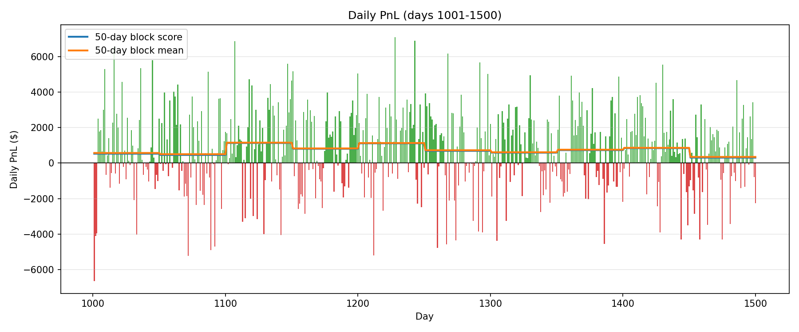<br><sub><b>Submission (v14) on unseen days 1001–1500:</b> score 723.8, mean $750/day, every 50-day block positive.</sub></td>
<td width="50%">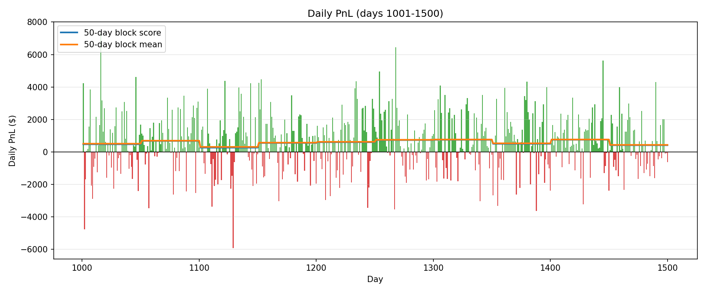<br><sub><b>Pairs book on the same days:</b> score 574.9. It is still profitable, but 42% below its exposed-window score.</sub></td>
</tr>
</table>

**What decayed and what didn't** on days 1001–1500 (desired, conflict-free pair PnL of `four_sigmas`, reproduced by
[`experiments/_investigate_new_oos_decay.py`](experiments/_investigate_new_oos_decay.py)):

| Component | Per-day PnL, days 31–1000 | Per-day PnL, days 1001–1500 | Change |
|---|---:|---:|---:|
| 7 protected pairs (selected on structure) | \$315 | \$303 | **−4%** |
| 81 other pairs (selected by score / screening) | \$1,330 | \$410 | **−69%** |
| ALGO residual basket (11 ALGO-vs-asset pairs) | \$96 | \$2 | −98% |
| Whole pair book | \$1,645 | \$713 | −57% |

79 of 88 pairs earned less per day on the new data, and 22 flipped from net-positive to net-negative.

---

## The competition

* **Interface.** `getMyPosition(prcSoFar)` receives a `51 × t` price history and returns integer share positions. It is
  called once per day, and the evaluator marks to market at the next close.
* **Limits and costs.** Positions are clipped to **\$10,000** per instrument. Instrument 0 (`ALGO`) is special: it has a
  **\$100,000** limit and **0.2 bp** commission, while the other 50 pay **1 bp**. A minimum traded volume applies.
* **Score.** With μ and σ the mean and standard deviation of daily PnL and SR = √250·μ/σ:

  $$\text{score} = \mu \cdot \frac{\text{SR}^2}{\text{SR}^2 + 1}\qquad(\text{score} = \mu \text{ if } \mu \le 0)$$

  Once SR is high this is almost just μ, so the score rewards deploying capital. We measured that **bang-bang (full limit
  in the signal's direction) is close to score-optimal**, and that conviction-weighted sizing loses (finding 5).
* **Data.** The panel is synthetic: 51 instruments with four-letter tickers, daily closes quoted to 2 dp. Days 1–750
  were available at the start, 751–1000 were released mid-competition, and 1001–1500 came afterwards. During the
  competition the live leaderboard scored submissions on hidden data. One of those prints (the pairs book scoring
  **878 → 599**) is what triggered the pre-registered validation protocol described below.
* Official starter code and rules:
  [UNSW-FinTech-Society-IT/algothon26-starter-code](https://github.com/UNSW-FinTech-Society-IT/algothon26-starter-code)
  and the [Algothon 2026 wiki](https://wiki.algothon.au/). `eval.py` here is the official evaluator with `--module`,
  `--start` and `--end` flags and PnL-distribution diagnostics added.

---

## Team and attribution

This was a two-person team effort, and the repository mixes both people's work. The split below comes from the
commit history (~120 commits) and the files each person drove. Several research files were co-edited.

| | Primary areas |
|---|---|
| **Alex Bray** ([@AlexnBray](https://github.com/AlexnBray)) | The `four_sigmas` book (pair voting, ridge VAR sleeve, deadlock overlay, ALGO residual basket) and the `testbedv2` line. Most of the research reports in [`docs/`](docs/): validation protocol, synthetic nulls, generator forensics, signal overlap, deadlocks, ALGO studies, ridge studies, literature briefs. Most notebooks, the Discord pair-review bot, and the `random_strat1` submission lineage. |
| **Daniel** ([@Dan7783](https://github.com/Dan7783)) | The OU optimal-stopping pair engine (`testbedv3`, `latest_strategy`) and the tuning stack (Sobol → BIPOP-CMA-ES with purged walk-forward, CPCV objective, JAX backtest kernel, HDBSCAN trial medoids). The universe pair screener and verification pipeline (placebo cohort, BH-FDR, deflated Sharpe). The hybrid books (`merged_strategy`, `merged_friend_ou`), the OU-engine diagnosis, CPCV of the submission, the fresh-data decay study, the first-generation tuners in `archive/old_tuners/`, and early pairs analysis. |

In the code, the "friend book" (`friend_book*.py`) means Alex's pairs book as seen from Daniel's hybrid experiments.
Reports often say "the user". That is whichever of us was directing the analysis, because many reports were drafted
with AI coding assistants under our direction (see [provenance notes](#provenance-caveats-and-honesty-notes)).

---

## Repository layout

```text
.
├── eval.py                      official evaluator (+ --module/--start/--end, distribution stats)
├── prices.txt                   51 instruments × 1,500 days (competition data)
│
├── random_strat1.py             FINAL SUBMISSION (v14): λ-ensemble Markowitz direction on a ridge VAR
├── random_strat1_v10.py         previous submission (single λ)
├── four_sigmas.py               88-pair vote book + ridge VAR + ALGO residual basket
├── four_sigmas_{ev,moneyness,asset_moneyness,daily_moneyness}.py   conflict-resolution variants
├── friend_book.py / friend_book_latest.py   frozen snapshots of the pairs book (hybrid baselines)
├── testbedv3.py                 single-pair OU optimal-stopping engine (Kalman+CUSUM → OU MLE → a*)
├── latest_strategy.py           stable-8 book on the OU engine
├── merged_strategy.py / merged_friend_ou.py / friend_stable8_ou.py   OU × pairs-book hybrids
├── nontestbedv4.py, testbedv2_*.py, top30_testbedv2.py, daniel_filter.py   earlier book generations
├── latest_tuner.py              Sobol → BIPOP-CMA-ES tuner, purged walk-forward, Optuna storage
├── windowed_tuner.py            CPCV-objective tuner on the JAX kernel
├── jax_pair_kernel.py           jit/vmap-able functional rewrite of the single-pair backtest
├── cluster_medoid.py            HDBSCAN over Optuna trials → robust medoid parameters
├── pair_screener.py             universe-wide, regime-aware pair screen (PELT, rolling coint., half-life…)
├── select_pairs.py, verify_pairs.py   shortlist + verification (null model, BH-FDR, placebos, DSR)
├── algo_combo_ic_sleeve.py      ALGO-combo IC sleeve used in CPCV studies
├── aggregation/                 model-free signal-aggregation methods (equal, softmax, Kelly, running count…)
├── overfit/                     Novy-Marx (2015) multi-signal critical values
├── tests/                       pytest suite (143 tests)
│
├── docs/                        102 research reports + 43 figures (see the catalogue below)
├── research/                    ~130 research scripts (+ cointegration/, cusum_legacy/, pairs_analysis/)
├── experiments/                 drivers for the OU-engine / hybrid / CPCV studies
├── notebooks/                   11 executed research notebooks
├── auto_tuning_results/         JSON/TXT outputs quoted in the docs (tuned catalogs, bake-offs, CPCV, screens)
├── analysis_outputs/            scratch output dir for research scripts (+ one runtime calibration file)
└── archive/                     superseded books, tuners and validation harnesses
```

---

## Quick start

```bash
git clone https://github.com/<you>/sig-algothon-2026.git
cd sig-algothon-2026
python -m venv .venv && source .venv/bin/activate        # Windows: .venv\Scripts\activate
pip install -r requirements.txt                          # numpy, pandas, scipy, scikit-learn, statsmodels, matplotlib

# score the submission on the unseen block
python eval.py --module random_strat1 --start 1001 --end 1500

# the pairs book, the OU stable-8 book, and the test suite
python eval.py --module four_sigmas --start 751 --end 1000
python eval.py --module latest_strategy --start 1001 --end 1500
python -m pytest -q tests
```

* Python **3.12+** is recommended. `pair_screener.py` (and two research/archive scripts) use PEP 701 f-strings.
  Everything else, including the test suite, also runs on 3.10.
* The tuners, JAX kernel, notebook builders and Discord bot need `pip install -r requirements-research.txt`.
* Always run scripts **from the repo root**: `python research/<script>.py`, `python experiments/<script>.py`.
* `eval.py` writes plots to `eval_plots/`, which is git-ignored.

---

## Strategy architecture

### 1. Final submission: `random_strat1.py` (v14)

A single cross-sectional model over all 51 instruments, ALGO included. Each day:

1. **Standardise.** Take log returns $r$ and scale each instrument by its full-history volatility: $z = r/\hat\sigma\$.
2. **Forecast with a ridge VAR(1).** $A_\lambda = S_{yx}(S_{xx} + \lambda I)^{-1}$ on lagged z-scores, truncated to its top
   **5 singular values**. The forecast is $s = A_\lambda z_t\$.
3. **Residual risk model.** $C = E E^\top/T$ with $E = Y - A_\lambda X$, computed from three Gram matrices so it costs
   O(n³) per λ. It is shrunk 50/50 toward a one-factor target that uses ALGO's residual as the factor, then ridged by
   δ·mean(diag C).
4. **Markowitz direction:** $w_\lambda = (C_{used} + \text{reg}\,I)^{-1} s$, unit-normalised.
5. **λ-ensemble (v14).** Average the unit directions over λ ∈ {0.1, 0.2, 0.3, 0.5, 0.7, 1.0} instead of choosing one.
   The λ sweep is a broad plateau that the selection windows cannot resolve, and only **three** eigenvalues of the
   51×51 return covariance clear the Marchenko–Pastur edge (1.503). So the right amount of ridge is uncertain, and the
   model integrates over it rather than guessing.
6. **Execution.** Take the full dollar cap in direction sign(w) (\$10k, or \$100k for ALGO), and only re-trade an
   instrument when the target moves by ≥ **\$2,000** (commission hysteresis).

v14 beat v10 (single λ) on every robustness read-out the team used: a long-history mean of 931.7 vs 845.3, jitter audits
won 15/16, and history-length controls. It also beat v10 on unseen days 1001–1500 (723.8 vs 636.8). Defensive coding
throughout (hold yesterday's book on any degenerate fit) reflects that a crash scores as an outright failure.

<p align="center">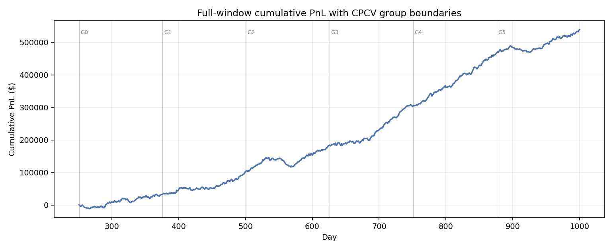<br>
<sub>Combinatorial purged CV of v14 over days 251–1000 (6 groups, 2 test groups, 15 paths): all 15 path scores positive,
median 742, 5th percentile 336.</sub></p>

### 2. The pairs book: `four_sigmas.py`

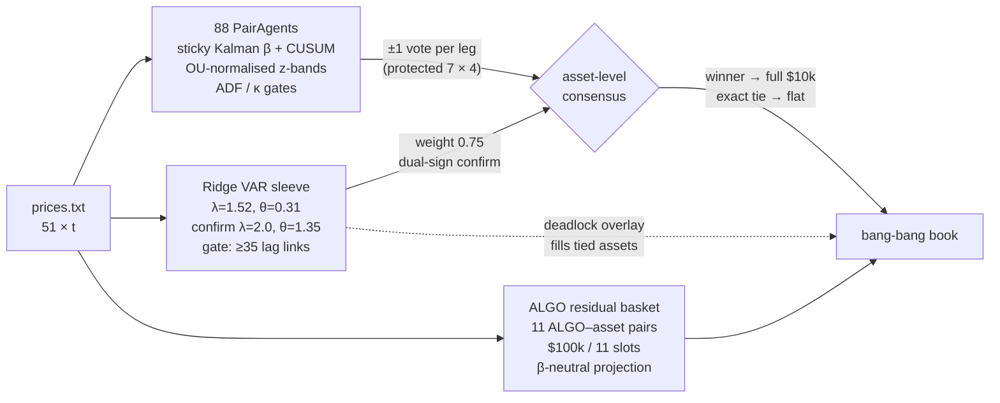

* **Pair agents.** Each pair runs a sticky, through-origin Kalman hedge ratio on log prices with CUSUM change
  detection, burst adaptation and covariance inflation (`PairSegFilter`). The spread is normalised on a rolling OU fit
  and traded with per-pair z-band profiles (entries between 0.8σ and 2.4σ, median 1.3σ, exits at the mean), gated by
  ADF and OU-κ checks. Seven **protected** pairs (AENO/NWIG, CTGI/EELT, EORC/NGTE, HETT/ULXY, HUXZ/ACAC, RTTH/NAYO,
  SMAH/ILVX) were chosen for persistent cointegration across sub-windows, and they get a 4× vote.
* **Consensus, not allocation.** Instead of each pair claiming capital, every active pair casts a direction vote on both
  of its legs. The book sums votes per instrument and takes the full limit in the winning direction. Equal votes beat
  κ·|z| "priority" votes by +44.6 / +65.3 on the two windows, because priority weights varied 600× across pairs and one
  pair decided 98.4% of contested assets (finding 6).
* **Ridge VAR sleeve.** A regularised 50×50 lagged cross-asset return forecast with an independent confirmation model.
  It votes with weight 0.75, and fills assets whose pair vote ties exactly (the deadlock overlay).
* **ALGO residual basket.** ALGO is a near-exact positive-weight basket of the other 50 (R² = 0.98). Eleven ALGO-vs-asset
  pairs trade the residual using ALGO's cheap \$100k capacity. This sleeve died on fresh data (\$96 → \$2/day).

### 3. The OU optimal-stopping engine: `testbedv3.py` → `latest_strategy.py`

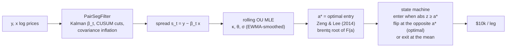

The entry threshold is not tuned. It is solved from the fitted OU parameters and the round-trip cost using the
Zeng & Lee (2014) optimal-threshold equation (a truncated series, root-found with Brent's method). Exit is either the
paper's "hold until the opposite threshold" rule or a conventional mean exit (`MERGED_OU_EXIT`). The mean exit cut OU
flips by 26% and helped conflict management. `latest_strategy.py` runs only the **stable-8** pairs on this engine. It
deploys little capital (score 314 on fresh data), but it had the **highest Sharpe (6.10) and the smallest decay (−9%)**
of any book on days 1001–1500.

<p align="center">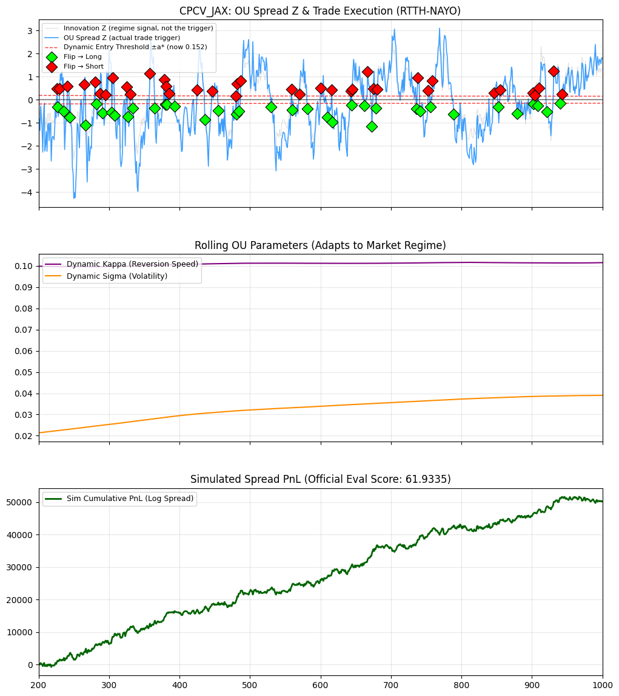<br>
<sub>OU engine on RTTH/NAYO: spread z with flips at ±a*, rolling κ/σ, and cumulative PnL (official-engine score 61.9).</sub></p>

### 4. Hybrids: `merged_strategy.py`, `merged_friend_ou.py`

These are the pairs book with the OU engine swapped in on the pairs where it won head-to-head, and they come with seven
conflict-resolution modes (`shared`, `sleeve`, `ou_flat`, `twopass`, `flat_conflict`, `stronger_vote`, `ml`). The full
story, including a retracted "beats the baseline" result, is in
[`docs/06-ou-engine-and-tuning/ou-engine-diagnosis.md`](docs/06-ou-engine-and-tuning/ou-engine-diagnosis.md) and finding 10.

---

## Tuning and validation infrastructure

| Component | What it does |
|---|---|
| [`latest_tuner.py`](latest_tuner.py) | Per-pair **Sobol-initialised BIPOP (restart) CMA-ES** via Optuna/OptunaHub. **Purged walk-forward** objective on days 30–800, strict OOS report on 801–1000. All studies persisted to SQLite for the Optuna dashboard. |
| [`windowed_tuner.py`](windowed_tuner.py) | **Combinatorial purged CV** objective (N groups, k test groups, purge + embargo): maximise mean − λ·std of path scores. Sobol candidates are evaluated in `jax.vmap` batches. |
| [`jax_pair_kernel.py`](jax_pair_kernel.py) | Static-shape functional rewrite of the single-pair backtest (`lax.scan`, masked OU buffers, fixed-iteration a* solver). **18× faster** per score than the official NumPy engine. Batched CPCV runs at 9.3 ms/trial, **157×** faster than the legacy windowed trial. Rank correlation with the official engine: 0.92 Pearson / 0.86 Spearman ([benchmark](auto_tuning_results/jax_cpcv_benchmark.json)). |
| [`cluster_medoid.py`](cluster_medoid.py) | HDBSCAN over the normalised trial history, returning the **medoid of the best cluster**: a typical good parameter set instead of a lucky best trial. |
| [`pair_screener.py`](pair_screener.py) | Screens all 1,225 tradable pairs without an HMM: **PELT changepoints** on spread level and volatility, rolling-window cointegration, half-life bounds, Kalman-β stability, vol-regime PnL. |
| [`verify_pairs.py`](verify_pairs.py) | Are the survivors real or noise from 1,225 combinations? Binomial null of expected false passers, **Benjamini–Hochberg FDR**, OOS re-screen, a **placebo cohort tuned with an identical budget**, and the **Deflated Sharpe Ratio** per finalist. |
| [`experiments/_run_cpcv.py`](experiments/_run_cpcv.py) | CPCV path-score distribution for any frozen book (used to choose v14 over v10). |
| [`overfit/critical_values.py`](overfit/critical_values.py) | Novy-Marx (2015) best-k-of-n critical values, including the correlated-signal generalisation. |
| [`research/synthetic_null.py`](research/synthetic_null.py) | 1,594 synthetic 1000-day price paths (bootstraps, matched Gaussians, phase surrogates, injected cointegration) replayed through the real book. |
| [`research/block_consistency.py`](research/block_consistency.py), [`research/pair_audit_trainonly.py`](research/pair_audit_trainonly.py) | Protocol tooling: per-block scores and floors, and leave-one-out marginals judged on train blocks only. |

<table>
<tr>
<td width="50%">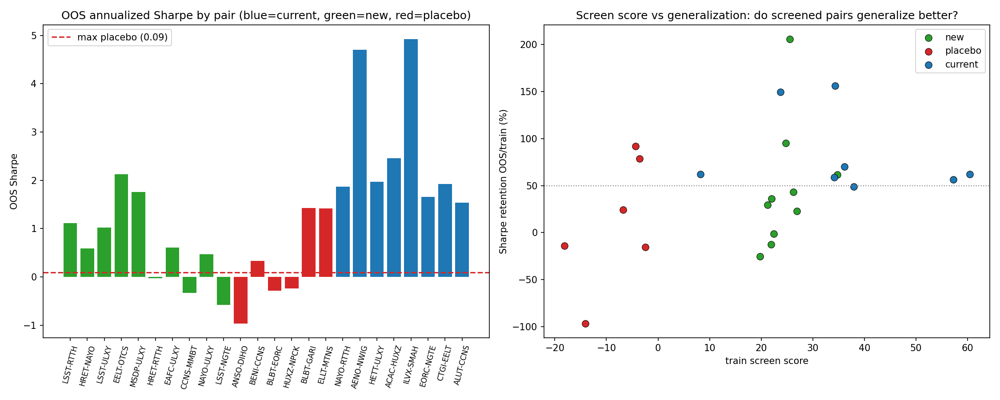<br><sub>Verification: OOS Sharpe for current (blue), newly screened (green) and placebo (red) pairs, and screen score vs Sharpe retention.</sub></td>
<td width="50%">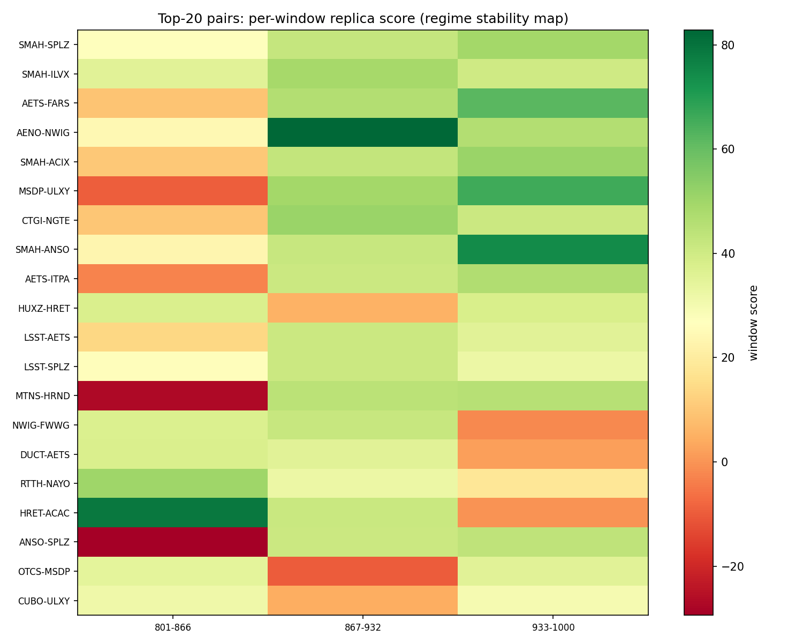<br><sub>Universe screen re-run on the strict OOS window. Real relationships keep passing, noise dies.</sub></td>
</tr>
</table>

---

## What we learned: fourteen findings

Each finding links to the reports with the full evidence.

**1. The panel is ~3 factors plus a handful of real pairs.**
Returns are close to Gaussian (Jarque–Bera rejects for 1/51 assets) with little ARCH. Only **3 eigenvalues** clear the
Marchenko–Pastur edge, and the top one explains 23% of variance. Only **7 of 1,225 pairs** hold residual ADF < −3 in
both halves of the sample. Six of them are protected pairs in the book, and the seventh protected pair, EORC/NGTE, is
the fifth-strongest Johansen relationship. A 23.6-million-hypothesis attempt to recover the
generator's RNG seed found nothing beyond its own noise ceiling, and 2 dp price rounding makes state recovery impossible
in principle.
→ [generator forensics](docs/01-data-and-market-structure/generator-forensics.md) ·
[seed search](docs/01-data-and-market-structure/rng-seed-recovery-attempt.md) ·
[MDGI/HTRK "are they built in pairs?"](docs/02-pair-discovery/mdgi-htrk-investigation.md) ·
[Johansen screens](docs/02-pair-discovery/johansen-kalman-network.md)

**2. Score-based selection does not survive. Structural selection does.**
The pairs book scored **878** on the 501–750 window we had been selecting on and **599** on the organiser's hidden feed,
a 32% haircut. Under a strict train-only protocol, per-pair tuning bought **+14.0** on train blocks and lost **−15.5**
held-out. A winner's-curse experiment showed the top selection decile loses **70%** of its edge out of sample. On the
fresh days 1001–1500 the structural core lost 4% while the score-selected pairs lost 69%.
→ [overfit reduction](docs/05-validation-and-overfitting/overfit-reduction.md) ·
[per-pair tuning verdict](docs/05-validation-and-overfitting/per-pair-tuning-verdict.md) ·
[seasonality & winner's curse](docs/01-data-and-market-structure/seasonality-and-reversal.md) ·
[top-30 OOS decay](docs/05-validation-and-overfitting/top30-oos-decay.md)

**3. A pre-registered validation protocol.**
After the 599 print we wrote the rules down before running the next experiment. Days 501–750 are "burned" and not a
holdout. A change must improve **both** train blocks independently, not just their average. A grid spike whose
neighbours fail is rejected. Per-pair effects must be portfolio-confirmed. Robustness is judged by the **block floor**,
not the median. Structural criteria outrank score criteria.
→ [validation protocol](docs/05-validation-and-overfitting/validation-protocol.md)

**4. The pairs-book edge is real, short-horizon mean reversion.**
Replayed on 450 endpoint-free null paths (common-index bootstrap, per-asset bootstrap, matched correlated Gaussians),
the real-data score of 986 was never reached (best null 217, empirical p ≈ 0.002). Block bootstraps put two-thirds of
the edge inside 5-day horizons and 95% inside 20 days. Injecting synthetic cointegration gives a score that rises
monotonically with the true reversion speed. Phase surrogates, which keep every linear auto- and cross-covariance, score
a median of **748**, so about **24%** of the realised 986 was this particular path. We also caught a subtle bug in our own
first null: permutations pin the terminal price, which creates a Brownian bridge with real, exploitable mean reversion.
→ [synthetic null testing](docs/05-validation-and-overfitting/synthetic-null-testing.md)

<p align="center">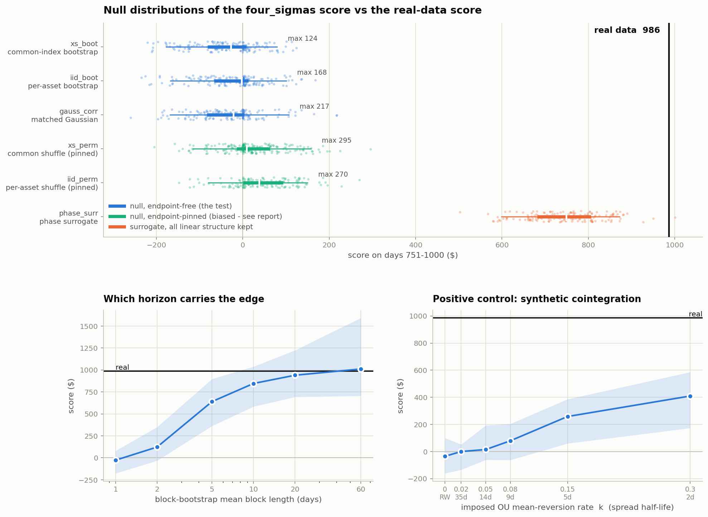</p>

**5. Under this score, bang-bang is (almost) optimal and conviction is not monetisable.**
Scaling a conviction-weighted book by k and clipping to caps peaks near **k ≈ 8**, where 94% of positions are pinned at
the limit and the book is 0.989 correlated with pure sign × cap. Conviction does carry information: real minus shuffled
magnitudes is +180 at low leverage. But the objective pushes you to a leverage where it is destroyed. A flat,
equal-magnitude book exactly matches the best conviction book (845.3). The decline past the peak is volatility, not
turnover.
→ [model-free aggregation brief, Part 3b](docs/literature/model-free-aggregation-brief.md) ·
[overlap verdict](docs/07-signal-overlap-and-conflicts/overlap-verdict.md)

**6. Conflict resolution: one pair, one vote. Every learned arbitrator failed.**
The 88 pairs are about **67 independent bets** (Meucci effective breadth), not the 12 an external brief claimed, so IR
inflation is about 1.15×, not 2.7×. The real defect was that κ·|z| priority voting made the heaviest pair the dictator
on **98.4%** of contested asset-days. Equal votes fixed it. Exact ties should go flat: breaking them with magnitude cost
−25 / −11. A gradient-boosted conflict arbitrator memorised train (1488 vs 790) and lost out of sample (801 vs 915).
Across 81 configurations the best test AUC was 0.5255, while the book needs 54–56% accuracy just to break even. EV
models, moneyness combiners, adaptive EV filters, ALGO-based tie-breaking and complete-hedge execution all lost on held-out
data.
→ [signal-overlap assessment](docs/literature/signal-overlap-brief-assessment.md) ·
[GBM deep dive](docs/07-signal-overlap-and-conflicts/conflict-ml-gbm-deepdive.md) ·
[vote deadlocks](docs/07-signal-overlap-and-conflicts/vote-deadlock-final-report.md) ·
[whole-vector EV](docs/07-signal-overlap-and-conflicts/whole-vector-ev.md)

**7. The Kalman filter's "bug" was doing real work.**
The pair filter hard-codes observation noise R = 1 against a measured residual variance of ~1.4e-3, which suppresses the
gain ~700×. Fixing it makes β a better *estimator* (tracking error 0.0036 vs 0.0042, NIS ≈ 1) but a worse *strategy*
(train median 872 → 829–840) because a fast β absorbs the very spread you want to trade. With q correctly scaled, CUSUM
cuts fall from 17 to 1: the whole break/snap/inflate chain existed to compensate for a mis-scaled q. Being through-origin,
the filter's β also converges to the log-price ratio, which is why q looked inert across eight orders of magnitude.
→ [staged tuning](docs/03-kalman-cusum-filter/staged-tuning.md) ·
[filter simplification](docs/03-kalman-cusum-filter/filter-simplification.md) ·
[NAYO/SRTX](docs/02-pair-discovery/nayo-srtx-investigation.md)

**8. A units bug silently disabled 13 of 21 pairs.**
The OU rewrite produced a signal equal to −z·(1−e^−κ), which is 10–40× smaller than the z-scores the thresholds were
written for, so 13 pairs could never trade. Recalibrating thresholds to percentiles of each pair's own train-window
signal took the book from **155.6 → 511.0** on train and **262.6 → 521.7** on test.
→ [OU signal-scale fix](docs/03-kalman-cusum-filter/ou-signal-scale-fix.md)

**9. Small-z entries are the engine. Flip-at-extremes and seasonality are not.**
713 episodes entered at |z| ∈ [0.27, 0.75) win **92%** of the time. Waiting for big divergences halves the sleeve in both
windows. Spreads overshoot the opposite extreme only 42% of the time, so flip-at-extremes loses to flip-at-mean at every
threshold. There is no 250-day seasonality (periodogram below the AR(1) null, permutation ANOVA p = 0.21–0.88). The
leaderboard fall came from edge decay plus regime drift: volatility and correlation rose and cointegration prevalence fell
year on year.
→ [entry timing](docs/04-books-and-sleeves/entry-timing-analysis.md) ·
[seasonality & reversal](docs/01-data-and-market-structure/seasonality-and-reversal.md)

**10. The OU engine's per-pair wins were partly an OOS-selection artefact. We retracted our own headline.**
On 76 catalog pairs the tuned OU engine beat z-bands on 31 (+\$74k desired OOS PnL) and lost on 45 (−\$137k). A hybrid
pruned by leave-one-out to score **1057** on the OOS window (vs the baseline's 974) was **rejected**, because its
in-sample score (831) was far below the baseline's (927). On the primary in-sample metric, aggregate z-band PnL beat OU
by about \$150k, so the "31 winners" story was driven by selecting on OOS. The criterion became in-sample first, with OOS
for verification only. Separately, the stable-8 OU book beat every placebo pair (placebo max OOS Sharpe 1.42), and an
ML conflict layer that beat the baseline in-sample (950 vs 927) collapsed on validation.
→ [OU engine diagnosis](docs/06-ou-engine-and-tuning/ou-engine-diagnosis.md) ·
[pair verification](docs/06-ou-engine-and-tuning/pair-verification.md)

**11. Diversification beats simplicity, and per-pair parameters do not earn.**
A 161-line "structural only" book (6 disjoint cointegrated pairs + ridge) scores 479 vs 853 for the 1,091-line book. The
gap is the extra *sleeves and pairs*, not the tuning. Replacing ~210 per-pair numbers with one shared config costs 2
points of block floor. Per-pair EV/priority was the one per-pair quantity that mattered, because it decided conflicts.
Dead rows that looked inert were silently re-weighting the conflict resolver through a hub penalty.
→ [simple vs complex](docs/05-validation-and-overfitting/simple-vs-complex.md) ·
[slim book](docs/03-kalman-cusum-filter/slim-book.md) ·
[dead pair rows](docs/03-kalman-cusum-filter/dead-pair-rows.md)

**12. ALGO is the market, and the market is not forecastable here.**
ALGO is a positive-weight basket of the other 50 (contemporaneous R² 0.984, 0.961 out of sample), and its one-step
ridge forecast is no better than the average asset's (sign accuracy 52.2%). Long tilts, dedicated-horizon models, joint
allocators, deadlock prediction and a 30-day MMBT→ALGO regression were each rejected under development-only selection.
The residual basket that did pass validation earned nothing on fresh data.
→ [ALGO 1,000-day deep dive](docs/09-algo-instrument/algo-1000-day-deepdive.md) ·
[ALGO ridge probe](docs/09-algo-instrument/algo-ridge-probe.md) · [all ALGO studies](#09--the-algo-instrument)

**13. The ridge sleeve is the complementary signal, and capacity ordering matters.**
On its own the ridge VAR scored 226/321 (train/test) and made the book test-heavy while the pairs were train-heavy.
Inside a 310-pair book it reached only 2 assets because capacity was allocated to pairs first. A protected-pair →
ridge → ordinary-pair hierarchy recovered it. Ridge confidence is a normalised magnitude, not a probability. A rolling
reliability gate and parameter re-tunes did not pass development.
→ [ridge capacity](docs/08-ridge-var-sleeve/ridge-capacity-small-barbell.md) ·
[ridge time trend](docs/08-ridge-var-sleeve/ridge-time-trend.md) ·
[ridge conflict policy](docs/08-ridge-var-sleeve/ridge-conflict-policy.md)

**14. On truly unseen data, fewer fitted choices meant less decay.**
From days 751–1000 to days 1001–1500: the OU hybrid fell **−47%**, the pairs book **−42%**, the submission **−22%**, and
the 8-pair OU book **−9%** with the best Sharpe of all. A clean CPCV of the frozen pairs book (path-score mean 1003, every path positive)
could not see this coming, because CPCV of a frozen book cannot undo selection that already happened on the same days.
→ [`experiments/_investigate_new_oos_decay.py`](experiments/_investigate_new_oos_decay.py) ·
[`auto_tuning_results/_new_oos_decay.json`](auto_tuning_results/_new_oos_decay.json)

---

## Research library: every report

All 102 reports, grouped by theme. Each file starts with a provenance line giving its original path in the working repo,
and reports that produced a diagnostic figure embed it at the end. The windows used throughout: **1–250** warm-up,
**251–500** train (blocks 251–375 / 376–500), **501–750** burned validation, **751–1000** exposed or "contaminated",
**1001–1500** fresh.

### Literature briefs (papers)

| Report | Summary |
|---|---|
| [Multi-signal overfitting (Novy-Marx 2015)](docs/literature/novy-marx-multisignal-brief.md) | Full restatement of *Backtesting Strategies Based on Multiple Signals*: signing signals in-sample is overfitting even with no selection. Best k-of-n ≈ best 1 of nᵏ. Critical-value formulas (with a typo fix to the paper's eq. 37) and the k ≈ n/2 result. Implemented in `overfit/critical_values.py`. |
| [Model-free signal aggregation](docs/literature/model-free-aggregation-brief.md) | Critical read of seven aggregators (equal, weighted, softmax, mean-variance, binary/continuous Kelly, running count). The headline is a best-of-224 selection, softmax β is unit-dependent (pure argmax on dollar PnL), and two formula/code mismatches. Adapted to Algothon: leverage-sweep and conviction experiments (finding 5). |
| [Signal-overlap brief assessment](docs/literature/signal-overlap-brief-assessment.md) | Tests an external "signal overlap" brief against the book: 67 effective bets, not 12. The real issue is vote dictatorship, and equal votes fix it. Reading-list triage (Grinold–Kahn, Meucci, RMT, Condorcet juries, Avellaneda–Lee, DSR). |

### 01 · Data and market structure

| Report | Summary |
|---|---|
| [Generator forensics](docs/01-data-and-market-structure/generator-forensics.md) | Quantisation, near-Gaussian returns, weak ARCH/autocorrelation, 3 factors above the MP edge, beta drift, and which pairs look imposed. |
| [RNG seed-recovery attempt](docs/01-data-and-market-structure/rng-seed-recovery-attempt.md) | 23.6M hypotheses over PCG64/MT19937 seeds. Nothing beats its own noise ceiling, and it cannot work in principle. |
| [Seasonality & reversal](docs/01-data-and-market-structure/seasonality-and-reversal.md) | No 250-day season. Regime drift and the winner's curse explain the leaderboard fall. Flip-at-extremes rejected. A rolling OU reversion gate helps test. |
| [Pair correlation by year](docs/01-data-and-market-structure/pair-correlation-by-year.md) | Return correlation for all 88 book pairs across four 250-day years, ranked by degradation. |
| [Market-beta exposure](docs/01-data-and-market-structure/market-beta-exposure.md) | The book is market-neutral at the PnL level (t < 1, R² < 0.4%). Hedging is worth +0.03 score. |

### 02 · Pair discovery and cointegration

| Report | Summary |
|---|---|
| [All-pair spread scores](docs/02-pair-discovery/all-pair-spread-scores.md) | Causal all-pair spread-score research across the 1,225-pair universe. |
| [Short-regime analysis](docs/02-pair-discovery/short-regime-analysis.md) | Short-window cointegration and row-hub analysis: are transient pairs tradeable? |
| [Kalman-stationary pairs](docs/02-pair-discovery/kalman-stationary-pairs.md) | Sticky-Kalman residual ADF and half-life screen: 50 pass (16 stable, 34 adaptive). |
| [Johansen on the Kalman network](docs/02-pair-discovery/johansen-kalman-network.md) | Bivariate (20/50) and basket (15/17) Johansen ranks, including the SMAH–EORC–NGTE–ILVX hub. |
| [Johansen, all pairs](docs/02-pair-discovery/johansen-all-pairs.md) · [I(1)-screened](docs/02-pair-discovery/johansen-all-pairs-i1.md) · [strict I(1)](docs/02-pair-discovery/johansen-all-pairs-i1-strict.md) | 233/1,225 rank ≥ 1 naively, inflated by near-stationary names. 100/946 after an I(1) screen and 67/780 after a strict ADF + KPSS screen. |
| [Pair-structure audit](docs/02-pair-discovery/pair-structure-audit.md) | Train-only audit of the 310-pair testbed: fixed-β, adaptive-β and segmented cointegration paths. 8 retained. |
| [Correlation + CUSUM screen](docs/02-pair-discovery/correlation-cusum-screen.md) | Walk-forward correlation and break-count screen (no ADF gate): 71 of 310 kept, including all 8 strict pairs. |
| [Pair clusters](docs/02-pair-discovery/pair-clusters.md) · [basket backtest](docs/02-pair-discovery/pair-cluster-basket-backtest.md) | 23 triangles in the pair graph, only 2 robust triples. Replacing pairs with cluster baskets loses 109 points. |
| [Restored pairs: walk-forward](docs/02-pair-discovery/restored-pairs-walkforward.md) · [annual](docs/02-pair-discovery/restored-pairs-annual-walkforward.md) | Seven restored pairs under singular and annual expanding walk-forward, with a correlation-gate diagnostic. |
| [Removed-pair investigation](docs/02-pair-discovery/removed-pair-investigation.md) | Were pairs removed on exposed data really bad? Mostly mixed or unstable. |
| [Pair prune (leave-one-out)](docs/02-pair-discovery/pair-prune-leave-one-out.md) | Marginal contribution of every pair: keep / dead / harmful / train-only / test-only. Marginals are not additive. |
| [MDGI/HTRK investigation](docs/02-pair-discovery/mdgi-htrk-investigation.md) | 0 of 87,480 configs improve it. It is not a designed pair, and only 7 of 1,225 pairs are. |
| [NAYO/SRTX investigation](docs/02-pair-discovery/nayo-srtx-investigation.md) | The candidate fix was really removing the ADF gate. A through-origin β converges to the log-price ratio. |
| [AENO/NWIG retune proof](docs/02-pair-discovery/aeno-nwig-retune-proof.md) | 120,960-candidate grid with Pareto, four-block and neighbourhood-smoothed robustness checks. |
| Pair-seed explorer: [RTTH/NAYO](docs/02-pair-discovery/pair-seed-explorer/rtth-nayo.md) · [CCNS/SRTX](docs/02-pair-discovery/pair-seed-explorer/ccns-srtx.md) · [CTGI/EELT](docs/02-pair-discovery/pair-seed-explorer/ctgi-eelt.md) · [HETT/ULXY](docs/02-pair-discovery/pair-seed-explorer/hett-ulxy.md) · [HRET/CTGI](docs/02-pair-discovery/pair-seed-explorer/hret-ctgi.md) · [HUXZ/ACAC](docs/02-pair-discovery/pair-seed-explorer/huxz-acac.md) | Per-pair robust seed decisions: interpretable thresholds on train plateaus, tail metrics, portfolio replay. |

### 03 · Kalman / CUSUM filter

| Report | Summary |
|---|---|
| [Staged tuning](docs/03-kalman-cusum-filter/staged-tuning.md) | Identify noise, then q, then CUSUM, against statistical criteria. R = 1 turns out to be a regulariser (finding 7). |
| [Filter simplification](docs/03-kalman-cusum-filter/filter-simplification.md) | Can covariance inflation replace the adapt burst? No (different targets), but `cov_inflate` itself is inert. |
| [Slim book](docs/03-kalman-cusum-filter/slim-book.md) | 18 of 29 config fields were constants. Dead variance-CUSUM branch. Pruning and slimming applied. |
| [Dead pair rows](docs/03-kalman-cusum-filter/dead-pair-rows.md) | Disabled rows were still steering conflicts through hub penalties. Penalties frozen explicitly. |
| [PairSegFilter tuning](docs/03-kalman-cusum-filter/pairseg-kalman-tuning.md) | Prequential multi-horizon hedge-error loss. The one-SE rule prefers sticky β and few cuts. |
| [Multi-pair dashboard](docs/03-kalman-cusum-filter/multi-pair-dashboard.md) | Snap and adapt statistics and β paths across 12 pairs. |
| [PairSegFilter walk-forward](docs/03-kalman-cusum-filter/pairseg-walkforward.md) | 5-offset walk-forward of the filter-driven pair strategy. 11 of 13 pairs are positive on average. |
| [CUSUM ARL calibration](docs/03-kalman-cusum-filter/cusum-arl-calibration.md) · [injection test](docs/03-kalman-cusum-filter/cusum-injection-test.md) · [SMAH/NGTE validation](docs/03-kalman-cusum-filter/smah-ngte-kalman-validation.md) | The first change-detection stack: in-control run length vs h, detection delay on injected breaks, innovation whiteness. |
| [OU signal-scale fix](docs/03-kalman-cusum-filter/ou-signal-scale-fix.md) | The units bug that silently disabled 13 of 21 pairs (finding 8). |
| [ADF gate necessity](docs/03-kalman-cusum-filter/adf-gate-necessity.md) | Per-pair tuning can replace the ADF gate's trade selection but not its capacity rationing. |

### 04 · Books and sleeves

| Report | Summary |
|---|---|
| [Fifty pairs](docs/04-books-and-sleeves/fifty-pairs.md) | 16 stable (gateless) + 34 adaptive (CUSUM) books. Stable labels validated, and an allocation bug that unhedged legs was fixed. |
| [Entry timing](docs/04-books-and-sleeves/entry-timing-analysis.md) | Low-z entries are the engine (92% win). Late entry and graded sizing both lose. |
| [Pair books](docs/04-books-and-sleeves/pair-books.md) | Uniform, zero-fitted adaptive-β books vs per-pair tuned (train/test ratio 1.4 vs 2.9). |
| [Robust hybrid](docs/04-books-and-sleeves/robust-hybrid.md) · [adaptive v2](docs/04-books-and-sleeves/robust-hybrid-adaptive-v2.md) | Ordered-sleeve hybrid (atlas → lead-lag → ridge → discovery) and conservative pair-local controls. |
| [random_strat1 assessment](docs/04-books-and-sleeves/random-strat1-assessment.md) | Early idea-by-idea audit of what became the submission lineage. Only rebalance-band hysteresis was worth porting at the time. |
| [Execution audit](docs/04-books-and-sleeves/execution-audit.md) | Exact counterfactuals: zero commission is worth +30 and 5 bp costs about −120. The share-rounding upper bound is negligible. |
| [Factor exposure](docs/04-books-and-sleeves/factor-exposure.md) | Sharpe ~9, max drawdown ~\$5–7k, hit rate ~72–75%. Raising pair/ridge/ALGO exposure does not dominate. |
| [Weak block 851–950](docs/04-books-and-sleeves/weak-block-851-950-attribution.md) | Descriptive attribution of the weakest block: the ridge sleeve went negative while pairs held. |

### 05 · Validation and overfitting

| Report | Summary |
|---|---|
| [Validation protocol](docs/05-validation-and-overfitting/validation-protocol.md) | The pre-registered rules adopted after 878 → 599 (finding 3). |
| [Overfit reduction](docs/05-validation-and-overfitting/overfit-reduction.md) | Where the ~235 fitted numbers live and which earn. A shared config keeps the floor with 4× fewer parameters. |
| [Per-pair tuning verdict](docs/05-validation-and-overfitting/per-pair-tuning-verdict.md) | Strict prospective test: +14.0 train, −15.5 held-out. Not applied. |
| [Simple vs complex](docs/05-validation-and-overfitting/simple-vs-complex.md) | An honest accounting of score-mining, plus a 161-line structural rebuild as the control. |
| [Synthetic null testing](docs/05-validation-and-overfitting/synthetic-null-testing.md) | 1,594 synthetic paths: null p ≈ 0.002, horizon decomposition, positive control, phase surrogates, and the pinned-endpoint artefact. |
| [Top-30 OOS decay](docs/05-validation-and-overfitting/top30-oos-decay.md) | Testbed v2 lost 51% OOS. Conflict blocking and RTTH concentration diagnosed pair by pair. |
| [Pareto pair tuning](docs/05-validation-and-overfitting/pareto-pair-tuning.md) | Per-pair train/test Pareto tuning (test used explicitly, so not a holdout) and a portfolio audit. |
| [Train/test balance](docs/05-validation-and-overfitting/train-test-balance.md) | Pairs are train-heavy and ridge makes the book test-heavy. Forcing more train trading hurts test. |

### 06 · OU engine and tuning

| Report | Summary |
|---|---|
| [OU engine diagnosis](docs/06-ou-engine-and-tuning/ou-engine-diagnosis.md) | The main writeup of the OU migration: per-pair results, conflict modes, exit modes, the retracted 1057, standalone engine comparison, ML conflicts, κ/σ priority studies (finding 10). |
| [Baseline book reference](docs/06-ou-engine-and-tuning/baseline-book-reference.md) | Diff notes between the two frozen pairs-book snapshots. |
| [Pair screen: train](docs/06-ou-engine-and-tuning/pair-screen-train.md) · [OOS re-run](docs/06-ou-engine-and-tuning/pair-screen-oos.md) | Universe-wide regime-aware screen output, with per-window evidence heat maps. |
| [Pair verification](docs/06-ou-engine-and-tuning/pair-verification.md) | Null model, FDR, OOS consistency, placebo cohort and DSR. Keep/review/reject verdicts. |
| [OU winners table](docs/06-ou-engine-and-tuning/ou-winners-table.md) | The 31 pairs where the tuned OU engine beat z-bands on desired OOS PnL (and the 45 where it lost). |
| [OU additions to four_sigmas](docs/06-ou-engine-and-tuning/ou-additions-to-four-sigmas.md) · [margin grid](docs/06-ou-engine-and-tuning/ou-additions-margin-grid.md) | Which hybrid ideas port back to the pairs book: only a 0.15–0.25 consensus margin passes all four halves. |

### 07 · Signal overlap and conflict resolution

| Report | Summary |
|---|---|
| [Overlap verdict](docs/07-signal-overlap-and-conflicts/overlap-verdict.md) | Pair/ridge combination layer: nothing ships. Double coverage is what lets the book hold 43.5 instruments at full size. |
| [Conflict ML: GBM deep dive](docs/07-signal-overlap-and-conflicts/conflict-ml-gbm-deepdive.md) | Why the gradient-boosted arbitrator cannot be regularised into working: ceiling, requirement, learnability, and the forecast-combination puzzle. |
| [Vote deadlocks: final](docs/07-signal-overlap-and-conflicts/vote-deadlock-final-report.md) · [mechanism](docs/07-signal-overlap-and-conflicts/vote-deadlock-mechanism.md) · [controls](docs/07-signal-overlap-and-conflicts/vote-deadlock-controls.md) | 55 abstention, hysteresis and continuous-aim resolvers tested. Equal-vote abstention stays. |
| [Deadlock accounting](docs/07-signal-overlap-and-conflicts/deadlock-accounting.md) · [opportunity](docs/07-signal-overlap-and-conflicts/deadlock-opportunity.md) · [ridge barbell](docs/07-signal-overlap-and-conflicts/deadlock-ridge-barbell.md) | About 3 exact pair-vote ties per day. Ridge fills are worth +38 to +57 score, while sub-threshold ridge direction is not significant against randomisation. |
| [Whole-vector EV](docs/07-signal-overlap-and-conflicts/whole-vector-ev.md) | +109 on validation but −40 held-out. About 290 learned scalars, and predicted-vs-realised correlation was only 0.02–0.08. |
| [Moneyness combiner](docs/07-signal-overlap-and-conflicts/moneyness-combiner.md) · [daily](docs/07-signal-overlap-and-conflicts/daily-moneyness-combiner.md) · [per-asset](docs/07-signal-overlap-and-conflicts/asset-moneyness.md) | Parameter-light dollar-opportunity combiners. A horizon mismatch makes them pair-dominant, and they are unstable across blocks. |
| [Adaptive EV pair filter](docs/07-signal-overlap-and-conflicts/adaptive-ev-pair-filter.md) | EWMA + CUSUM "which combiner is better" gates lag the regime: −61.7 OOS. |
| [Overlap black-box ML](docs/07-signal-overlap-and-conflicts/overlap-blackbox-ml.md) | Identity-free conflict router: validation AUC < 0.5, not accepted. |
| [Winning-pair hedge: development](docs/07-signal-overlap-and-conflicts/winning-pair-hedge-development.md) · [held-out](docs/07-signal-overlap-and-conflicts/winning-pair-hedge-heldout.md) | Enforcing complete hedged pairs costs −190 held-out. Half-hedged double coverage is worth more than hedge purity. |
| [Pair hedge execution](docs/07-signal-overlap-and-conflicts/pair-hedge-execution.md) | About 38–41% of live pair events have a flipped leg, yet every "properly hedged" allocator scores lower. |

### 08 · The ridge VAR sleeve

| Report | Summary |
|---|---|
| [Ridge capacity & small barbell](docs/08-ridge-var-sleeve/ridge-capacity-small-barbell.md) | Why ridge vanished inside the 310-pair book, and the protected-pair → ridge → ordinary-pair hierarchy. |
| [Ridge time trend](docs/08-ridge-var-sleeve/ridge-time-trend.md) | 50-day block attribution of the expanding ridge vs rolling and frozen counterfactuals. |
| [Ridge parameter conflicts](docs/08-ridge-var-sleeve/ridge-parameter-conflicts.md) | λ/θ variants standalone vs combined, and how much standalone PnL survives into the book. |
| [Ridge conflict policy](docs/08-ridge-var-sleeve/ridge-conflict-policy.md) | Dual-sign confirmation selected before exposure. Positive in all four development halves. |
| [Ridge rolling reliability](docs/08-ridge-var-sleeve/ridge-rolling-reliability.md) | Causal rolling reliability gates all failed. Production unchanged. |

### 09 · The ALGO instrument

| Report | Summary |
|---|---|
| [ALGO 1,000-day deep dive](docs/09-algo-instrument/algo-1000-day-deepdive.md) | ALGO as market proxy (market corr 0.96–0.997). The book's ALGO exposure. Cross-asset lead tests with BH q-values. |
| [ALGO ridge probe](docs/09-algo-instrument/algo-ridge-probe.md) | ALGO = positive-weight basket (R² 0.984). One-step sign accuracy 52.2%, rank 25 of 51. |
| [Twelve equal ALGO sleeves](docs/09-algo-instrument/algo-twelve-equal-sleeves.md) | Independent \$8.3k ALGO-pair sleeves: small mixed deltas. |
| [ALGO deadlock prediction](docs/09-algo-instrument/algo-deadlock-prediction.md) | Can ALGO predict or resolve vote deadlocks? No (validation AUC 0.48, direction p ≈ 0.4–0.6). |
| [Dedicated ALGO horizon](docs/09-algo-instrument/algo-dedicated-horizon.md) | 210 ridge forecast specs: 6 pass development, 0 profitable on the exposed window. |
| [Joint ALGO allocator](docs/09-algo-instrument/algo-joint-allocator.md) | Constrained mean-variance residual allocation. Only overlay variants are near zero. |
| [ALGO long tilt](docs/09-algo-instrument/algo-long-tilt.md) | A five-fold selection protocol picks no tilt, even though year 4 ALGO returned +27.7%. |
| [ALGO pairs: market-relative?](docs/09-algo-instrument/algo-pair-market-relative.md) | Historical ALGO pair agents were mostly naked asset reversion, not ALGO-relative. |
| [ALGO residual projection](docs/09-algo-instrument/algo-residual-projection.md) | Residual forecasts significant in 3 of 4 folds, but beta projection removes mean as well as variance. |
| [MMBT → ALGO forward OLS](docs/09-algo-instrument/mmbt-algo-forward-ols.md) | A rumoured 30-day lead relationship: HAC t = 0.42, OOS R² ≈ 0. |
| [ALGO in the final submission](docs/09-algo-instrument/algo-in-final-submission.md) | ALGO's score contribution inside `random_strat1` swings with the regime: −70 on days 251–500, +47 on 501–750 and +122 on 751–1000 (a +27.7% ALGO year). |

Other written material: [`research/DISCORD_PAIR_REVIEW.md`](research/DISCORD_PAIR_REVIEW.md) (the bot we used to
hand-review ~500 candidate pair diagnostics as a team), the raw pipeline reports in
[`auto_tuning_results/`](auto_tuning_results/), the notebooks listed in [`notebooks/README.md`](notebooks/README.md),
and per-folder indexes in [`research/`](research/README.md), [`experiments/`](experiments/README.md) and
[`archive/`](archive/README.md).

### Figure gallery

<table>
<tr>
<td width="33%">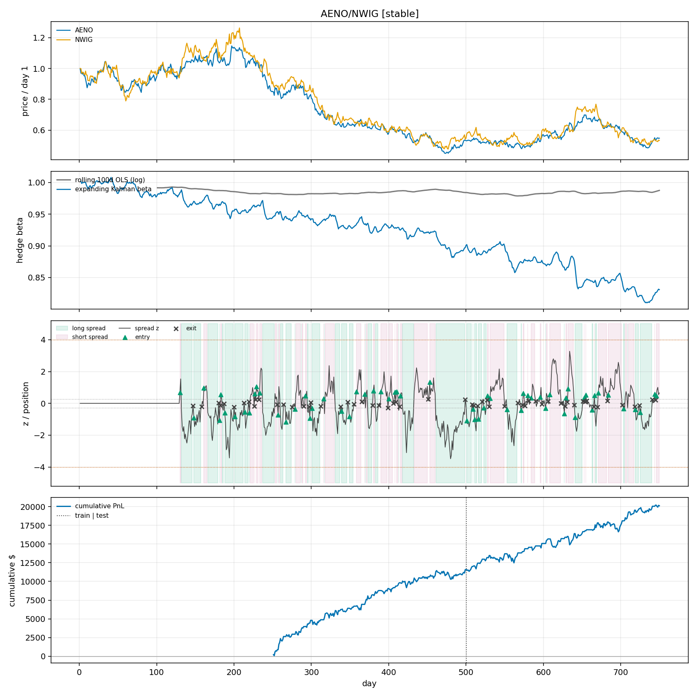<br><sub>A structural pair (AENO/NWIG): prices, hedge β, spread z with trades, cumulative PnL.</sub></td>
<td width="33%">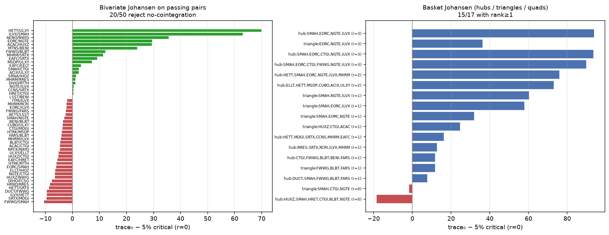<br><sub>Bivariate and basket Johansen trace statistics on the Kalman-passing network.</sub></td>
<td width="33%">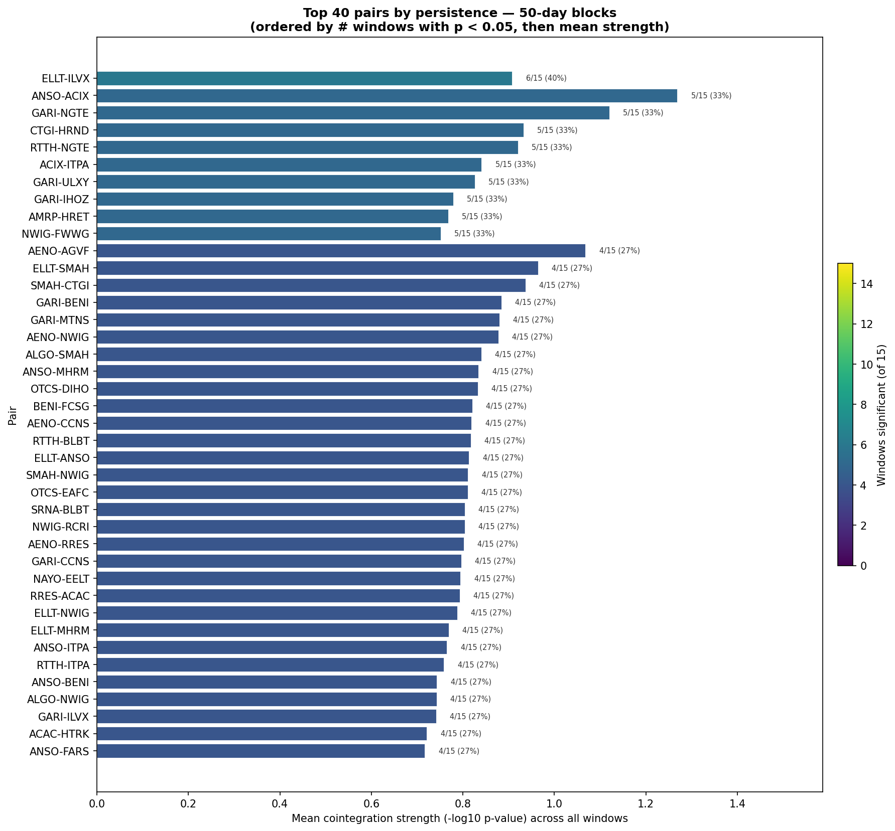<br><sub>No pair is cointegrated in more than 6 of 15 fifty-day blocks.</sub></td>
</tr>
<tr>
<td>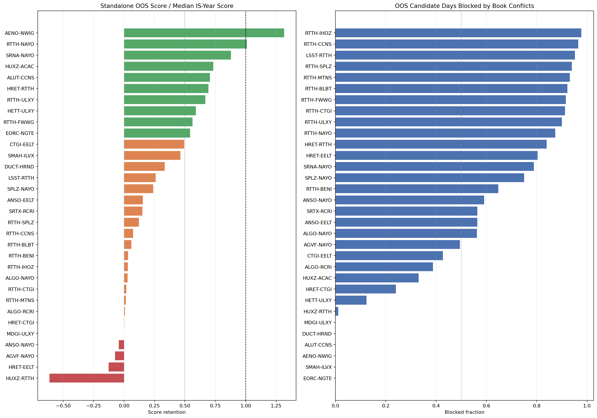<br><sub>Testbed v2: OOS retention vs median in-sample year, and conflict blocking.</sub></td>
<td><br><sub>Standalone ridge sleeve by 50-day block.</sub></td>
<td>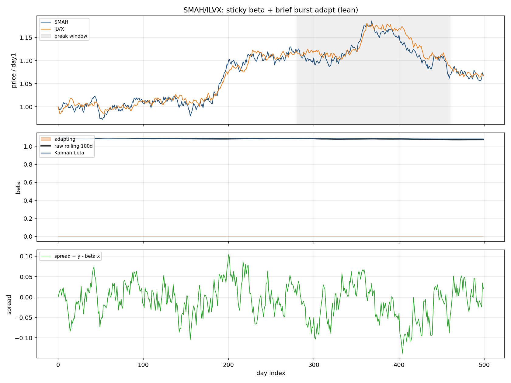<br><sub>Sticky through-origin β with burst adaptation (SMAH/ILVX).</sub></td>
</tr>
<tr>
<td>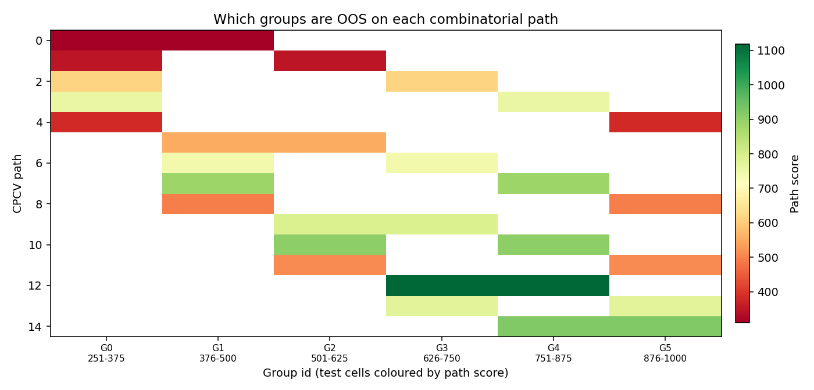<br><sub>v14 CPCV path scores by test-group combination.</sub></td>
<td>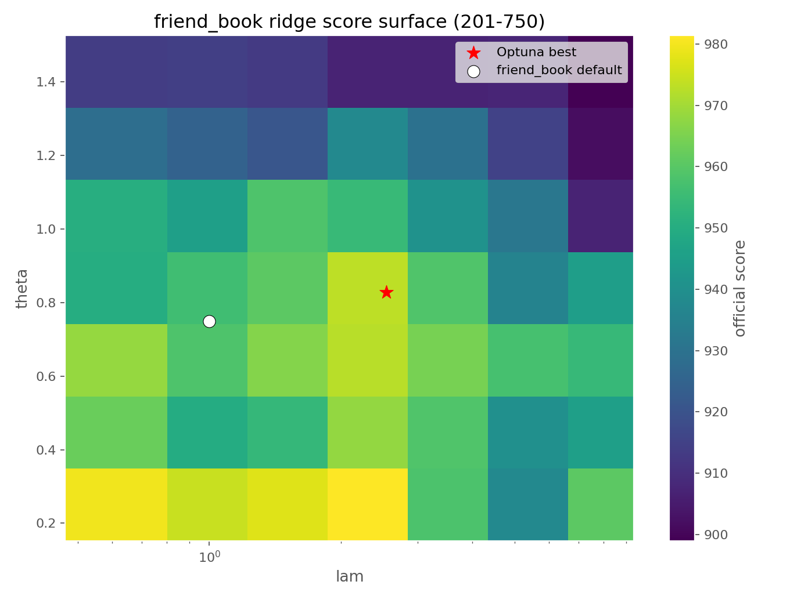<br><sub>Ridge λ/θ parameter surface from the Optuna study.</sub></td>
<td><br><sub>ALGO as a market and factor instrument.</sub></td>
</tr>
</table>

---

## Papers and references

Papers we restated, implemented or tested against. Sections in brackets show where each is used.

**Overfitting, selection and validation**
* Novy-Marx, R. (2015). *Backtesting Strategies Based on Multiple Signals.* NBER Working Paper 21329. [nber.org/papers/w21329](https://www.nber.org/papers/w21329) [brief, `overfit/`]
* Bailey, D. H. & López de Prado, M. (2014). *The Deflated Sharpe Ratio: Correcting for Selection Bias, Backtest Overfitting and Non-Normality.* Journal of Portfolio Management 40(5). [SSRN 2460551](https://papers.ssrn.com/sol3/papers.cfm?abstract_id=2460551) [`verify_pairs.py`]
* Bailey, D. H., Borwein, J., López de Prado, M. & Zhu, Q. (2014). *Pseudo-Mathematics and Financial Charlatanism: The Effects of Backtest Overfitting on Out-of-Sample Performance.* Notices of the AMS 61(5). [GBM deep dive]
* López de Prado, M. (2018). *Advances in Financial Machine Learning.* Wiley. Ch. 3 (meta-labelling), Ch. 7 (purged CV and embargo), Ch. 12 (combinatorial purged CV). [tuners, `_run_cpcv.py`]
* Harvey, C. R., Liu, Y. & Zhu, H. (2016). *…and the Cross-Section of Expected Returns.* Review of Financial Studies 29(1). [doi:10.1093/rfs/hhv059](https://doi.org/10.1093/rfs/hhv059)
* Benjamini, Y. & Hochberg, Y. (1995). *Controlling the False Discovery Rate.* JRSS B 57(1). [`verify_pairs.py`]
* McLean, R. D. & Pontiff, J. (2016). *Does Academic Research Destroy Stock Return Predictability?* Journal of Finance 71(1).

**Pairs trading, cointegration and mean reversion**
* Zeng, Z. & Lee, C.-G. (2014). *Pairs trading: optimal thresholds and profitability.* Quantitative Finance 14(11), 1881–1893. [doi:10.1080/14697688.2014.917806](https://doi.org/10.1080/14697688.2014.917806) [OU engine a*]
* Engle, R. F. & Granger, C. W. J. (1987). *Co-integration and Error Correction.* Econometrica 55(2).
* Johansen, S. (1991). *Estimation and Hypothesis Testing of Cointegration Vectors in Gaussian VAR Models.* Econometrica 59(6). [Johansen screens]
* Gregory, A. W. & Hansen, B. E. (1996). *Residual-based tests for cointegration in models with regime shifts.* Journal of Econometrics 70(1). [`research/cointegration/gregory_hansen_lc.py`]
* Hansen, B. E. (1992). *Tests for Parameter Instability in Regressions with I(1) Processes.* JBES 10(3). [Lc stability test]
* Avellaneda, M. & Lee, J.-H. (2010). *Statistical arbitrage in the US equities market.* Quantitative Finance 10(7).
* d'Aspremont, A. (2011). *Identifying small mean-reverting portfolios.* Quantitative Finance 11(3); Cuturi, M. & d'Aspremont, A. (2013). *Mean Reversion with a Variance Threshold.* ICML.

**Filtering and change detection**
* Kalman, R. E. (1960). *A New Approach to Linear Filtering and Prediction Problems.* J. Basic Engineering 82(1).
* Page, E. S. (1954). *Continuous Inspection Schemes.* Biometrika 41 (CUSUM).
* Killick, R., Fearnhead, P. & Eckley, I. A. (2012). *Optimal Detection of Changepoints with a Linear Computational Cost.* JASA 107 (PELT). [`pair_screener.py`]
* z411392, *Kalman + CUSUM Segmentation* (TradingView open-source indicator). Inspiration for the sticky Kalman + CUSUM pair filter. A Pine port of our pair version is in `research/pairs_analysis/kalman_cusum_beta_pair.pine`.

**Portfolio construction, breadth and random matrices**
* Grinold, R. & Kahn, R. (2000). *Active Portfolio Management*, ch. 6; Clarke, R., de Silva, H. & Thorley, S. (2002). *Portfolio Constraints and the Fundamental Law of Active Management.* FAJ 58(5).
* Meucci, A. (2009). *Managing Diversification.* Risk 22(5). [effective breadth]
* Marčenko, V. A. & Pastur, L. A. (1967). *Distribution of eigenvalues for some sets of random matrices.* Laloux, L., Cizeau, P., Bouchaud, J.-P. & Potters, M. (1999). *Noise Dressing of Financial Correlation Matrices.* PRL 83; Plerou, V. et al. (2002). PRE 65; Ledoit, O. & Wolf, M. (2004). JMVA 88.
* Ladha, K. (1992). *The Condorcet Jury Theorem, Free Speech, and Correlated Votes.* AJPS 36(3); Berg, S. (1993). *Condorcet's jury theorem, dependency among jurors.* Social Choice and Welfare 10.
* palmbook (2025). *Model-Free Trading Signals Aggregation.* InsiderFinance Wire, 31 March 2025. [aggregation brief, `aggregation/`]
* Thorp, E. O. on continuous Kelly sizing (f* = μ/σ²). [`aggregation/methods.py`]

**Forecast combination and ML in finance** (GBM deep dive)
* Bates, J. M. & Granger, C. W. J. (1969). *The Combination of Forecasts.* Operational Research Quarterly 20(4).
* Stock, J. & Watson, M. (2004). *Combination forecasts of output growth in a seven-country data set.* Journal of Forecasting 23(6).
* Timmermann, A. (2006). *Forecast Combinations.* Handbook of Economic Forecasting, vol. 1.
* Smith, J. & Wallis, K. (2009). *A Simple Explanation of the Forecast Combination Puzzle.* OBES 71(3); Claeskens, G., Magnus, J., Vasnev, A. & Wang, W. (2016). IJF 32(3).
* Rossi, B. (2013). *Advances in Forecasting under Instability.* Handbook of Economic Forecasting, vol. 2B.
* Krogh, A. & Vedelsby, J. (1995). *Neural Network Ensembles, Cross Validation, and Active Learning.* NIPS.
* Gu, S., Kelly, B. & Xiu, D. (2020). *Empirical Asset Pricing via Machine Learning.* RFS 33(5); Israel, R., Kelly, B. & Moskowitz, T. (2020). *Can Machines "Learn" Finance?* JOIM 18(2).

**Optimisation and clustering**
* Hansen, N. & Ostermeier, A. (2001). *Completely Derandomized Self-Adaptation in Evolution Strategies.* Evolutionary Computation 9(2); Hansen, N. (2009). *Benchmarking a BI-Population CMA-ES on the BBOB-2009 Function Testbed.* GECCO.
* Akiba, T. et al. (2019). *Optuna: A Next-generation Hyperparameter Optimization Framework.* KDD. [arXiv:1907.10902](https://arxiv.org/abs/1907.10902)
* Campello, R., Moulavi, D. & Sander, J. (2013). *Density-Based Clustering Based on Hierarchical Density Estimates.* PAKDD (HDBSCAN).
* Theiler, J. et al. (1992). *Testing for nonlinearity in time series: the method of surrogate data.* Physica D 58; Prichard, D. & Theiler, J. (1994). PRL 73 (multivariate phase surrogates). [synthetic null]

---

## Provenance, caveats and honesty notes

* **This is a cleaned copy** of the working repository. Removed: Optuna SQLite databases (~400 MB), per-pair diagnostic
  image dumps (~1,200 images; 43 curated figures kept), regenerable screen outputs, caches and local tooling. Reports were moved from scattered output
  folders into `docs/`. Each report keeps a provenance line, and script references inside reports were updated to the new
  paths (`experiments/…`, `research/pairs_analysis/…`, `archive/…`). The underscore-prefixed drivers moved from the root
  into `experiments/` with a small path bootstrap. Absolute local paths in result JSON were made repo-relative.
* **Numbers are snapshots.** Reports were written as the code evolved over three weeks, so the same book can show slightly
  different scores in different reports. The table at the top was recomputed on the final code.
* **"Out of sample" is labelled carefully.** Reports distinguish train, burned validation, exposed/contaminated and fresh
  windows. Only days 1001–1500 are clean for the books frozen before 3 August.
* **AI-assisted research.** Much of the analysis code and report drafting was done with AI coding assistants working
  under our direction. "The user" in a report is whichever of us was directing it. Every number in this README was
  re-derived from the repo's own scripts and JSON outputs.
* **Not investment advice.** This is competition research on synthetic data.

## Acknowledgements

Thanks to Susquehanna (SIG) and the UNSW FinTech Society for running Algothon 2026 and publishing the starter code and
evaluator, and to the authors of the papers above. The repository was put together by Daniel and Alex Bray.
