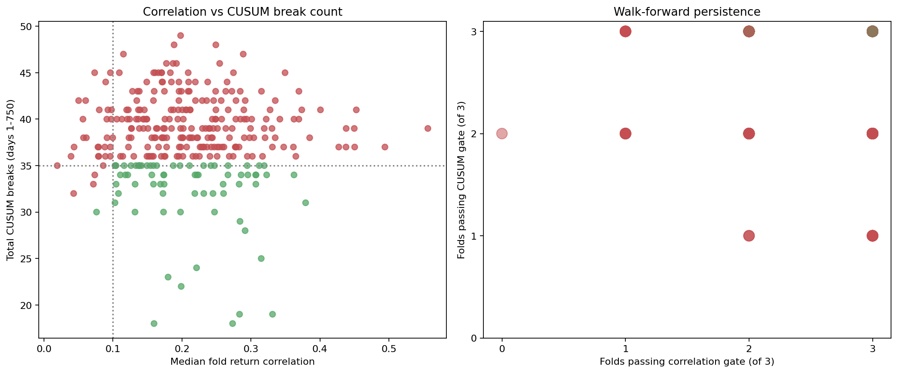

# testbedv2_tuned correlation + CUSUM walk-forward screen

> **Source:** `analysis_outputs/testbedv2_corr_cusum_screen/corr_cusum_screen_report.md` in the team's working repository (relocated here for the public release).

All statistics use days 1-750 only, split into three sequential walk-forward folds (1-250, 251-500, 501-750). Days 751-1000 were not read. Unlike the cointegration audit in pair_structure_report.md, a pair is filtered off correlation and shared/untuned CUSUM break behaviour ONLY -- no Engle-Granger or ADF gate, since a single fixed-beta test is known unreliable when beta genuinely moves across folds (see the beta columns below).

## Result

- Active input pairs: **310**
- Kept: **71**
- Rejected: **239**

## Filter rules

- Correlation: return corr >= 0.10 OR level corr >= 0.50, sane in >= 2/3 walk-forward folds.
- CUSUM breaks (shared, untuned filter): <= 15 per fold, sane in >= 2/3 folds, and <= 35 total across days 1-750.
- Fixed-beta ADF / cointegration: reported per fold and full-window for reference only. NOT used to keep or reject a pair.

## Comparison against the strict cointegration-audit pair list

- Prior strict list size: **8**
- Overlap (kept by both): **8** -- AENO-NWIG, ALUT-CCNS, CTGI-EELT, EORC-NGTE, HETT-ULXY, HUXZ-ACAC, RTTH-NAYO, SMAH-ILVX
- New pairs (kept here, not in strict list): **63**
- Dropped pairs (in strict list, rejected here): **0** -- none

## Kept pairs

| Pair | Return corr F1/F2/F3 | Corr folds | CUSUM cuts F1/F2/F3 | CUSUM folds | Beta F1/F2/F3 | Beta ratio | Full ADF p (diagnostic) |
|---|---|---:|---|---:|---|---:|---:|
| ACAC-IHOZ | 0.222/0.307/0.441 | 3/3 | 13/12/8 | 3/3 | 0.281/1.018/0.621 | 3.62 | 0.0022 |
| ACAC-NAYO | 0.069/0.103/0.139 | 2/3 | 9/11/11 | 3/3 | 0.346/0.958/-0.266 | inf | 0.0147 |
| AENO-ACAC | 0.323/0.350/0.289 | 3/3 | 17/6/11 | 2/3 | -0.234/0.981/0.932 | inf | 0.0108 |
| AENO-AETS | 0.187/0.194/0.082 | 2/3 | 10/11/14 | 3/3 | 0.217/0.687/0.004 | 184.59 | 0.1100 |
| AENO-HUXZ | 0.219/0.362/0.210 | 3/3 | 16/6/10 | 2/3 | -0.213/1.025/0.828 | inf | 0.0017 |
| AENO-IHOZ | 0.255/0.391/0.286 | 3/3 | 9/17/8 | 2/3 | 0.612/1.285/0.854 | 2.10 | 0.0002 |
| AENO-NWIG | 0.177/0.329/0.273 | 3/3 | 7/5/6 | 3/3 | 0.703/0.960/0.793 | 1.37 | 0.0000 |
| ALGO-HRET | 0.379/0.362/0.431 | 3/3 | 15/7/9 | 3/3 | 0.266/0.477/0.403 | 1.80 | 0.0172 |
| ALUT-BLBT | 0.260/0.328/0.191 | 3/3 | 14/10/9 | 3/3 | 0.948/0.769/0.225 | 4.21 | 0.0041 |
| ALUT-CCNS | 0.315/0.076/0.389 | 3/3 | 10/6/9 | 3/3 | 0.894/0.846/0.901 | 1.07 | 0.0000 |
| ALUT-FWWG | 0.197/0.168/0.204 | 3/3 | 15/11/9 | 3/3 | 0.135/0.579/0.419 | 4.30 | 0.0028 |
| ALUT-IHOZ | 0.120/0.201/0.133 | 3/3 | 16/9/10 | 2/3 | -0.300/0.272/0.401 | inf | 0.0191 |
| ALUT-RCRI | 0.188/0.112/0.159 | 3/3 | 12/11/10 | 3/3 | 0.486/-0.320/0.186 | inf | 0.0196 |
| ALUT-SRTX | 0.013/0.192/0.118 | 2/3 | 14/8/12 | 3/3 | 0.704/0.523/0.024 | 29.96 | 0.0042 |
| AMRP-ULXY | 0.112/0.138/0.171 | 3/3 | 12/12/11 | 3/3 | 0.275/-0.615/0.919 | inf | 0.0297 |
| ANSO-ACAC | 0.254/0.333/0.307 | 3/3 | 10/18/6 | 2/3 | 0.800/0.053/-0.132 | inf | 0.0186 |
| ANSO-CTGI | 0.103/0.045/0.226 | 2/3 | 10/13/12 | 3/3 | 0.597/-0.033/-0.324 | inf | 0.0083 |
| ANSO-IHOZ | 0.231/0.276/0.212 | 3/3 | 14/12/9 | 3/3 | 0.319/-0.063/-0.312 | inf | 0.0046 |
| ANSO-RCRI | 0.084/0.201/0.174 | 2/3 | 12/11/11 | 3/3 | 0.259/-0.163/0.131 | inf | 0.0161 |
| CTGI-EELT | 0.199/0.279/0.194 | 3/3 | 6/7/9 | 3/3 | 0.795/0.787/0.902 | 1.15 | 0.0000 |
| CUBO-ACIX | 0.149/0.141/0.168 | 3/3 | 12/15/8 | 3/3 | -0.262/-0.380/0.067 | inf | 0.2085 |
| CUBO-ULXY | 0.284/0.389/0.265 | 3/3 | 5/17/7 | 2/3 | 0.601/0.215/0.379 | 2.80 | 0.2081 |
| DUCT-SRTX | 0.162/0.347/0.295 | 3/3 | 14/15/6 | 3/3 | -0.363/0.960/0.522 | inf | 0.0189 |
| ELLT-AETS | 0.242/0.174/0.257 | 3/3 | 12/12/11 | 3/3 | 0.244/0.486/0.873 | 3.58 | 0.0063 |
| ELLT-FCSG | 0.180/0.294/0.224 | 3/3 | 13/12/9 | 3/3 | 1.231/-0.407/0.857 | inf | 0.0443 |
| ELLT-HTRK | 0.256/0.171/0.232 | 3/3 | 10/9/13 | 3/3 | 1.648/1.362/1.768 | 1.30 | 0.0010 |
| EORC-AETS | 0.150/0.142/0.132 | 3/3 | 12/12/11 | 3/3 | 0.254/1.178/0.035 | 34.03 | 0.0033 |
| EORC-NGTE | 0.221/0.231/0.214 | 3/3 | 8/11/5 | 3/3 | 0.890/1.029/0.914 | 1.16 | 0.0000 |
| HETT-MTNS | 0.292/0.244/0.323 | 3/3 | 10/9/9 | 3/3 | 0.362/0.747/1.446 | 4.00 | 0.0204 |
| HETT-ULXY | 0.160/0.134/0.190 | 3/3 | 8/4/6 | 3/3 | 0.758/0.673/0.863 | 1.28 | 0.0000 |
| HRET-HTRK | 0.198/0.102/0.220 | 3/3 | 9/8/13 | 3/3 | 0.921/1.438/-0.177 | inf | 0.0046 |
| HRET-SRTX | 0.123/0.267/0.290 | 3/3 | 14/10/10 | 3/3 | -0.056/0.561/0.126 | inf | 0.0176 |
| HUXZ-ACAC | 0.142/0.331/0.403 | 3/3 | 5/9/5 | 3/3 | 0.874/0.940/0.992 | 1.13 | 0.0000 |
| HUXZ-AETS | 0.076/0.104/0.190 | 2/3 | 9/11/15 | 3/3 | 0.087/0.528/0.038 | 13.95 | 0.0675 |
| HUXZ-BLBT | 0.111/0.331/0.154 | 3/3 | 12/11/12 | 3/3 | 0.194/1.749/-0.339 | inf | 0.0264 |
| HUXZ-CCNS | 0.130/0.156/0.204 | 3/3 | 11/8/15 | 3/3 | 0.209/0.880/0.561 | 4.22 | 0.0135 |
| HUXZ-IHOZ | 0.191/0.361/0.247 | 3/3 | 11/12/7 | 3/3 | 0.359/1.096/0.666 | 3.05 | 0.0009 |
| HUXZ-NWIG | 0.179/0.245/0.284 | 3/3 | 15/9/8 | 3/3 | -0.242/0.810/0.680 | inf | 0.0016 |
| HUXZ-RRES | 0.073/0.160/0.126 | 2/3 | 10/18/7 | 2/3 | 0.157/-0.677/-0.446 | inf | 0.0125 |
| HUXZ-ULXY | 0.075/0.315/0.132 | 2/3 | 9/15/9 | 3/3 | 0.246/0.403/0.215 | 1.88 | 0.1623 |
| LSST-ANSO | 0.085/0.284/0.211 | 2/3 | 17/7/11 | 2/3 | 0.130/-0.451/0.094 | inf | 0.0045 |
| LSST-HRET | 0.173/0.197/0.150 | 3/3 | 17/11/4 | 2/3 | 0.162/-0.540/0.825 | inf | 0.0047 |
| LSST-SMAH | 0.164/0.293/0.267 | 3/3 | 20/10/5 | 2/3 | -0.194/0.193/0.840 | inf | 0.0040 |
| MDGI-MTNS | 0.236/0.106/0.174 | 3/3 | 19/3/11 | 2/3 | -1.736/0.810/1.577 | inf | 0.0327 |
| MSDP-SRTX | 0.004/0.205/0.137 | 2/3 | 11/9/15 | 3/3 | 0.972/0.611/0.717 | 1.59 | 0.0287 |
| MSDP-ULXY | 0.157/0.139/0.104 | 3/3 | 12/13/10 | 3/3 | 0.751/0.556/1.257 | 2.26 | 0.0018 |
| NPCK-NGTE | 0.219/0.206/0.337 | 3/3 | 14/8/12 | 3/3 | -0.514/0.392/0.560 | inf | 0.0572 |
| NPCK-RCRI | 0.121/0.113/0.141 | 3/3 | 10/16/8 | 2/3 | 0.578/-0.557/-0.130 | inf | 0.0192 |
| RRES-EELT | 0.279/0.319/0.322 | 3/3 | 11/15/9 | 3/3 | 0.289/-0.200/-0.444 | inf | 0.0510 |
| RTTH-ACAC | 0.105/0.101/0.128 | 3/3 | 11/11/11 | 3/3 | 0.739/0.391/-1.088 | inf | 0.0106 |
| RTTH-FARS | 0.049/0.111/0.174 | 3/3 | 11/9/14 | 3/3 | 0.573/0.189/-0.008 | inf | 0.0503 |
| RTTH-FWWG | 0.188/0.074/0.076 | 2/3 | 11/10/9 | 3/3 | 0.149/0.512/1.040 | 6.96 | 0.0002 |
| RTTH-MDGI | 0.138/0.180/0.163 | 3/3 | 14/7/14 | 3/3 | -0.370/0.544/-0.542 | inf | 0.1146 |
| RTTH-NAYO | 0.310/0.141/0.180 | 3/3 | 7/7/9 | 3/3 | 0.684/0.709/0.807 | 1.18 | 0.0000 |
| RTTH-RCRI | 0.320/0.171/0.260 | 3/3 | 10/11/11 | 3/3 | 0.495/0.113/0.358 | 4.38 | 0.0080 |
| SMAH-ILVX | 0.266/0.326/0.283 | 3/3 | 6/7/6 | 3/3 | 1.122/0.985/0.981 | 1.14 | 0.0000 |
| SMAH-ULXY | 0.173/0.313/0.139 | 3/3 | 15/7/12 | 3/3 | -0.043/0.768/0.211 | inf | 0.0452 |
| SPLZ-AETS | 0.284/0.180/0.283 | 3/3 | 10/11/12 | 3/3 | 0.382/0.513/0.339 | 1.51 | 0.0283 |
| SPLZ-BLBT | 0.313/0.287/0.307 | 3/3 | 7/15/12 | 3/3 | 1.632/1.724/0.956 | 1.80 | 0.0051 |
| SPLZ-CCNS | 0.173/0.088/0.179 | 3/3 | 8/9/13 | 3/3 | 0.613/1.583/-0.142 | inf | 0.0009 |
| SRNA-ALUT | 0.104/0.094/0.189 | 3/3 | 17/7/11 | 2/3 | -0.333/1.185/0.152 | inf | 0.0253 |
| SRNA-FCSG | 0.104/0.176/0.159 | 3/3 | 12/15/8 | 3/3 | 0.390/-0.732/0.510 | inf | 0.1158 |
| SRNA-HUXZ | 0.272/0.344/0.296 | 3/3 | 11/8/15 | 3/3 | 0.699/1.047/-0.256 | inf | 0.0446 |
| SRNA-NAYO | 0.125/0.132/0.140 | 3/3 | 10/12/8 | 3/3 | -0.036/0.646/0.508 | inf | 0.0017 |
| SRNA-RTTH | 0.146/0.051/0.108 | 2/3 | 13/10/9 | 3/3 | -0.007/0.667/0.518 | inf | 0.0030 |
| SRTX-AETS | 0.116/0.236/0.112 | 3/3 | 11/11/13 | 3/3 | 0.014/0.363/-0.175 | inf | 0.0418 |
| SRTX-BENI | 0.237/0.398/0.312 | 3/3 | 8/15/12 | 3/3 | 0.354/0.916/1.671 | 4.72 | 0.3804 |
| SRTX-BLBT | 0.123/0.323/0.222 | 3/3 | 8/11/15 | 3/3 | 0.200/1.421/-0.924 | inf | 0.0242 |
| SRTX-FWWG | 0.158/0.239/0.169 | 3/3 | 7/12/14 | 3/3 | 0.020/1.187/-0.857 | inf | 0.0140 |
| SRTX-IHOZ | 0.289/0.439/0.362 | 3/3 | 12/14/8 | 3/3 | 0.248/0.816/1.240 | 5.00 | 0.0055 |
| SRTX-MTNS | 0.217/0.247/0.327 | 3/3 | 9/12/14 | 3/3 | 0.296/1.070/0.897 | 3.61 | 0.3123 |

## Rejection counts

- excessive_total_cusum_breaks: **234**
- correlation_not_persistent: **21**
- cusum_breaks_not_persistent: **16**

## Rejected pairs

| Pair | Median return corr | Corr folds | Total CUSUM cuts | CUSUM folds | Reasons |
|---|---:|---:|---:|---:|---|
| ELLT-ULXY | 0.050 | 0/3 | 42 | 2/3 | correlation_not_persistent;excessive_total_cusum_breaks |
| HRET-RTTH | 0.039 | 1/3 | 36 | 2/3 | correlation_not_persistent;excessive_total_cusum_breaks |
| CTGI-FCSG | 0.056 | 1/3 | 40 | 2/3 | correlation_not_persistent;excessive_total_cusum_breaks |
| EORC-FCSG | 0.057 | 1/3 | 38 | 2/3 | correlation_not_persistent;excessive_total_cusum_breaks |
| RRES-ALUT | 0.060 | 1/3 | 42 | 2/3 | correlation_not_persistent;excessive_total_cusum_breaks |
| EORC-RTTH | 0.078 | 1/3 | 37 | 2/3 | correlation_not_persistent;excessive_total_cusum_breaks |
| RRES-IHOZ | 0.086 | 1/3 | 35 | 2/3 | correlation_not_persistent |
| OTCS-EAFC | 0.089 | 1/3 | 44 | 2/3 | correlation_not_persistent;excessive_total_cusum_breaks |
| HETT-RTTH | 0.091 | 1/3 | 40 | 2/3 | correlation_not_persistent;excessive_total_cusum_breaks |
| ELLT-MMBT | 0.097 | 1/3 | 40 | 2/3 | correlation_not_persistent;excessive_total_cusum_breaks |
| CUBO-RTTH | 0.098 | 1/3 | 41 | 2/3 | correlation_not_persistent;excessive_total_cusum_breaks |
| OTCS-MMBT | 0.019 | 1/3 | 35 | 3/3 | correlation_not_persistent |
| HUXZ-NAYO | 0.043 | 1/3 | 32 | 3/3 | correlation_not_persistent |
| LSST-NAYO | 0.044 | 1/3 | 37 | 3/3 | correlation_not_persistent;excessive_total_cusum_breaks |
| RTTH-SRTX | 0.072 | 1/3 | 33 | 3/3 | correlation_not_persistent |
| LSST-RTTH | 0.074 | 1/3 | 34 | 3/3 | correlation_not_persistent |
| RTTH-ULXY | 0.079 | 1/3 | 36 | 3/3 | correlation_not_persistent;excessive_total_cusum_breaks |
| AMRP-RRES | 0.088 | 1/3 | 37 | 3/3 | correlation_not_persistent;excessive_total_cusum_breaks |
| HETT-EELT | 0.096 | 1/3 | 36 | 3/3 | correlation_not_persistent;excessive_total_cusum_breaks |
| AENO-RTTH | 0.096 | 1/3 | 37 | 3/3 | correlation_not_persistent;excessive_total_cusum_breaks |
| NWIG-CCNS | 0.100 | 1/3 | 38 | 3/3 | correlation_not_persistent;excessive_total_cusum_breaks |
| RRES-FARS | 0.173 | 2/3 | 39 | 1/3 | cusum_breaks_not_persistent;excessive_total_cusum_breaks |
| OTCS-CCNS | 0.196 | 2/3 | 44 | 1/3 | cusum_breaks_not_persistent;excessive_total_cusum_breaks |
| OTCS-DIHO | 0.198 | 2/3 | 49 | 1/3 | cusum_breaks_not_persistent;excessive_total_cusum_breaks |
| MMBT-FCSG | 0.061 | 2/3 | 38 | 2/3 | excessive_total_cusum_breaks |
| OTCS-HRND | 0.073 | 2/3 | 45 | 2/3 | excessive_total_cusum_breaks |
| NWIG-FCSG | 0.080 | 2/3 | 41 | 2/3 | excessive_total_cusum_breaks |
| HRET-HRND | 0.096 | 2/3 | 45 | 2/3 | excessive_total_cusum_breaks |
| CTGI-FARS | 0.106 | 2/3 | 40 | 2/3 | excessive_total_cusum_breaks |
| MMBT-GARI | 0.109 | 2/3 | 45 | 2/3 | excessive_total_cusum_breaks |
| AENO-SPLZ | 0.113 | 2/3 | 40 | 2/3 | excessive_total_cusum_breaks |
| ANSO-HRND | 0.115 | 2/3 | 47 | 2/3 | excessive_total_cusum_breaks |
| AMRP-RTTH | 0.120 | 2/3 | 41 | 2/3 | excessive_total_cusum_breaks |
| EORC-CCNS | 0.122 | 2/3 | 41 | 2/3 | excessive_total_cusum_breaks |
| OTCS-SPLZ | 0.134 | 2/3 | 42 | 2/3 | excessive_total_cusum_breaks |
| AENO-ACIX | 0.159 | 2/3 | 36 | 2/3 | excessive_total_cusum_breaks |
| MSDP-FCSG | 0.170 | 2/3 | 45 | 2/3 | excessive_total_cusum_breaks |
| MSDP-HRND | 0.177 | 2/3 | 46 | 2/3 | excessive_total_cusum_breaks |
| ACAC-FARS | 0.178 | 2/3 | 38 | 2/3 | excessive_total_cusum_breaks |
| SMAH-FARS | 0.183 | 2/3 | 45 | 2/3 | excessive_total_cusum_breaks |
| SMAH-ALUT | 0.199 | 2/3 | 43 | 2/3 | excessive_total_cusum_breaks |
| MSDP-ANSO | 0.249 | 2/3 | 43 | 2/3 | excessive_total_cusum_breaks |
| NWIG-MMBT | 0.079 | 2/3 | 37 | 3/3 | excessive_total_cusum_breaks |
| RTTH-FCSG | 0.089 | 2/3 | 36 | 3/3 | excessive_total_cusum_breaks |
| HRET-SPLZ | 0.091 | 2/3 | 38 | 3/3 | excessive_total_cusum_breaks |
| NWIG-AETS | 0.114 | 2/3 | 36 | 3/3 | excessive_total_cusum_breaks |
| EORC-ULXY | 0.121 | 2/3 | 40 | 3/3 | excessive_total_cusum_breaks |
| EORC-NAYO | 0.122 | 2/3 | 37 | 3/3 | excessive_total_cusum_breaks |
| HRET-MHRM | 0.123 | 2/3 | 38 | 3/3 | excessive_total_cusum_breaks |
| OTCS-CTGI | 0.127 | 2/3 | 39 | 3/3 | excessive_total_cusum_breaks |
| AGVF-ULXY | 0.130 | 2/3 | 36 | 3/3 | excessive_total_cusum_breaks |
| ANSO-RTTH | 0.134 | 2/3 | 40 | 3/3 | excessive_total_cusum_breaks |
| SPLZ-ULXY | 0.138 | 2/3 | 39 | 3/3 | excessive_total_cusum_breaks |
| SPLZ-MMBT | 0.145 | 2/3 | 41 | 3/3 | excessive_total_cusum_breaks |
| ANSO-CCNS | 0.149 | 2/3 | 40 | 3/3 | excessive_total_cusum_breaks |
| SPLZ-NGTE | 0.149 | 2/3 | 36 | 3/3 | excessive_total_cusum_breaks |
| SPLZ-CTGI | 0.164 | 2/3 | 39 | 3/3 | excessive_total_cusum_breaks |
| SRTX-ACIX | 0.170 | 2/3 | 36 | 3/3 | excessive_total_cusum_breaks |
| SPLZ-HTRK | 0.172 | 2/3 | 38 | 3/3 | excessive_total_cusum_breaks |
| RTTH-EAFC | 0.176 | 2/3 | 36 | 3/3 | excessive_total_cusum_breaks |
| CTGI-ILVX | 0.196 | 2/3 | 36 | 3/3 | excessive_total_cusum_breaks |
| HUXZ-ALUT | 0.201 | 2/3 | 36 | 3/3 | excessive_total_cusum_breaks |
| ELLT-HUXZ | 0.211 | 2/3 | 43 | 3/3 | excessive_total_cusum_breaks |
| AMRP-AGVF | 0.220 | 2/3 | 36 | 3/3 | excessive_total_cusum_breaks |
| CUBO-GARI | 0.160 | 3/3 | 43 | 1/3 | cusum_breaks_not_persistent;excessive_total_cusum_breaks |
| OTCS-MSDP | 0.161 | 3/3 | 45 | 1/3 | cusum_breaks_not_persistent;excessive_total_cusum_breaks |
| AGVF-FCSG | 0.166 | 3/3 | 45 | 1/3 | cusum_breaks_not_persistent;excessive_total_cusum_breaks |
| MSDP-NGTE | 0.175 | 3/3 | 43 | 1/3 | cusum_breaks_not_persistent;excessive_total_cusum_breaks |
| MDGI-FWWG | 0.189 | 3/3 | 48 | 1/3 | cusum_breaks_not_persistent;excessive_total_cusum_breaks |
| ELLT-DIHO | 0.192 | 3/3 | 46 | 1/3 | cusum_breaks_not_persistent;excessive_total_cusum_breaks |
| HRET-FWWG | 0.212 | 3/3 | 41 | 1/3 | cusum_breaks_not_persistent;excessive_total_cusum_breaks |
| MDGI-GARI | 0.249 | 3/3 | 48 | 1/3 | cusum_breaks_not_persistent;excessive_total_cusum_breaks |
| DUCT-ANSO | 0.285 | 3/3 | 40 | 1/3 | cusum_breaks_not_persistent;excessive_total_cusum_breaks |
| EORC-MTNS | 0.289 | 3/3 | 47 | 1/3 | cusum_breaks_not_persistent;excessive_total_cusum_breaks |
| SMAH-ACAC | 0.292 | 3/3 | 42 | 1/3 | cusum_breaks_not_persistent;excessive_total_cusum_breaks |
| LSST-DUCT | 0.301 | 3/3 | 40 | 1/3 | cusum_breaks_not_persistent;excessive_total_cusum_breaks |
| GARI-ACIX | 0.349 | 3/3 | 45 | 1/3 | cusum_breaks_not_persistent;excessive_total_cusum_breaks |
| ELLT-HRET | 0.079 | 3/3 | 36 | 2/3 | excessive_total_cusum_breaks |
| HRET-FARS | 0.124 | 3/3 | 40 | 2/3 | excessive_total_cusum_breaks |
| AMRP-ALUT | 0.128 | 3/3 | 43 | 2/3 | excessive_total_cusum_breaks |
| SMAH-SPLZ | 0.136 | 3/3 | 43 | 2/3 | excessive_total_cusum_breaks |
| OTCS-ACAC | 0.137 | 3/3 | 41 | 2/3 | excessive_total_cusum_breaks |
| AGVF-CTGI | 0.139 | 3/3 | 41 | 2/3 | excessive_total_cusum_breaks |
| HRET-ACAC | 0.145 | 3/3 | 40 | 2/3 | excessive_total_cusum_breaks |
| SRTX-FCSG | 0.149 | 3/3 | 44 | 2/3 | excessive_total_cusum_breaks |
| NWIG-ACIX | 0.150 | 3/3 | 37 | 2/3 | excessive_total_cusum_breaks |
| AENO-FARS | 0.151 | 3/3 | 39 | 2/3 | excessive_total_cusum_breaks |
| MDGI-BENI | 0.154 | 3/3 | 36 | 2/3 | excessive_total_cusum_breaks |
| NPCK-BLBT | 0.156 | 3/3 | 38 | 2/3 | excessive_total_cusum_breaks |
| LSST-FCSG | 0.159 | 3/3 | 42 | 2/3 | excessive_total_cusum_breaks |
| ELLT-HRND | 0.159 | 3/3 | 45 | 2/3 | excessive_total_cusum_breaks |
| MDGI-SRTX | 0.160 | 3/3 | 38 | 2/3 | excessive_total_cusum_breaks |
| LSST-EAFC | 0.162 | 3/3 | 38 | 2/3 | excessive_total_cusum_breaks |
| DUCT-FARS | 0.163 | 3/3 | 39 | 2/3 | excessive_total_cusum_breaks |
| NPCK-FARS | 0.166 | 3/3 | 37 | 2/3 | excessive_total_cusum_breaks |
| MDGI-ACAC | 0.171 | 3/3 | 45 | 2/3 | excessive_total_cusum_breaks |
| DUCT-FCSG | 0.171 | 3/3 | 44 | 2/3 | excessive_total_cusum_breaks |
| HUXZ-FCSG | 0.172 | 3/3 | 44 | 2/3 | excessive_total_cusum_breaks |
| ELLT-NGTE | 0.174 | 3/3 | 38 | 2/3 | excessive_total_cusum_breaks |
| ANSO-ITPA | 0.174 | 3/3 | 36 | 2/3 | excessive_total_cusum_breaks |
| MSDP-HRET | 0.175 | 3/3 | 39 | 2/3 | excessive_total_cusum_breaks |
| LSST-ACIX | 0.175 | 3/3 | 40 | 2/3 | excessive_total_cusum_breaks |
| CUBO-NAYO | 0.178 | 3/3 | 37 | 2/3 | excessive_total_cusum_breaks |
| SPLZ-ACAC | 0.184 | 3/3 | 41 | 2/3 | excessive_total_cusum_breaks |
| LSST-FWWG | 0.185 | 3/3 | 44 | 2/3 | excessive_total_cusum_breaks |
| DUCT-RCRI | 0.185 | 3/3 | 39 | 2/3 | excessive_total_cusum_breaks |
| MDGI-HRND | 0.187 | 3/3 | 46 | 2/3 | excessive_total_cusum_breaks |
| OTCS-HUXZ | 0.188 | 3/3 | 41 | 2/3 | excessive_total_cusum_breaks |
| HETT-MSDP | 0.196 | 3/3 | 42 | 2/3 | excessive_total_cusum_breaks |
| LSST-BLBT | 0.196 | 3/3 | 43 | 2/3 | excessive_total_cusum_breaks |
| AGVF-AETS | 0.198 | 3/3 | 39 | 2/3 | excessive_total_cusum_breaks |
| CTGI-NGTE | 0.198 | 3/3 | 38 | 2/3 | excessive_total_cusum_breaks |
| SPLZ-FCSG | 0.202 | 3/3 | 40 | 2/3 | excessive_total_cusum_breaks |
| DUCT-AGVF | 0.206 | 3/3 | 41 | 2/3 | excessive_total_cusum_breaks |
| ANSO-NGTE | 0.207 | 3/3 | 37 | 2/3 | excessive_total_cusum_breaks |
| SRNA-ULXY | 0.209 | 3/3 | 43 | 2/3 | excessive_total_cusum_breaks |
| GARI-MTNS | 0.209 | 3/3 | 45 | 2/3 | excessive_total_cusum_breaks |
| CUBO-SPLZ | 0.210 | 3/3 | 44 | 2/3 | excessive_total_cusum_breaks |
| ELLT-EORC | 0.212 | 3/3 | 41 | 2/3 | excessive_total_cusum_breaks |
| SMAH-BLBT | 0.219 | 3/3 | 44 | 2/3 | excessive_total_cusum_breaks |
| HRET-NGTE | 0.222 | 3/3 | 38 | 2/3 | excessive_total_cusum_breaks |
| EORC-ANSO | 0.223 | 3/3 | 38 | 2/3 | excessive_total_cusum_breaks |
| ACAC-ITPA | 0.229 | 3/3 | 42 | 2/3 | excessive_total_cusum_breaks |
| AENO-HRET | 0.230 | 3/3 | 39 | 2/3 | excessive_total_cusum_breaks |
| SRNA-CCNS | 0.232 | 3/3 | 37 | 2/3 | excessive_total_cusum_breaks |
| AGVF-RCRI | 0.236 | 3/3 | 37 | 2/3 | excessive_total_cusum_breaks |
| SMAH-FWWG | 0.237 | 3/3 | 44 | 2/3 | excessive_total_cusum_breaks |
| AENO-ANSO | 0.240 | 3/3 | 39 | 2/3 | excessive_total_cusum_breaks |
| MSDP-MTNS | 0.241 | 3/3 | 36 | 2/3 | excessive_total_cusum_breaks |
| ELLT-DUCT | 0.246 | 3/3 | 42 | 2/3 | excessive_total_cusum_breaks |
| HETT-MDGI | 0.247 | 3/3 | 37 | 2/3 | excessive_total_cusum_breaks |
| ACAC-GARI | 0.249 | 3/3 | 40 | 2/3 | excessive_total_cusum_breaks |
| OTCS-HTRK | 0.249 | 3/3 | 40 | 2/3 | excessive_total_cusum_breaks |
| HRET-MTNS | 0.251 | 3/3 | 37 | 2/3 | excessive_total_cusum_breaks |
| LSST-SRNA | 0.255 | 3/3 | 46 | 2/3 | excessive_total_cusum_breaks |
| DUCT-ITPA | 0.257 | 3/3 | 42 | 2/3 | excessive_total_cusum_breaks |
| ALUT-ACIX | 0.258 | 3/3 | 40 | 2/3 | excessive_total_cusum_breaks |
| AGVF-HRND | 0.263 | 3/3 | 43 | 2/3 | excessive_total_cusum_breaks |
| AGVF-ITPA | 0.265 | 3/3 | 44 | 2/3 | excessive_total_cusum_breaks |
| RRES-CTGI | 0.269 | 3/3 | 36 | 2/3 | excessive_total_cusum_breaks |
| CUBO-HRET | 0.269 | 3/3 | 38 | 2/3 | excessive_total_cusum_breaks |
| NWIG-BENI | 0.272 | 3/3 | 43 | 2/3 | excessive_total_cusum_breaks |
| SRNA-AMRP | 0.273 | 3/3 | 39 | 2/3 | excessive_total_cusum_breaks |
| SRNA-SMAH | 0.275 | 3/3 | 45 | 2/3 | excessive_total_cusum_breaks |
| AMRP-ANSO | 0.278 | 3/3 | 40 | 2/3 | excessive_total_cusum_breaks |
| SRNA-GARI | 0.279 | 3/3 | 37 | 2/3 | excessive_total_cusum_breaks |
| ELLT-ACIX | 0.285 | 3/3 | 43 | 2/3 | excessive_total_cusum_breaks |
| SRNA-NGTE | 0.290 | 3/3 | 41 | 2/3 | excessive_total_cusum_breaks |
| AENO-SRNA | 0.290 | 3/3 | 38 | 2/3 | excessive_total_cusum_breaks |
| HRET-BENI | 0.290 | 3/3 | 40 | 2/3 | excessive_total_cusum_breaks |
| DUCT-NGTE | 0.294 | 3/3 | 40 | 2/3 | excessive_total_cusum_breaks |
| NWIG-ACAC | 0.295 | 3/3 | 36 | 2/3 | excessive_total_cusum_breaks |
| DIHO-BLBT | 0.298 | 3/3 | 38 | 2/3 | excessive_total_cusum_breaks |
| ACAC-BENI | 0.315 | 3/3 | 43 | 2/3 | excessive_total_cusum_breaks |
| DUCT-MTNS | 0.319 | 3/3 | 39 | 2/3 | excessive_total_cusum_breaks |
| RTTH-RRES | 0.322 | 3/3 | 40 | 2/3 | excessive_total_cusum_breaks |
| CUBO-ACAC | 0.328 | 3/3 | 41 | 2/3 | excessive_total_cusum_breaks |
| SRNA-HRET | 0.335 | 3/3 | 42 | 2/3 | excessive_total_cusum_breaks |
| CUBO-IHOZ | 0.370 | 3/3 | 40 | 2/3 | excessive_total_cusum_breaks |
| ALGO-FCSG | 0.374 | 3/3 | 41 | 2/3 | excessive_total_cusum_breaks |
| ALGO-AETS | 0.385 | 3/3 | 38 | 2/3 | excessive_total_cusum_breaks |
| RRES-NAYO | 0.401 | 3/3 | 41 | 2/3 | excessive_total_cusum_breaks |
| ALGO-MHRM | 0.427 | 3/3 | 37 | 2/3 | excessive_total_cusum_breaks |
| ALGO-NPCK | 0.438 | 3/3 | 37 | 2/3 | excessive_total_cusum_breaks |
| ALGO-NGTE | 0.438 | 3/3 | 39 | 2/3 | excessive_total_cusum_breaks |
| ALGO-LSST | 0.450 | 3/3 | 39 | 2/3 | excessive_total_cusum_breaks |
| ALGO-CUBO | 0.557 | 3/3 | 39 | 2/3 | excessive_total_cusum_breaks |
| DUCT-HRND | 0.093 | 3/3 | 41 | 3/3 | excessive_total_cusum_breaks |
| HRET-MDGI | 0.111 | 3/3 | 36 | 3/3 | excessive_total_cusum_breaks |
| HRET-AETS | 0.126 | 3/3 | 38 | 3/3 | excessive_total_cusum_breaks |
| SMAH-AETS | 0.127 | 3/3 | 39 | 3/3 | excessive_total_cusum_breaks |
| OTCS-EELT | 0.137 | 3/3 | 40 | 3/3 | excessive_total_cusum_breaks |
| HETT-SPLZ | 0.138 | 3/3 | 43 | 3/3 | excessive_total_cusum_breaks |
| HETT-AETS | 0.144 | 3/3 | 40 | 3/3 | excessive_total_cusum_breaks |
| LSST-AETS | 0.144 | 3/3 | 39 | 3/3 | excessive_total_cusum_breaks |
| AGVF-ACAC | 0.149 | 3/3 | 40 | 3/3 | excessive_total_cusum_breaks |
| ANSO-RRES | 0.152 | 3/3 | 36 | 3/3 | excessive_total_cusum_breaks |
| NWIG-ULXY | 0.157 | 3/3 | 36 | 3/3 | excessive_total_cusum_breaks |
| NPCK-ANSO | 0.171 | 3/3 | 38 | 3/3 | excessive_total_cusum_breaks |
| SPLZ-FARS | 0.182 | 3/3 | 40 | 3/3 | excessive_total_cusum_breaks |
| CTGI-ITPA | 0.193 | 3/3 | 36 | 3/3 | excessive_total_cusum_breaks |
| SMAH-NWIG | 0.194 | 3/3 | 40 | 3/3 | excessive_total_cusum_breaks |
| AGVF-NGTE | 0.195 | 3/3 | 41 | 3/3 | excessive_total_cusum_breaks |
| NPCK-ACIX | 0.196 | 3/3 | 37 | 3/3 | excessive_total_cusum_breaks |
| CUBO-ITPA | 0.198 | 3/3 | 37 | 3/3 | excessive_total_cusum_breaks |
| HETT-NWIG | 0.201 | 3/3 | 41 | 3/3 | excessive_total_cusum_breaks |
| SPLZ-BENI | 0.201 | 3/3 | 38 | 3/3 | excessive_total_cusum_breaks |
| AENO-NGTE | 0.201 | 3/3 | 38 | 3/3 | excessive_total_cusum_breaks |
| AMRP-HETT | 0.202 | 3/3 | 39 | 3/3 | excessive_total_cusum_breaks |
| DUCT-SPLZ | 0.207 | 3/3 | 41 | 3/3 | excessive_total_cusum_breaks |
| HUXZ-HRET | 0.210 | 3/3 | 38 | 3/3 | excessive_total_cusum_breaks |
| HUXZ-NGTE | 0.213 | 3/3 | 38 | 3/3 | excessive_total_cusum_breaks |
| ELLT-SMAH | 0.214 | 3/3 | 39 | 3/3 | excessive_total_cusum_breaks |
| DIHO-FCSG | 0.215 | 3/3 | 38 | 3/3 | excessive_total_cusum_breaks |
| HUXZ-DUCT | 0.216 | 3/3 | 36 | 3/3 | excessive_total_cusum_breaks |
| ELLT-CTGI | 0.220 | 3/3 | 42 | 3/3 | excessive_total_cusum_breaks |
| HRET-ULXY | 0.225 | 3/3 | 36 | 3/3 | excessive_total_cusum_breaks |
| HUXZ-FWWG | 0.226 | 3/3 | 37 | 3/3 | excessive_total_cusum_breaks |
| HETT-ACIX | 0.228 | 3/3 | 37 | 3/3 | excessive_total_cusum_breaks |
| NWIG-EAFC | 0.231 | 3/3 | 37 | 3/3 | excessive_total_cusum_breaks |
| SRNA-NWIG | 0.234 | 3/3 | 39 | 3/3 | excessive_total_cusum_breaks |
| ANSO-BLBT | 0.236 | 3/3 | 42 | 3/3 | excessive_total_cusum_breaks |
| GARI-IHOZ | 0.238 | 3/3 | 38 | 3/3 | excessive_total_cusum_breaks |
| ANSO-MTNS | 0.239 | 3/3 | 39 | 3/3 | excessive_total_cusum_breaks |
| LSST-MTNS | 0.243 | 3/3 | 37 | 3/3 | excessive_total_cusum_breaks |
| HRET-NWIG | 0.243 | 3/3 | 38 | 3/3 | excessive_total_cusum_breaks |
| SPLZ-MTNS | 0.244 | 3/3 | 40 | 3/3 | excessive_total_cusum_breaks |
| NWIG-NGTE | 0.244 | 3/3 | 38 | 3/3 | excessive_total_cusum_breaks |
| SPLZ-GARI | 0.245 | 3/3 | 39 | 3/3 | excessive_total_cusum_breaks |
| AENO-FWWG | 0.249 | 3/3 | 41 | 3/3 | excessive_total_cusum_breaks |
| DUCT-ACAC | 0.251 | 3/3 | 36 | 3/3 | excessive_total_cusum_breaks |
| SPLZ-IHOZ | 0.252 | 3/3 | 39 | 3/3 | excessive_total_cusum_breaks |
| SMAH-SRTX | 0.254 | 3/3 | 37 | 3/3 | excessive_total_cusum_breaks |
| AMRP-SRTX | 0.258 | 3/3 | 37 | 3/3 | excessive_total_cusum_breaks |
| LSST-AMRP | 0.261 | 3/3 | 37 | 3/3 | excessive_total_cusum_breaks |
| AENO-MTNS | 0.264 | 3/3 | 39 | 3/3 | excessive_total_cusum_breaks |
| SRTX-NGTE | 0.267 | 3/3 | 41 | 3/3 | excessive_total_cusum_breaks |
| NPCK-NWIG | 0.274 | 3/3 | 36 | 3/3 | excessive_total_cusum_breaks |
| SMAH-IHOZ | 0.277 | 3/3 | 37 | 3/3 | excessive_total_cusum_breaks |
| HUXZ-MTNS | 0.278 | 3/3 | 37 | 3/3 | excessive_total_cusum_breaks |
| SRNA-NPCK | 0.278 | 3/3 | 42 | 3/3 | excessive_total_cusum_breaks |
| CUBO-ANSO | 0.283 | 3/3 | 37 | 3/3 | excessive_total_cusum_breaks |
| SRNA-ACAC | 0.299 | 3/3 | 39 | 3/3 | excessive_total_cusum_breaks |
| AENO-DUCT | 0.302 | 3/3 | 36 | 3/3 | excessive_total_cusum_breaks |
| SRNA-BLBT | 0.304 | 3/3 | 38 | 3/3 | excessive_total_cusum_breaks |
| MDGI-ACIX | 0.317 | 3/3 | 36 | 3/3 | excessive_total_cusum_breaks |
| AENO-SRTX | 0.321 | 3/3 | 38 | 3/3 | excessive_total_cusum_breaks |
| AENO-SMAH | 0.331 | 3/3 | 39 | 3/3 | excessive_total_cusum_breaks |
| LSST-IHOZ | 0.331 | 3/3 | 37 | 3/3 | excessive_total_cusum_breaks |
| NWIG-HTRK | 0.335 | 3/3 | 38 | 3/3 | excessive_total_cusum_breaks |
| MDGI-ITPA | 0.342 | 3/3 | 40 | 3/3 | excessive_total_cusum_breaks |
| MSDP-EAFC | 0.348 | 3/3 | 37 | 3/3 | excessive_total_cusum_breaks |
| NPCK-ILVX | 0.362 | 3/3 | 37 | 3/3 | excessive_total_cusum_breaks |
| ANSO-BENI | 0.362 | 3/3 | 40 | 3/3 | excessive_total_cusum_breaks |
| SPLZ-EAFC | 0.365 | 3/3 | 36 | 3/3 | excessive_total_cusum_breaks |
| ALGO-OTCS | 0.370 | 3/3 | 43 | 3/3 | excessive_total_cusum_breaks |
| ALGO-ANSO | 0.450 | 3/3 | 37 | 3/3 | excessive_total_cusum_breaks |
| ALGO-SPLZ | 0.453 | 3/3 | 41 | 3/3 | excessive_total_cusum_breaks |
| ALGO-ACIX | 0.494 | 3/3 | 37 | 3/3 | excessive_total_cusum_breaks |

---

## Figures

*Correlation + CUSUM screen diagnostics.*
