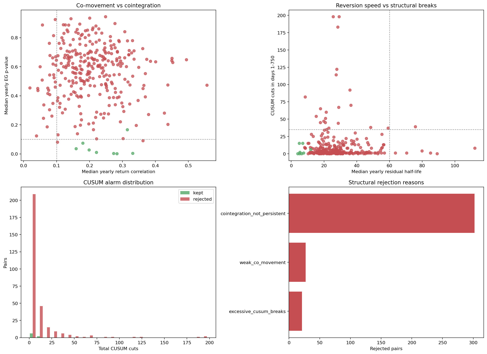

# testbedv2_tuned train-only pair-structure audit

> **Source:** `analysis_outputs/testbedv2_pair_structure/pair_structure_report.md` in the team's working repository (relocated here for the public release).

All removal decisions use days 1-750 only. Days 751-1000 were not loaded into any statistic.

## Result

- Active input pairs: **310**
- Structurally retained: **8**
- Rejected: **302**
- Pairs passing yearly/segment cointegration persistence under any of the three paths: **33**

## Methodology comparison

How many of the 310 candidate pairs show persistent, statistically significant cointegration under each independent test, before the shared sanity gates (correlation / half-life / hedge-ratio / break-count) are applied, and how many of those make it into the final retained set once those gates run:

| Path | Persistent (pre shared-gate) | In final retained set |
|---|---:|---:|
| Fixed-beta (classic Engle-Granger) | 7 | 7 |
| Continuous adaptive-beta (frozen Kalman) | 8 | 8 |
| Segmented / CUSUM-aware beta (new) | 0 | 0 |

Retained-set path combinations (a pair can pass more than one path):

- fixed+adaptive: **7**
- adaptive: **1**

Cointegration is tested three independent ways. The fixed-beta path is the classic Engle-Granger test: one OLS hedge ratio fit over the whole window, which assumes beta is constant over that window. The adaptive-beta path instead runs a single fixed, untuned PairSegFilter config (q_beta=1e-6, class defaults otherwise) shared identically by every candidate pair, and tests the ADF stationarity of the frozen-beta residual y_t - beta_(t-20) * x_t: the hedge ratio used at day t was estimated 20 days earlier from data only up to that point, so it cannot have adapted to the very relationship being tested, yet it is free to have moved since. A same-day (one-step) Kalman residual was tried first and rejected: the filter's beta re-fits fast enough to absorb almost any y-x relationship one day at a time, which made >80% of all candidate pairs look 'cointegrated'. The segmented / CUSUM-aware path exists because even the adaptive-beta path above barely moves beta: its shared q_beta=1e-6 caps process noise at q_beta * max_cov_inflate = 2.5e-5 even mid-break, so it behaves closer to a slowly-creeping near-fixed beta than to the live PairAgent's actual piecewise-stationary behaviour (steady beta, CUSUM-detected break, covariance-inflation reset, new steady segment). The segmented path reuses the SAME shared, untuned filter purely to mark segment boundaries (its own retrospective breakpoint estimate, seg_start), then fits an independent OLS beta from scratch within each segment and ADF-tests that segment's own residual. Using each pair's own P&L-tuned cfg.filt for any of these tests was tried and rejected: a filter tuned to maximise a specific pair's historical P&L will tend to make that pair's own residual look stationary irrespective of whether it is really cointegrated (confirmed empirically: >80% of all 310 candidate pairs 'passed' that way). A pair is retained if ANY of the three paths shows persistent, statistically significant cointegration, plus the shared sanity gates below. Running three independent family-wise-controlled tests per pair means the combined false-discovery budget across this pair universe is somewhat above the nominal 5% used for any one test alone. CUSUM cuts in the tables below are from each pair's own configured (tuned) filter; they describe live trading behaviour, not the cointegration tests above, and a high count indicates repeated model breaks, not additional independent trading signal.

## Fixed rules

### Fixed-beta path (classic Engle-Granger)
- Engle-Granger p <= 0.10 in at least 2/3 years, including at least 1 year at p <= 0.05.
- Full-IS cointegration must also pass the Bonferroni family-wise 5% limit: p <= 0.000161 for 310 tested pairs.

### Adaptive-beta path (shared untuned Kalman filter, frozen beta)
- ADF p <= 0.10 on the 20-day frozen-beta residual in at least 2/3 years, including at least 1 year at p <= 0.05.
- Full-IS adaptive residual must also pass the same Bonferroni family-wise 5% limit: p <= 0.000161.
- The Kalman beta must keep one sign on >= 90% of days 1-750 (a hedge ratio that flips sign is not an economically sensible spread).

### Segmented / CUSUM-aware beta path (new)
- Segment boundaries come from the SAME shared, untuned PairSegFilter as the adaptive path (non-circular); a segment needs >= 20 days to be tested at all, and a pair needs >= 2 such eligible segments for the path to apply.
- Untuned break count capped at 15/year and 35 total across days 1-750 -- more than that is continuous structural degradation, not piecewise stationarity.
- ADF p <= 0.10 (fresh in-segment OLS beta + residual) in >= 67% of eligible segments, including >= 1 segment at p <= 0.05.
- Fisher-combined p-value across all eligible segments' ADF tests must also pass the same Bonferroni family-wise 5% limit: p <= 0.000161.
- Segment betas must be sign-consistent (day-weighted) on >= 90% of eligible days.
- Segment residual half-life in (0, 60] days in >= 67% of eligible segments.
- Median yearly return correlation >= 0.50 -- stricter than the shared gate below; this path alone does not get the benefit of the level-correlation fallback, since a spread that resets its beta at every break needs stronger raw co-movement to trust.

### Shared gates (any path)
- Median return correlation >= 0.10, unless median log-price-level correlation >= 0.50.
- Residual half-life in (0, 60] days in at least 2/3 years, on the fixed-window, adaptive-filter, or dominant-segment residual.
- Positive yearly hedge ratios with max/min <= 3.0, unless the Kalman beta or the segment beta sign-consistency test passes.
- No year above 15 CUSUM cuts and no more than 35 cuts across days 1-750 (pair's own tuned filter).

## Retained pairs

| Pair | Path | Return corr Y1/Y2/Y3 | EG p Y1/Y2/Y3 | Adaptive ADF p Y1/Y2/Y3 | Segment ADF p Y1/Y2/Y3 | Eligible segs | Seg sign % | Half-life Y1/Y2/Y3 | Beta sign % | CUSUM cuts Y1/Y2/Y3 |
|---|---|---|---|---|---|---:|---:|---|---:|---|
| AENO-NWIG | fixed+adaptive | 0.177/0.329/0.273 | 0.0020/0.0024/0.0088 | 0.0019/0.0006/0.0012 | 0.2782/0.0005/0.0842 | 15 | 100.0% | 3.4/4.0/6.8 | 100.0% | 0/0/0 |
| ALUT-CCNS | adaptive | 0.315/0.076/0.389 | 0.4895/0.0037/0.1658 | 0.0371/0.0056/0.0597 | 0.0122/0.0578/0.0761 | 14 | 88.7% | 17.2/5.6/11.9 | 100.0% | 3/1/2 |
| CTGI-EELT | fixed+adaptive | 0.199/0.279/0.194 | 0.0134/0.0268/0.0918 | 0.0058/0.0041/0.0122 | 0.0146/0.0013/0.1864 | 12 | 93.3% | 5.8/7.6/8.5 | 100.0% | 0/1/0 |
| EORC-NGTE | fixed+adaptive | 0.221/0.231/0.214 | 0.0097/0.0099/0.0024 | 0.0064/0.0592/0.0008 | 0.0109/0.0033/0.0032 | 15 | 92.7% | 4.9/5.4/4.8 | 100.0% | 6/5/4 |
| HETT-ULXY | fixed+adaptive | 0.160/0.134/0.190 | 0.0937/0.0009/0.0354 | 0.0301/0.0004/0.0064 | 0.0479/0.0099/0.0690 | 12 | 100.0% | 9.8/4.3/6.4 | 100.0% | 0/0/0 |
| HUXZ-ACAC | fixed+adaptive | 0.142/0.331/0.403 | 0.0502/0.0032/0.0029 | 0.0566/0.0008/0.0008 | 0.1018/0.3792/0.0002 | 14 | 100.0% | 6.5/5.2/4.1 | 100.0% | 0/0/0 |
| RTTH-NAYO | fixed+adaptive | 0.310/0.141/0.180 | 0.4007/0.0014/0.0734 | 0.1592/0.0001/0.0333 | 0.0014/0.0655/0.4421 | 18 | 86.7% | 17.3/5.7/7.1 | 100.0% | 5/5/5 |
| SMAH-ILVX | fixed+adaptive | 0.266/0.326/0.283 | 0.0004/0.0060/0.0008 | 0.0003/0.0029/0.0001 | 0.0171/0.0059/0.0010 | 14 | 100.0% | 4.1/5.7/5.3 | 100.0% | 1/1/0 |

## Persistent-cointegration near-misses

| Pair | EG p Y1/Y2/Y3 | Adaptive ADF p Y1/Y2/Y3 | Segment ADF p Y1/Y2/Y3 | Full-IS p (fixed/adaptive/segment) | CUSUM cuts Y1/Y2/Y3 | Reasons |
|---|---|---|---|---|---|---|
| ACAC-ITPA | 0.8313/0.0943/0.6021 | 0.4905/0.0229/0.5259 | 0.0878/0.4424/0.0054 | 0.8128/0.0394/0.0001 | 5/5/5 | cointegration_not_persistent |
| ACAC-NAYO | 0.6558/0.3651/0.3439 | 0.0537/0.0461/0.3979 | 0.0960/0.0056/0.0188 | 0.3126/0.0802/0.0057 | 0/0/0 | cointegration_not_persistent |
| ALGO-HRET | 0.0656/0.6151/0.2707 | 0.9037/0.0844/0.0065 | 0.0223/0.2226/0.5738 | 0.3396/0.0762/0.0029 | 1/0/0 | cointegration_not_persistent |
| ALUT-ACIX | 0.7457/0.0320/0.2746 | 0.0448/0.0377/0.5857 | 0.3654/0.5390/0.0632 | 0.8675/0.0151/0.0009 | 17/18/25 | cointegration_not_persistent;excessive_cusum_breaks |
| ANSO-BENI | 0.9811/0.0902/0.0420 | 0.8913/0.8890/0.5867 | 0.2118/0.0597/0.0719 | 0.2324/0.6564/0.0258 | 6/2/1 | cointegration_not_persistent |
| ANSO-CTGI | 0.0803/0.7045/0.0037 | 0.0112/0.4919/0.6694 | 0.0190/0.2566/0.0561 | 0.2257/0.0537/0.0037 | 22/29/31 | cointegration_not_persistent;excessive_cusum_breaks |
| CUBO-ACAC | 0.6947/0.3030/0.7375 | 0.7145/0.0257/0.0902 | 0.1120/0.4458/0.3458 | 0.2177/0.5027/0.0957 | 1/0/0 | cointegration_not_persistent |
| CUBO-HRET | 0.5325/0.2601/0.4824 | 0.8628/0.0740/0.0799 | 0.8353/0.2999/0.2503 | 0.7357/0.4099/0.0659 | 1/0/0 | cointegration_not_persistent |
| CUBO-NAYO | 0.5657/0.4171/0.5040 | 0.0709/0.0905/0.4102 | 0.1569/0.1759/0.3285 | 0.2789/0.1012/0.0042 | 0/1/0 | cointegration_not_persistent |
| EORC-RTTH | 0.7609/0.8183/0.6143 | 0.0727/0.7153/0.0830 | 0.2050/0.0868/0.0011 | 0.4442/0.1869/0.0190 | 23/27/20 | cointegration_not_persistent;weak_co_movement;excessive_cusum_breaks |
| HETT-MSDP | 0.6771/0.6049/0.0729 | 0.7251/0.0222/0.0911 | 0.2257/0.1035/0.1502 | 0.1731/0.2107/0.0126 | 0/0/0 | cointegration_not_persistent |
| HRET-FWWG | 0.9787/0.2119/0.0554 | 0.8927/0.0734/0.0925 | 0.5646/0.0687/0.4419 | 0.3958/0.0736/0.0008 | 6/4/5 | cointegration_not_persistent |
| HRET-MTNS | 0.9616/0.4692/0.0124 | 0.8722/0.0777/0.0158 | 0.0553/0.2697/0.0200 | 0.4102/0.2542/0.0047 | 1/0/0 | cointegration_not_persistent |
| HRET-RTTH | 0.9711/0.1234/0.0802 | 0.3405/0.0329/0.0774 | 0.0051/0.0394/0.8330 | 0.3471/0.0056/0.0152 | 0/0/1 | cointegration_not_persistent;weak_co_movement |
| HUXZ-NAYO | 0.4502/0.5125/0.3313 | 0.0369/0.0692/0.4615 | 0.2845/0.1069/0.3123 | 0.3788/0.0984/0.0594 | 1/2/3 | cointegration_not_persistent;weak_co_movement |
| LSST-RTTH | 0.1360/0.5258/0.4152 | 0.0881/0.2835/0.0484 | 0.2255/0.0211/0.1299 | 0.0845/0.0221/0.0066 | 1/0/0 | cointegration_not_persistent;weak_co_movement |
| LSST-SRNA | 0.7540/0.4419/0.5103 | 0.0923/0.4883/0.0463 | 0.0713/0.0303/0.1025 | 0.1711/0.5921/0.0128 | 1/1/0 | cointegration_not_persistent |
| MDGI-FWWG | 0.7469/0.1916/0.8949 | 0.0100/0.0707/0.2753 | 0.0050/0.3134/0.5976 | 0.4136/0.0754/0.0059 | 2/0/0 | cointegration_not_persistent |
| MDGI-MTNS | 0.4859/0.4492/0.4167 | 0.0496/0.0292/0.2108 | 0.5800/0.0410/0.3488 | 0.4666/0.2652/0.0003 | 4/1/3 | cointegration_not_persistent |
| MDGI-SRTX | 0.4894/0.0126/0.8388 | 0.0440/0.0166/0.5856 | 0.0780/0.0404/0.5975 | 0.3773/0.0448/0.0102 | 1/1/0 | cointegration_not_persistent |
| MSDP-ULXY | 0.8822/0.6591/0.0191 | 0.3677/0.0036/0.0511 | 0.1625/0.8797/0.0024 | 0.0837/0.0273/0.0000 | 4/4/4 | cointegration_not_persistent |
| NWIG-NGTE | 0.7720/0.3727/0.7158 | 0.6223/0.9029/0.8473 | 0.4904/0.0101/0.0612 | 0.5877/0.5395/0.0004 | 1/0/0 | cointegration_not_persistent |
| RTTH-ACAC | 0.4060/0.0696/0.1309 | 0.0075/0.0190/0.3064 | 0.3336/0.2093/0.1193 | 0.2595/0.0435/0.0002 | 1/1/0 | cointegration_not_persistent |
| RTTH-MDGI | 0.0713/0.1382/0.1980 | 0.0556/0.0691/0.3348 | 0.0247/0.0756/0.4224 | 0.7429/0.0444/0.0037 | 1/0/1 | cointegration_not_persistent |
| SMAH-FWWG | 0.9600/0.8311/0.4381 | 0.7670/0.7382/0.3096 | 0.0947/0.0080/0.0080 | 0.6132/0.1122/0.0000 | 2/1/1 | cointegration_not_persistent |

## Rejection counts

- cointegration_not_persistent: **302**
- weak_co_movement: **27**
- excessive_cusum_breaks: **21**

## Rejected pairs

| Pair | Median return corr | EG pass years | Adaptive ADF pass years | Eligible segs | Segment pass frac | Median half-life | CUSUM cuts | Reasons |
|---|---:|---:|---:|---:|---:|---:|---:|---|
| OTCS-MMBT | 0.019 | 0/3 | 0/3 | 8 | 0.50 | 18.0 | 1 | cointegration_not_persistent;weak_co_movement |
| LSST-NAYO | 0.044 | 0/3 | 0/3 | 16 | 0.38 | 21.0 | 51 | cointegration_not_persistent;weak_co_movement;excessive_cusum_breaks |
| ELLT-ULXY | 0.050 | 0/3 | 0/3 | 15 | 0.40 | 39.1 | 1 | cointegration_not_persistent;weak_co_movement |
| CTGI-FCSG | 0.056 | 0/3 | 0/3 | 14 | 0.21 | 20.3 | 1 | cointegration_not_persistent;weak_co_movement |
| EORC-FCSG | 0.057 | 0/3 | 0/3 | 12 | 0.25 | 44.3 | 0 | cointegration_not_persistent;weak_co_movement |
| OTCS-HRND | 0.073 | 0/3 | 0/3 | 9 | 0.33 | 18.9 | 1 | cointegration_not_persistent;weak_co_movement |
| RTTH-FWWG | 0.076 | 0/3 | 0/3 | 13 | 0.31 | 17.8 | 1 | cointegration_not_persistent;weak_co_movement |
| NWIG-MMBT | 0.079 | 0/3 | 0/3 | 12 | 0.17 | 21.7 | 3 | cointegration_not_persistent;weak_co_movement |
| NWIG-FCSG | 0.080 | 0/3 | 0/3 | 12 | 0.17 | 36.8 | 19 | cointegration_not_persistent;weak_co_movement |
| AMRP-RRES | 0.088 | 0/3 | 0/3 | 12 | 0.42 | 21.9 | 1 | cointegration_not_persistent;weak_co_movement |
| RTTH-FCSG | 0.089 | 0/3 | 0/3 | 12 | 0.58 | 16.8 | 7 | cointegration_not_persistent;weak_co_movement |
| OTCS-EAFC | 0.089 | 0/3 | 0/3 | 12 | 0.33 | 26.6 | 9 | cointegration_not_persistent;weak_co_movement |
| HETT-RTTH | 0.091 | 0/3 | 0/3 | 12 | 0.25 | 51.7 | 1 | cointegration_not_persistent;weak_co_movement |
| DUCT-HRND | 0.093 | 0/3 | 0/3 | 13 | 0.38 | 15.3 | 54 | cointegration_not_persistent;excessive_cusum_breaks |
| HETT-EELT | 0.096 | 0/3 | 0/3 | 15 | 0.07 | 79.9 | 4 | cointegration_not_persistent;weak_co_movement |
| AENO-RTTH | 0.096 | 0/3 | 0/3 | 11 | 0.27 | 21.5 | 13 | cointegration_not_persistent;weak_co_movement |
| ELLT-MMBT | 0.097 | 0/3 | 0/3 | 13 | 0.15 | 27.8 | 1 | cointegration_not_persistent;weak_co_movement |
| NWIG-CCNS | 0.100 | 0/3 | 0/3 | 13 | 0.08 | 29.3 | 5 | cointegration_not_persistent;weak_co_movement |
| HUXZ-AETS | 0.104 | 0/3 | 0/3 | 10 | 0.30 | 22.5 | 1 | cointegration_not_persistent |
| CTGI-FARS | 0.106 | 0/3 | 0/3 | 12 | 0.33 | 19.5 | 3 | cointegration_not_persistent |
| SRNA-RTTH | 0.108 | 0/3 | 0/3 | 16 | 0.12 | 53.3 | 2 | cointegration_not_persistent |
| MMBT-GARI | 0.109 | 0/3 | 0/3 | 9 | 0.11 | 16.7 | 17 | cointegration_not_persistent |
| RTTH-FARS | 0.111 | 0/3 | 0/3 | 12 | 0.50 | 18.5 | 1 | cointegration_not_persistent |
| AENO-SPLZ | 0.113 | 0/3 | 0/3 | 8 | 0.12 | 28.6 | 17 | cointegration_not_persistent |
| NWIG-AETS | 0.114 | 0/3 | 0/3 | 11 | 0.27 | 22.4 | 24 | cointegration_not_persistent |
| ANSO-HRND | 0.115 | 0/3 | 0/3 | 10 | 0.20 | 17.7 | 2 | cointegration_not_persistent |
| SRTX-AETS | 0.116 | 0/3 | 0/3 | 12 | 0.08 | 53.0 | 0 | cointegration_not_persistent |
| AMRP-RTTH | 0.120 | 0/3 | 0/3 | 14 | 0.29 | 40.6 | 1 | cointegration_not_persistent |
| EORC-ULXY | 0.121 | 0/3 | 0/3 | 13 | 0.38 | 56.9 | 1 | cointegration_not_persistent |
| EORC-CCNS | 0.122 | 0/3 | 0/3 | 13 | 0.46 | 48.1 | 1 | cointegration_not_persistent |
| HUXZ-RRES | 0.126 | 0/3 | 0/3 | 12 | 0.33 | 21.4 | 7 | cointegration_not_persistent |
| SMAH-AETS | 0.127 | 0/3 | 0/3 | 12 | 0.33 | 55.2 | 8 | cointegration_not_persistent |
| OTCS-CTGI | 0.127 | 0/3 | 0/3 | 14 | 0.21 | 19.6 | 13 | cointegration_not_persistent |
| AMRP-ALUT | 0.128 | 0/3 | 0/3 | 11 | 0.45 | 25.8 | 1 | cointegration_not_persistent |
| AGVF-ULXY | 0.130 | 0/3 | 0/3 | 12 | 0.33 | 33.5 | 22 | cointegration_not_persistent |
| SRNA-NAYO | 0.132 | 0/3 | 0/3 | 13 | 0.00 | 63.7 | 1 | cointegration_not_persistent |
| HUXZ-ULXY | 0.132 | 0/3 | 0/3 | 11 | 0.09 | 24.6 | 5 | cointegration_not_persistent |
| ALUT-IHOZ | 0.133 | 0/3 | 0/3 | 10 | 0.30 | 38.3 | 18 | cointegration_not_persistent |
| OTCS-SPLZ | 0.134 | 0/3 | 0/3 | 9 | 0.33 | 47.3 | 13 | cointegration_not_persistent |
| OTCS-EELT | 0.137 | 0/3 | 0/3 | 16 | 0.25 | 17.3 | 3 | cointegration_not_persistent |
| OTCS-ACAC | 0.137 | 0/3 | 0/3 | 17 | 0.35 | 55.1 | 1 | cointegration_not_persistent |
| HETT-SPLZ | 0.138 | 0/3 | 0/3 | 11 | 0.18 | 35.8 | 1 | cointegration_not_persistent |
| SPLZ-ULXY | 0.138 | 0/3 | 0/3 | 11 | 0.27 | 28.7 | 44 | cointegration_not_persistent;excessive_cusum_breaks |
| AGVF-CTGI | 0.139 | 0/3 | 0/3 | 15 | 0.13 | 28.6 | 4 | cointegration_not_persistent |
| EORC-AETS | 0.142 | 0/3 | 0/3 | 9 | 0.33 | 28.7 | 3 | cointegration_not_persistent |
| HETT-AETS | 0.144 | 0/3 | 0/3 | 15 | 0.27 | 85.1 | 1 | cointegration_not_persistent |
| LSST-AETS | 0.144 | 0/3 | 0/3 | 14 | 0.43 | 18.6 | 0 | cointegration_not_persistent |
| SPLZ-MMBT | 0.145 | 0/3 | 0/3 | 12 | 0.08 | 30.4 | 2 | cointegration_not_persistent |
| AGVF-ACAC | 0.149 | 0/3 | 0/3 | 12 | 0.33 | 31.9 | 2 | cointegration_not_persistent |
| ANSO-CCNS | 0.149 | 0/3 | 0/3 | 11 | 0.00 | 19.5 | 1 | cointegration_not_persistent |
| CUBO-ACIX | 0.149 | 0/3 | 0/3 | 12 | 0.42 | 23.1 | 0 | cointegration_not_persistent |
| NWIG-ACIX | 0.150 | 0/3 | 0/3 | 12 | 0.50 | 26.5 | 4 | cointegration_not_persistent |
| AENO-FARS | 0.151 | 0/3 | 0/3 | 15 | 0.27 | 40.2 | 21 | cointegration_not_persistent |
| MDGI-BENI | 0.154 | 0/3 | 0/3 | 10 | 0.30 | 26.0 | 2 | cointegration_not_persistent |
| NPCK-BLBT | 0.156 | 0/3 | 0/3 | 13 | 0.15 | 12.8 | 1 | cointegration_not_persistent |
| NWIG-ULXY | 0.157 | 0/3 | 0/3 | 10 | 0.40 | 38.9 | 13 | cointegration_not_persistent |
| LSST-FCSG | 0.159 | 0/3 | 0/3 | 14 | 0.50 | 21.7 | 35 | cointegration_not_persistent |
| ALUT-RCRI | 0.159 | 0/3 | 0/3 | 13 | 0.23 | 26.5 | 1 | cointegration_not_persistent |
| ELLT-HRND | 0.159 | 0/3 | 0/3 | 11 | 0.18 | 35.9 | 92 | cointegration_not_persistent;excessive_cusum_breaks |
| OTCS-MSDP | 0.161 | 0/3 | 0/3 | 13 | 0.31 | 18.1 | 10 | cointegration_not_persistent |
| LSST-EAFC | 0.162 | 0/3 | 0/3 | 11 | 0.27 | 23.2 | 1 | cointegration_not_persistent |
| DUCT-FARS | 0.163 | 0/3 | 0/3 | 7 | 0.29 | 40.5 | 1 | cointegration_not_persistent |
| AGVF-FCSG | 0.166 | 0/3 | 0/3 | 10 | 0.30 | 42.6 | 1 | cointegration_not_persistent |
| NPCK-FARS | 0.166 | 0/3 | 0/3 | 12 | 0.17 | 25.4 | 1 | cointegration_not_persistent |
| SRTX-FWWG | 0.169 | 0/3 | 0/3 | 15 | 0.33 | 22.8 | 1 | cointegration_not_persistent |
| NPCK-ANSO | 0.171 | 0/3 | 0/3 | 12 | 0.42 | 55.7 | 9 | cointegration_not_persistent |
| SPLZ-CCNS | 0.173 | 0/3 | 0/3 | 13 | 0.31 | 18.8 | 21 | cointegration_not_persistent |
| SMAH-ULXY | 0.173 | 0/3 | 0/3 | 11 | 0.36 | 13.9 | 0 | cointegration_not_persistent |
| ANSO-RCRI | 0.174 | 0/3 | 0/3 | 10 | 0.10 | 16.0 | 2 | cointegration_not_persistent |
| MSDP-NGTE | 0.175 | 0/3 | 0/3 | 9 | 0.44 | 47.6 | 3 | cointegration_not_persistent |
| LSST-ACIX | 0.175 | 0/3 | 0/3 | 13 | 0.38 | 18.8 | 1 | cointegration_not_persistent |
| RTTH-EAFC | 0.176 | 0/3 | 0/3 | 12 | 0.33 | 17.7 | 1 | cointegration_not_persistent |
| MSDP-HRND | 0.177 | 0/3 | 0/3 | 10 | 0.20 | 34.6 | 1 | cointegration_not_persistent |
| ACAC-FARS | 0.178 | 0/3 | 0/3 | 15 | 0.47 | 36.7 | 5 | cointegration_not_persistent |
| SPLZ-FARS | 0.182 | 0/3 | 0/3 | 13 | 0.31 | 25.5 | 2 | cointegration_not_persistent |
| SMAH-FARS | 0.183 | 0/3 | 0/3 | 10 | 0.30 | 28.5 | 1 | cointegration_not_persistent |
| SPLZ-ACAC | 0.184 | 0/3 | 0/3 | 12 | 0.25 | 17.9 | 9 | cointegration_not_persistent |
| LSST-FWWG | 0.185 | 0/3 | 0/3 | 9 | 0.56 | 21.6 | 1 | cointegration_not_persistent |
| DUCT-RCRI | 0.185 | 0/3 | 0/3 | 10 | 0.60 | 29.9 | 15 | cointegration_not_persistent |
| AENO-AETS | 0.187 | 0/3 | 0/3 | 10 | 0.30 | 25.7 | 198 | cointegration_not_persistent;excessive_cusum_breaks |
| OTCS-HUXZ | 0.188 | 0/3 | 0/3 | 15 | 0.40 | 46.3 | 2 | cointegration_not_persistent |
| CTGI-ITPA | 0.193 | 0/3 | 0/3 | 15 | 0.33 | 23.0 | 1 | cointegration_not_persistent |
| SMAH-NWIG | 0.194 | 0/3 | 0/3 | 10 | 0.60 | 49.0 | 8 | cointegration_not_persistent |
| AGVF-NGTE | 0.195 | 0/3 | 0/3 | 6 | 0.17 | 22.3 | 1 | cointegration_not_persistent |
| OTCS-CCNS | 0.196 | 0/3 | 0/3 | 12 | 0.00 | 28.9 | 11 | cointegration_not_persistent |
| LSST-BLBT | 0.196 | 0/3 | 0/3 | 12 | 0.25 | 21.0 | 6 | cointegration_not_persistent |
| AGVF-AETS | 0.198 | 0/3 | 0/3 | 13 | 0.38 | 45.8 | 2 | cointegration_not_persistent |
| CUBO-ITPA | 0.198 | 0/3 | 0/3 | 12 | 0.08 | 25.7 | 19 | cointegration_not_persistent |
| HETT-NWIG | 0.201 | 0/3 | 0/3 | 10 | 0.20 | 89.2 | 0 | cointegration_not_persistent |
| SPLZ-BENI | 0.201 | 0/3 | 0/3 | 10 | 0.30 | 26.3 | 3 | cointegration_not_persistent |
| AENO-NGTE | 0.201 | 0/3 | 0/3 | 10 | 0.30 | 30.4 | 1 | cointegration_not_persistent |
| SPLZ-FCSG | 0.202 | 0/3 | 0/3 | 11 | 0.18 | 29.0 | 67 | cointegration_not_persistent;excessive_cusum_breaks |
| DUCT-AGVF | 0.206 | 0/3 | 0/3 | 9 | 0.44 | 27.5 | 114 | cointegration_not_persistent;excessive_cusum_breaks |
| DUCT-SPLZ | 0.207 | 0/3 | 0/3 | 11 | 0.36 | 26.7 | 1 | cointegration_not_persistent |
| ANSO-NGTE | 0.207 | 0/3 | 0/3 | 12 | 0.25 | 18.7 | 4 | cointegration_not_persistent |
| GARI-MTNS | 0.209 | 0/3 | 0/3 | 16 | 0.50 | 30.0 | 1 | cointegration_not_persistent |
| CUBO-SPLZ | 0.210 | 0/3 | 0/3 | 8 | 0.00 | 25.7 | 1 | cointegration_not_persistent |
| HUXZ-HRET | 0.210 | 0/3 | 0/3 | 11 | 0.09 | 19.9 | 47 | cointegration_not_persistent;excessive_cusum_breaks |
| ELLT-HUXZ | 0.211 | 0/3 | 0/3 | 13 | 0.38 | 112.2 | 8 | cointegration_not_persistent |
| LSST-ANSO | 0.211 | 0/3 | 0/3 | 9 | 0.33 | 21.2 | 14 | cointegration_not_persistent |
| ELLT-SMAH | 0.214 | 0/3 | 0/3 | 14 | 0.29 | 42.4 | 9 | cointegration_not_persistent |
| SMAH-BLBT | 0.219 | 0/3 | 0/3 | 10 | 0.50 | 46.7 | 16 | cointegration_not_persistent |
| ELLT-CTGI | 0.220 | 0/3 | 0/3 | 12 | 0.33 | 32.1 | 12 | cointegration_not_persistent |
| AMRP-AGVF | 0.220 | 0/3 | 0/3 | 13 | 0.31 | 30.8 | 5 | cointegration_not_persistent |
| SRTX-BLBT | 0.222 | 0/3 | 0/3 | 14 | 0.21 | 20.9 | 45 | cointegration_not_persistent;excessive_cusum_breaks |
| EORC-ANSO | 0.223 | 0/3 | 0/3 | 10 | 0.20 | 24.7 | 1 | cointegration_not_persistent |
| HETT-ACIX | 0.228 | 0/3 | 0/3 | 11 | 0.27 | 54.6 | 5 | cointegration_not_persistent |
| AENO-HRET | 0.230 | 0/3 | 0/3 | 13 | 0.46 | 37.2 | 1 | cointegration_not_persistent |
| ELLT-HTRK | 0.232 | 0/3 | 0/3 | 15 | 0.27 | 16.5 | 3 | cointegration_not_persistent |
| SRNA-CCNS | 0.232 | 0/3 | 0/3 | 13 | 0.38 | 48.6 | 38 | cointegration_not_persistent;excessive_cusum_breaks |
| SRNA-NWIG | 0.234 | 0/3 | 0/3 | 14 | 0.21 | 31.8 | 13 | cointegration_not_persistent |
| AGVF-RCRI | 0.236 | 0/3 | 0/3 | 14 | 0.36 | 27.9 | 122 | cointegration_not_persistent;excessive_cusum_breaks |
| SMAH-FWWG | 0.237 | 0/3 | 0/3 | 9 | 0.89 | 43.3 | 4 | cointegration_not_persistent |
| AENO-ANSO | 0.240 | 0/3 | 0/3 | 12 | 0.25 | 23.5 | 2 | cointegration_not_persistent |
| MSDP-MTNS | 0.241 | 0/3 | 0/3 | 13 | 0.08 | 19.4 | 8 | cointegration_not_persistent |
| ELLT-AETS | 0.242 | 0/3 | 0/3 | 15 | 0.33 | 75.9 | 39 | cointegration_not_persistent;excessive_cusum_breaks |
| LSST-MTNS | 0.243 | 0/3 | 0/3 | 14 | 0.57 | 22.4 | 0 | cointegration_not_persistent |
| SPLZ-MTNS | 0.244 | 0/3 | 0/3 | 10 | 0.30 | 25.7 | 3 | cointegration_not_persistent |
| NWIG-NGTE | 0.244 | 0/3 | 0/3 | 9 | 0.67 | 27.0 | 1 | cointegration_not_persistent |
| SPLZ-GARI | 0.245 | 0/3 | 0/3 | 13 | 0.00 | 30.5 | 0 | cointegration_not_persistent |
| SRTX-MTNS | 0.247 | 0/3 | 0/3 | 10 | 0.20 | 40.9 | 0 | cointegration_not_persistent |
| OTCS-HTRK | 0.249 | 0/3 | 0/3 | 13 | 0.31 | 16.0 | 1 | cointegration_not_persistent |
| MDGI-GARI | 0.249 | 0/3 | 0/3 | 9 | 0.44 | 28.5 | 183 | cointegration_not_persistent;excessive_cusum_breaks |
| SMAH-SRTX | 0.254 | 0/3 | 0/3 | 14 | 0.36 | 19.6 | 4 | cointegration_not_persistent |
| AMRP-SRTX | 0.258 | 0/3 | 0/3 | 11 | 0.27 | 20.3 | 34 | cointegration_not_persistent |
| ALUT-BLBT | 0.260 | 0/3 | 0/3 | 15 | 0.27 | 22.4 | 31 | cointegration_not_persistent |
| LSST-AMRP | 0.261 | 0/3 | 0/3 | 14 | 0.29 | 24.9 | 1 | cointegration_not_persistent |
| AGVF-HRND | 0.263 | 0/3 | 0/3 | 8 | 0.25 | 44.4 | 2 | cointegration_not_persistent |
| AENO-MTNS | 0.264 | 0/3 | 0/3 | 10 | 0.10 | 45.3 | 0 | cointegration_not_persistent |
| SRTX-NGTE | 0.267 | 0/3 | 0/3 | 12 | 0.33 | 33.2 | 16 | cointegration_not_persistent |
| RRES-CTGI | 0.269 | 0/3 | 0/3 | 12 | 0.42 | 21.6 | 3 | cointegration_not_persistent |
| NWIG-BENI | 0.272 | 0/3 | 0/3 | 10 | 0.00 | 35.6 | 1 | cointegration_not_persistent |
| SRNA-AMRP | 0.273 | 0/3 | 0/3 | 9 | 0.22 | 22.8 | 1 | cointegration_not_persistent |
| NPCK-NWIG | 0.274 | 0/3 | 0/3 | 12 | 0.17 | 45.9 | 22 | cointegration_not_persistent |
| SRNA-SMAH | 0.275 | 0/3 | 0/3 | 14 | 0.21 | 33.5 | 1 | cointegration_not_persistent |
| SMAH-IHOZ | 0.277 | 0/3 | 0/3 | 14 | 0.14 | 59.2 | 37 | cointegration_not_persistent;excessive_cusum_breaks |
| AMRP-ANSO | 0.278 | 0/3 | 0/3 | 12 | 0.42 | 18.7 | 4 | cointegration_not_persistent |
| CUBO-ANSO | 0.283 | 0/3 | 0/3 | 13 | 0.08 | 23.3 | 8 | cointegration_not_persistent |
| SPLZ-AETS | 0.283 | 0/3 | 0/3 | 16 | 0.12 | 28.3 | 0 | cointegration_not_persistent |
| ELLT-ACIX | 0.285 | 0/3 | 0/3 | 13 | 0.15 | 25.2 | 2 | cointegration_not_persistent |
| DUCT-ANSO | 0.285 | 0/3 | 0/3 | 11 | 0.09 | 55.4 | 28 | cointegration_not_persistent |
| EORC-MTNS | 0.289 | 0/3 | 0/3 | 13 | 0.23 | 37.0 | 1 | cointegration_not_persistent |
| SRNA-NGTE | 0.290 | 0/3 | 0/3 | 10 | 0.20 | 24.1 | 5 | cointegration_not_persistent |
| AENO-SRNA | 0.290 | 0/3 | 0/3 | 14 | 0.29 | 30.3 | 7 | cointegration_not_persistent |
| HETT-MTNS | 0.292 | 0/3 | 0/3 | 13 | 0.31 | 31.7 | 2 | cointegration_not_persistent |
| SMAH-ACAC | 0.292 | 0/3 | 0/3 | 8 | 0.38 | 30.3 | 10 | cointegration_not_persistent |
| DUCT-NGTE | 0.294 | 0/3 | 0/3 | 11 | 0.27 | 10.8 | 15 | cointegration_not_persistent |
| SRNA-HUXZ | 0.296 | 0/3 | 0/3 | 13 | 0.08 | 28.2 | 2 | cointegration_not_persistent |
| DIHO-BLBT | 0.298 | 0/3 | 0/3 | 12 | 0.33 | 18.4 | 26 | cointegration_not_persistent |
| SRNA-ACAC | 0.299 | 0/3 | 0/3 | 13 | 0.15 | 28.6 | 0 | cointegration_not_persistent |
| LSST-DUCT | 0.301 | 0/3 | 0/3 | 10 | 0.30 | 15.8 | 4 | cointegration_not_persistent |
| AENO-DUCT | 0.302 | 0/3 | 0/3 | 10 | 0.20 | 8.6 | 8 | cointegration_not_persistent |
| SRNA-BLBT | 0.304 | 0/3 | 0/3 | 14 | 0.36 | 16.7 | 1 | cointegration_not_persistent |
| SRTX-BENI | 0.312 | 0/3 | 0/3 | 11 | 0.45 | 25.5 | 1 | cointegration_not_persistent |
| ACAC-BENI | 0.315 | 0/3 | 0/3 | 11 | 0.36 | 37.0 | 14 | cointegration_not_persistent |
| MDGI-ACIX | 0.317 | 0/3 | 0/3 | 13 | 0.46 | 21.3 | 1 | cointegration_not_persistent |
| RRES-EELT | 0.319 | 0/3 | 0/3 | 13 | 0.31 | 23.5 | 0 | cointegration_not_persistent |
| DUCT-MTNS | 0.319 | 0/3 | 0/3 | 14 | 0.21 | 34.1 | 8 | cointegration_not_persistent |
| AENO-SRTX | 0.321 | 0/3 | 0/3 | 14 | 0.07 | 29.8 | 0 | cointegration_not_persistent |
| RTTH-RRES | 0.322 | 0/3 | 0/3 | 11 | 0.45 | 17.9 | 65 | cointegration_not_persistent;excessive_cusum_breaks |
| AENO-ACAC | 0.323 | 0/3 | 0/3 | 13 | 0.46 | 17.1 | 1 | cointegration_not_persistent |
| AENO-SMAH | 0.331 | 0/3 | 0/3 | 8 | 0.38 | 40.6 | 2 | cointegration_not_persistent |
| LSST-IHOZ | 0.331 | 0/3 | 0/3 | 12 | 0.50 | 24.7 | 1 | cointegration_not_persistent |
| NPCK-ILVX | 0.362 | 0/3 | 0/3 | 12 | 0.08 | 42.0 | 1 | cointegration_not_persistent |
| SRTX-IHOZ | 0.362 | 0/3 | 0/3 | 14 | 0.29 | 23.0 | 8 | cointegration_not_persistent |
| CUBO-IHOZ | 0.370 | 0/3 | 0/3 | 14 | 0.21 | 18.0 | 2 | cointegration_not_persistent |
| ALGO-OTCS | 0.370 | 0/3 | 0/3 | 16 | 0.25 | 23.1 | 1 | cointegration_not_persistent |
| ALGO-AETS | 0.385 | 0/3 | 0/3 | 13 | 0.23 | 27.1 | 1 | cointegration_not_persistent |
| RRES-NAYO | 0.401 | 0/3 | 0/3 | 10 | 0.30 | 24.0 | 11 | cointegration_not_persistent |
| ALGO-MHRM | 0.427 | 0/3 | 0/3 | 13 | 0.31 | 14.8 | 4 | cointegration_not_persistent |
| ALGO-NPCK | 0.438 | 0/3 | 0/3 | 9 | 0.33 | 21.7 | 1 | cointegration_not_persistent |
| ALGO-NGTE | 0.438 | 0/3 | 0/3 | 8 | 0.12 | 11.7 | 9 | cointegration_not_persistent |
| ALGO-LSST | 0.450 | 0/3 | 0/3 | 11 | 0.18 | 36.2 | 2 | cointegration_not_persistent |
| ALGO-ANSO | 0.450 | 0/3 | 0/3 | 13 | 0.23 | 25.6 | 5 | cointegration_not_persistent |
| ALGO-ACIX | 0.494 | 0/3 | 0/3 | 12 | 0.17 | 27.1 | 1 | cointegration_not_persistent |
| MMBT-FCSG | 0.061 | 0/3 | 1/3 | 9 | 0.44 | 15.8 | 1 | cointegration_not_persistent |
| RTTH-SRTX | 0.072 | 0/3 | 1/3 | 13 | 0.23 | 13.0 | 2 | cointegration_not_persistent;weak_co_movement |
| RTTH-ULXY | 0.079 | 0/3 | 1/3 | 14 | 0.43 | 17.8 | 4 | cointegration_not_persistent;weak_co_movement |
| ELLT-HRET | 0.079 | 0/3 | 1/3 | 12 | 0.58 | 27.4 | 7 | cointegration_not_persistent |
| RRES-IHOZ | 0.086 | 0/3 | 1/3 | 14 | 0.14 | 15.3 | 2 | cointegration_not_persistent;weak_co_movement |
| CUBO-RTTH | 0.098 | 0/3 | 1/3 | 12 | 0.00 | 24.6 | 0 | cointegration_not_persistent;weak_co_movement |
| SRNA-ALUT | 0.104 | 0/3 | 1/3 | 14 | 0.07 | 35.7 | 0 | cointegration_not_persistent |
| NPCK-RCRI | 0.121 | 0/3 | 1/3 | 13 | 0.00 | 37.9 | 0 | cointegration_not_persistent |
| EORC-NAYO | 0.122 | 0/3 | 1/3 | 14 | 0.14 | 46.2 | 1 | cointegration_not_persistent |
| ANSO-RTTH | 0.134 | 0/3 | 1/3 | 11 | 0.27 | 19.1 | 1 | cointegration_not_persistent |
| SMAH-SPLZ | 0.136 | 0/3 | 1/3 | 9 | 0.44 | 20.5 | 4 | cointegration_not_persistent |
| MSDP-SRTX | 0.137 | 0/3 | 1/3 | 13 | 0.62 | 27.7 | 7 | cointegration_not_persistent |
| SRTX-FCSG | 0.149 | 0/3 | 1/3 | 11 | 0.18 | 31.4 | 18 | cointegration_not_persistent |
| SPLZ-NGTE | 0.149 | 0/3 | 1/3 | 10 | 0.30 | 25.1 | 3 | cointegration_not_persistent |
| HUXZ-BLBT | 0.154 | 0/3 | 1/3 | 13 | 0.23 | 19.1 | 29 | cointegration_not_persistent |
| HUXZ-CCNS | 0.156 | 0/3 | 1/3 | 13 | 0.31 | 23.8 | 0 | cointegration_not_persistent |
| AENO-ACIX | 0.159 | 0/3 | 1/3 | 12 | 0.42 | 26.0 | 2 | cointegration_not_persistent |
| SPLZ-CTGI | 0.164 | 0/3 | 1/3 | 11 | 0.27 | 31.5 | 14 | cointegration_not_persistent |
| SRTX-ACIX | 0.170 | 0/3 | 1/3 | 14 | 0.29 | 28.5 | 0 | cointegration_not_persistent |
| DUCT-FCSG | 0.171 | 0/3 | 1/3 | 11 | 0.36 | 25.5 | 6 | cointegration_not_persistent |
| SPLZ-HTRK | 0.172 | 0/3 | 1/3 | 11 | 0.09 | 22.8 | 5 | cointegration_not_persistent |
| HUXZ-FCSG | 0.172 | 0/3 | 1/3 | 8 | 0.25 | 28.7 | 1 | cointegration_not_persistent |
| LSST-HRET | 0.173 | 0/3 | 1/3 | 14 | 0.36 | 11.5 | 1 | cointegration_not_persistent |
| RRES-FARS | 0.173 | 0/3 | 1/3 | 14 | 0.21 | 28.0 | 0 | cointegration_not_persistent |
| MSDP-HRET | 0.175 | 0/3 | 1/3 | 10 | 0.60 | 34.5 | 8 | cointegration_not_persistent |
| ELLT-DIHO | 0.192 | 0/3 | 1/3 | 13 | 0.23 | 18.5 | 1 | cointegration_not_persistent |
| NPCK-ACIX | 0.196 | 0/3 | 1/3 | 14 | 0.21 | 28.9 | 2 | cointegration_not_persistent |
| ALUT-FWWG | 0.197 | 0/3 | 1/3 | 15 | 0.20 | 21.6 | 0 | cointegration_not_persistent |
| OTCS-DIHO | 0.198 | 0/3 | 1/3 | 10 | 0.40 | 20.4 | 2 | cointegration_not_persistent |
| SMAH-ALUT | 0.199 | 0/3 | 1/3 | 11 | 0.18 | 23.0 | 37 | cointegration_not_persistent;excessive_cusum_breaks |
| DIHO-FCSG | 0.215 | 0/3 | 1/3 | 13 | 0.46 | 16.2 | 3 | cointegration_not_persistent |
| AENO-HUXZ | 0.219 | 0/3 | 1/3 | 17 | 0.24 | 12.6 | 8 | cointegration_not_persistent |
| NPCK-NGTE | 0.219 | 0/3 | 1/3 | 9 | 0.33 | 32.2 | 3 | cointegration_not_persistent |
| ELLT-FCSG | 0.224 | 0/3 | 1/3 | 12 | 0.17 | 27.5 | 0 | cointegration_not_persistent |
| HUXZ-FWWG | 0.226 | 0/3 | 1/3 | 13 | 0.00 | 19.8 | 0 | cointegration_not_persistent |
| NWIG-EAFC | 0.231 | 0/3 | 1/3 | 16 | 0.31 | 20.6 | 5 | cointegration_not_persistent |
| GARI-IHOZ | 0.238 | 0/3 | 1/3 | 11 | 0.45 | 29.3 | 198 | cointegration_not_persistent;excessive_cusum_breaks |
| HETT-MDGI | 0.247 | 0/3 | 1/3 | 11 | 0.45 | 39.1 | 30 | cointegration_not_persistent |
| HUXZ-IHOZ | 0.247 | 0/3 | 1/3 | 13 | 0.46 | 27.2 | 0 | cointegration_not_persistent |
| ACAC-GARI | 0.249 | 0/3 | 1/3 | 11 | 0.09 | 26.1 | 2 | cointegration_not_persistent |
| MSDP-ANSO | 0.249 | 0/3 | 1/3 | 9 | 0.44 | 56.6 | 13 | cointegration_not_persistent |
| DUCT-ACAC | 0.251 | 0/3 | 1/3 | 13 | 0.15 | 17.8 | 14 | cointegration_not_persistent |
| SPLZ-IHOZ | 0.252 | 0/3 | 1/3 | 12 | 0.42 | 19.9 | 3 | cointegration_not_persistent |
| DUCT-ITPA | 0.257 | 0/3 | 1/3 | 14 | 0.29 | 26.7 | 11 | cointegration_not_persistent |
| RTTH-RCRI | 0.260 | 0/3 | 1/3 | 15 | 0.40 | 18.7 | 3 | cointegration_not_persistent |
| AGVF-ITPA | 0.265 | 0/3 | 1/3 | 10 | 0.20 | 47.0 | 1 | cointegration_not_persistent |
| LSST-SMAH | 0.267 | 0/3 | 1/3 | 10 | 0.30 | 33.5 | 1 | cointegration_not_persistent |
| HUXZ-MTNS | 0.278 | 0/3 | 1/3 | 12 | 0.17 | 25.5 | 4 | cointegration_not_persistent |
| AENO-IHOZ | 0.286 | 0/3 | 1/3 | 12 | 0.33 | 17.8 | 45 | cointegration_not_persistent;excessive_cusum_breaks |
| DUCT-SRTX | 0.295 | 0/3 | 1/3 | 11 | 0.36 | 27.3 | 5 | cointegration_not_persistent |
| SPLZ-BLBT | 0.307 | 0/3 | 1/3 | 11 | 0.36 | 21.4 | 1 | cointegration_not_persistent |
| ACAC-IHOZ | 0.307 | 0/3 | 1/3 | 15 | 0.47 | 37.9 | 15 | cointegration_not_persistent |
| NWIG-HTRK | 0.335 | 0/3 | 1/3 | 15 | 0.20 | 20.1 | 2 | cointegration_not_persistent |
| SRNA-HRET | 0.335 | 0/3 | 1/3 | 11 | 0.18 | 29.8 | 8 | cointegration_not_persistent |
| GARI-ACIX | 0.349 | 0/3 | 1/3 | 11 | 0.45 | 26.4 | 2 | cointegration_not_persistent |
| SPLZ-EAFC | 0.365 | 0/3 | 1/3 | 12 | 0.33 | 20.8 | 4 | cointegration_not_persistent |
| ALGO-FCSG | 0.374 | 0/3 | 1/3 | 10 | 0.20 | 31.2 | 0 | cointegration_not_persistent |
| ALGO-SPLZ | 0.453 | 0/3 | 1/3 | 9 | 0.22 | 26.1 | 24 | cointegration_not_persistent |
| HUXZ-NAYO | 0.043 | 0/3 | 2/3 | 15 | 0.13 | 17.3 | 6 | cointegration_not_persistent;weak_co_movement |
| LSST-RTTH | 0.074 | 0/3 | 2/3 | 14 | 0.21 | 15.8 | 1 | cointegration_not_persistent;weak_co_movement |
| EORC-RTTH | 0.078 | 0/3 | 2/3 | 10 | 0.20 | 36.5 | 70 | cointegration_not_persistent;weak_co_movement;excessive_cusum_breaks |
| ACAC-NAYO | 0.103 | 0/3 | 2/3 | 15 | 0.27 | 16.9 | 0 | cointegration_not_persistent |
| MDGI-MTNS | 0.174 | 0/3 | 2/3 | 13 | 0.31 | 19.2 | 8 | cointegration_not_persistent |
| CUBO-NAYO | 0.178 | 0/3 | 2/3 | 12 | 0.25 | 20.9 | 1 | cointegration_not_persistent |
| MDGI-FWWG | 0.189 | 0/3 | 2/3 | 8 | 0.38 | 36.2 | 2 | cointegration_not_persistent |
| LSST-SRNA | 0.255 | 0/3 | 2/3 | 12 | 0.33 | 20.2 | 2 | cointegration_not_persistent |
| CUBO-HRET | 0.269 | 0/3 | 2/3 | 13 | 0.15 | 19.1 | 1 | cointegration_not_persistent |
| CUBO-ACAC | 0.328 | 0/3 | 2/3 | 10 | 0.20 | 28.3 | 1 | cointegration_not_persistent |
| RRES-ALUT | 0.060 | 1/3 | 0/3 | 11 | 0.18 | 22.3 | 1 | cointegration_not_persistent;weak_co_movement |
| HRET-SPLZ | 0.091 | 1/3 | 0/3 | 16 | 0.12 | 20.6 | 2 | cointegration_not_persistent;weak_co_movement |
| HRET-HRND | 0.096 | 1/3 | 0/3 | 9 | 0.33 | 13.8 | 7 | cointegration_not_persistent |
| HRET-MDGI | 0.111 | 1/3 | 0/3 | 12 | 0.17 | 16.8 | 3 | cointegration_not_persistent |
| HRET-MHRM | 0.123 | 1/3 | 0/3 | 10 | 0.30 | 18.9 | 3 | cointegration_not_persistent |
| HRET-FARS | 0.124 | 1/3 | 0/3 | 13 | 0.31 | 33.5 | 1 | cointegration_not_persistent |
| HRET-AETS | 0.126 | 1/3 | 0/3 | 11 | 0.09 | 17.4 | 1 | cointegration_not_persistent |
| AMRP-ULXY | 0.138 | 1/3 | 0/3 | 10 | 0.20 | 19.0 | 2 | cointegration_not_persistent |
| HRET-ACAC | 0.145 | 1/3 | 0/3 | 13 | 0.23 | 15.7 | 1 | cointegration_not_persistent |
| ANSO-RRES | 0.152 | 1/3 | 0/3 | 15 | 0.40 | 14.1 | 1 | cointegration_not_persistent |
| SRNA-FCSG | 0.159 | 1/3 | 0/3 | 12 | 0.08 | 70.5 | 1 | cointegration_not_persistent |
| CUBO-GARI | 0.160 | 1/3 | 0/3 | 9 | 0.11 | 27.8 | 9 | cointegration_not_persistent |
| ELLT-NGTE | 0.174 | 1/3 | 0/3 | 12 | 0.42 | 20.2 | 5 | cointegration_not_persistent |
| MDGI-HRND | 0.187 | 1/3 | 0/3 | 8 | 0.25 | 49.0 | 1 | cointegration_not_persistent |
| AMRP-HETT | 0.202 | 1/3 | 0/3 | 12 | 0.08 | 20.6 | 1 | cointegration_not_persistent |
| SRNA-ULXY | 0.209 | 1/3 | 0/3 | 10 | 0.10 | 56.3 | 13 | cointegration_not_persistent |
| ELLT-EORC | 0.212 | 1/3 | 0/3 | 14 | 0.07 | 13.4 | 1 | cointegration_not_persistent |
| HUXZ-DUCT | 0.216 | 1/3 | 0/3 | 12 | 0.17 | 17.1 | 16 | cointegration_not_persistent |
| HRET-NGTE | 0.222 | 1/3 | 0/3 | 9 | 0.56 | 8.7 | 8 | cointegration_not_persistent |
| HRET-ULXY | 0.225 | 1/3 | 0/3 | 16 | 0.25 | 32.0 | 1 | cointegration_not_persistent |
| ANSO-IHOZ | 0.231 | 1/3 | 0/3 | 11 | 0.36 | 19.7 | 18 | cointegration_not_persistent |
| ANSO-MTNS | 0.239 | 1/3 | 0/3 | 14 | 0.21 | 17.3 | 0 | cointegration_not_persistent |
| HRET-NWIG | 0.243 | 1/3 | 0/3 | 12 | 0.50 | 11.4 | 1 | cointegration_not_persistent |
| HRET-SRTX | 0.267 | 1/3 | 0/3 | 13 | 0.38 | 21.7 | 3 | cointegration_not_persistent |
| SRNA-NPCK | 0.278 | 1/3 | 0/3 | 8 | 0.25 | 16.6 | 2 | cointegration_not_persistent |
| SRNA-GARI | 0.279 | 1/3 | 0/3 | 10 | 0.30 | 20.7 | 1 | cointegration_not_persistent |
| ANSO-ACAC | 0.307 | 1/3 | 0/3 | 12 | 0.42 | 11.7 | 1 | cointegration_not_persistent |
| ALUT-SRTX | 0.118 | 1/3 | 1/3 | 15 | 0.33 | 21.4 | 2 | cointegration_not_persistent |
| MSDP-FCSG | 0.170 | 1/3 | 1/3 | 12 | 0.17 | 27.2 | 4 | cointegration_not_persistent |
| MDGI-ACAC | 0.171 | 1/3 | 1/3 | 11 | 0.36 | 51.0 | 1 | cointegration_not_persistent |
| ANSO-ITPA | 0.174 | 1/3 | 1/3 | 12 | 0.33 | 15.4 | 8 | cointegration_not_persistent |
| CTGI-ILVX | 0.196 | 1/3 | 1/3 | 13 | 0.31 | 20.7 | 1 | cointegration_not_persistent |
| HRET-HTRK | 0.198 | 1/3 | 1/3 | 11 | 0.36 | 10.4 | 0 | cointegration_not_persistent |
| CTGI-NGTE | 0.198 | 1/3 | 1/3 | 15 | 0.40 | 19.7 | 1 | cointegration_not_persistent |
| HUXZ-ALUT | 0.201 | 1/3 | 1/3 | 14 | 0.07 | 19.3 | 1 | cointegration_not_persistent |
| HUXZ-NGTE | 0.213 | 1/3 | 1/3 | 10 | 0.20 | 23.1 | 12 | cointegration_not_persistent |
| ACAC-ITPA | 0.229 | 1/3 | 1/3 | 7 | 0.71 | 22.8 | 15 | cointegration_not_persistent |
| ANSO-BLBT | 0.236 | 1/3 | 1/3 | 11 | 0.36 | 18.9 | 4 | cointegration_not_persistent |
| HUXZ-NWIG | 0.245 | 1/3 | 1/3 | 15 | 0.27 | 12.3 | 28 | cointegration_not_persistent |
| ELLT-DUCT | 0.246 | 1/3 | 1/3 | 10 | 0.20 | 41.1 | 13 | cointegration_not_persistent |
| AENO-FWWG | 0.249 | 1/3 | 1/3 | 14 | 0.36 | 29.4 | 4 | cointegration_not_persistent |
| CUBO-ULXY | 0.284 | 1/3 | 1/3 | 14 | 0.21 | 17.8 | 0 | cointegration_not_persistent |
| HRET-BENI | 0.290 | 1/3 | 1/3 | 14 | 0.43 | 27.8 | 5 | cointegration_not_persistent |
| NWIG-ACAC | 0.295 | 1/3 | 1/3 | 14 | 0.43 | 19.8 | 1 | cointegration_not_persistent |
| MDGI-ITPA | 0.342 | 1/3 | 1/3 | 16 | 0.38 | 13.4 | 25 | cointegration_not_persistent |
| MSDP-EAFC | 0.348 | 1/3 | 1/3 | 13 | 0.08 | 25.6 | 4 | cointegration_not_persistent |
| ALGO-CUBO | 0.557 | 1/3 | 1/3 | 14 | 0.07 | 20.6 | 23 | cointegration_not_persistent |
| HRET-RTTH | 0.039 | 1/3 | 2/3 | 13 | 0.38 | 11.4 | 1 | cointegration_not_persistent;weak_co_movement |
| RTTH-ACAC | 0.105 | 1/3 | 2/3 | 15 | 0.27 | 12.5 | 2 | cointegration_not_persistent |
| MSDP-ULXY | 0.139 | 1/3 | 2/3 | 16 | 0.50 | 26.3 | 12 | cointegration_not_persistent |
| MDGI-SRTX | 0.160 | 1/3 | 2/3 | 13 | 0.31 | 39.5 | 2 | cointegration_not_persistent |
| RTTH-MDGI | 0.163 | 1/3 | 2/3 | 12 | 0.42 | 11.5 | 2 | cointegration_not_persistent |
| HETT-MSDP | 0.196 | 1/3 | 2/3 | 13 | 0.15 | 31.5 | 0 | cointegration_not_persistent |
| HRET-FWWG | 0.212 | 1/3 | 2/3 | 11 | 0.27 | 10.3 | 15 | cointegration_not_persistent |
| HRET-MTNS | 0.251 | 1/3 | 2/3 | 11 | 0.36 | 27.9 | 1 | cointegration_not_persistent |
| ALUT-ACIX | 0.258 | 1/3 | 2/3 | 12 | 0.17 | 21.4 | 60 | cointegration_not_persistent;excessive_cusum_breaks |
| ALGO-HRET | 0.379 | 1/3 | 2/3 | 14 | 0.50 | 17.7 | 1 | cointegration_not_persistent |
| ANSO-BENI | 0.362 | 2/3 | 0/3 | 13 | 0.23 | 8.2 | 9 | cointegration_not_persistent |
| ANSO-CTGI | 0.103 | 2/3 | 1/3 | 18 | 0.28 | 8.6 | 82 | cointegration_not_persistent;excessive_cusum_breaks |

---

## Figures

*Pair-structure audit diagnostics.*
