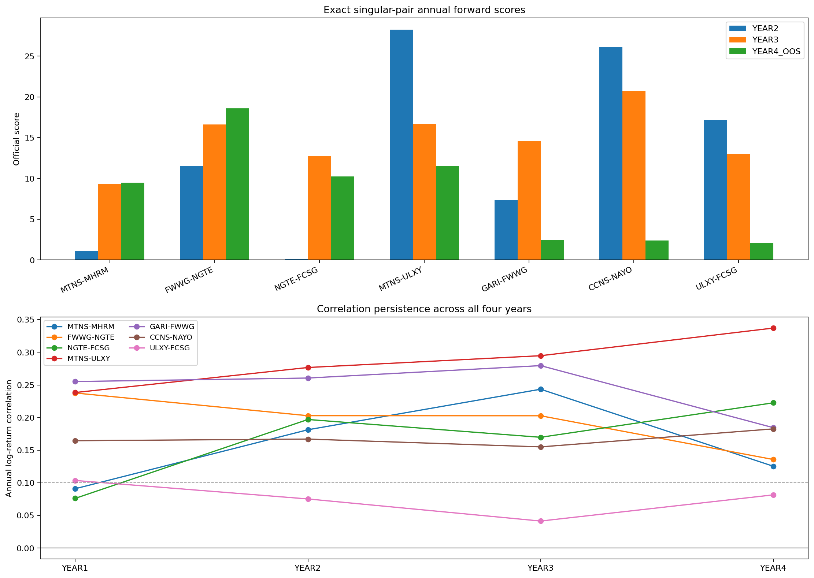

# Annual expanding walk-forward: seven restored pairs

> **Source:** `analysis_outputs/new_tuning_pairs_annual_walkforward/annual_walkforward_report.md` in the team's working repository (relocated here for the public release).

## What was tested

- The exact profiles currently active in `four_sigmas.py`.
- Each pair alone: no ridge, other pairs, conflict votes or netting.
- Exact `eval.py` accounting, \$10k bang-bang asset limits and 1bp fees.
- YEAR2: train/state history 1-250, score 251-500.
- YEAR3: train/state history 1-500, score 501-750.
- YEAR4_OOS: train/state history 1-750, score 751-1000.
- The current parameters were selected with data through day 750, so YEAR2/YEAR3 measure chronological stability; YEAR4 is the only true parameter-selection holdout.
- The correlation-gated replay is a diagnostic candidate, not a change to the submitted strategy. It blocks/flatlines a pair whenever its causal 60-day return correlation is below 0.10.

## Result

| Pair | Correlation | Year return corr Y1/Y2/Y3/Y4 | Baseline scores Y2/Y3/Y4 | Positive years | Y4 PnL | Gate Y4 score | Gate delta | Conclusion |
|---|---|---|---|---:|---:|---:|---:|---|
| MTNS-MHRM | MODERATE | 0.091/0.181/0.243/0.125 | 1.15/9.35/9.47 | 3/3 | \$3,895 | 5.03 | -4.44 | KEEP_WITH_CORRELATION_MONITOR |
| FWWG-NGTE | STRONG | 0.238/0.203/0.203/0.136 | 11.49/16.62/18.60 | 3/3 | \$5,538 | 1.00 | -17.59 | KEEP |
| NGTE-FCSG | MODERATE | 0.076/0.197/0.170/0.223 | 0.13/12.75/10.24 | 3/3 | \$4,137 | 0.35 | -9.89 | KEEP_WITH_CORRELATION_MONITOR |
| MTNS-ULXY | STRONG | 0.238/0.277/0.295/0.337 | 28.26/16.66/11.54 | 3/3 | \$4,854 | 14.11 | +2.58 | KEEP |
| GARI-FWWG | STRONG | 0.255/0.261/0.280/0.185 | 7.32/14.57/2.49 | 3/3 | \$1,863 | 5.42 | +2.92 | KEEP |
| CCNS-NAYO | STRONG | 0.165/0.167/0.155/0.183 | 26.15/20.71/2.40 | 3/3 | \$2,465 | 3.18 | +0.78 | KEEP |
| ULXY-FCSG | FAIL | 0.104/0.075/0.041/0.082 | 17.20/13.00/2.14 | 3/3 | \$1,592 | -0.97 | -3.11 | REJECT_AS_PAIR |

## Exact annual performance

| Pair | Fold | Mode | Score | Mean PnL | Total PnL | Sharpe | Turnover | Entries | Active corr median | Active corr >= 0.10 |
|---|---|---|---:|---:|---:|---:|---:|---:|---:|---:|
| MTNS-MHRM | YEAR2 | baseline | 1.15 | 6.03 | \$1,508 | 0.48 | \$422,491 | 10 | 0.154 | 63% |
| MTNS-MHRM | YEAR2 | gated | -3.72 | -3.72 | \$-930 | -0.39 | \$346,264 | 8 | 0.244 | 100% |
| MTNS-MHRM | YEAR3 | baseline | 9.35 | 14.92 | \$3,729 | 1.30 | \$502,659 | 12 | 0.200 | 77% |
| MTNS-MHRM | YEAR3 | gated | 12.18 | 16.23 | \$4,059 | 1.73 | \$528,276 | 13 | 0.248 | 100% |
| MTNS-MHRM | YEAR4_OOS | baseline | 9.47 | 15.58 | \$3,895 | 1.25 | \$420,402 | 10 | 0.124 | 61% |
| MTNS-MHRM | YEAR4_OOS | gated | 5.03 | 9.91 | \$2,477 | 1.02 | \$381,588 | 9 | 0.155 | 100% |
| FWWG-NGTE | YEAR2 | baseline | 11.49 | 16.66 | \$4,166 | 1.49 | \$608,187 | 15 | 0.258 | 87% |
| FWWG-NGTE | YEAR2 | gated | 7.93 | 12.98 | \$3,246 | 1.25 | \$584,006 | 14 | 0.271 | 100% |
| FWWG-NGTE | YEAR3 | baseline | 16.62 | 20.83 | \$5,208 | 1.99 | \$626,933 | 15 | 0.126 | 68% |
| FWWG-NGTE | YEAR3 | gated | 8.75 | 12.67 | \$3,168 | 1.49 | \$455,519 | 11 | 0.165 | 100% |
| FWWG-NGTE | YEAR4_OOS | baseline | 18.60 | 22.15 | \$5,538 | 2.29 | \$580,002 | 14 | 0.112 | 58% |
| FWWG-NGTE | YEAR4_OOS | gated | 1.00 | 3.97 | \$993 | 0.58 | \$328,002 | 8 | 0.209 | 100% |
| NGTE-FCSG | YEAR2 | baseline | 0.13 | 3.13 | \$781 | 0.21 | \$119,223 | 2 | 0.146 | 79% |
| NGTE-FCSG | YEAR2 | gated | 7.70 | 9.85 | \$2,462 | 1.89 | \$47,262 | 1 | 0.210 | 100% |
| NGTE-FCSG | YEAR3 | baseline | 12.75 | 20.68 | \$5,170 | 1.27 | \$129,268 | 2 | 0.160 | 69% |
| NGTE-FCSG | YEAR3 | gated | 4.31 | 9.39 | \$2,347 | 0.92 | \$104,843 | 2 | 0.185 | 100% |
| NGTE-FCSG | YEAR4_OOS | baseline | 10.24 | 16.55 | \$4,137 | 1.27 | \$146,143 | 3 | 0.171 | 80% |
| NGTE-FCSG | YEAR4_OOS | gated | 0.35 | 3.34 | \$835 | 0.34 | \$123,793 | 3 | 0.192 | 100% |
| MTNS-ULXY | YEAR2 | baseline | 28.26 | 34.60 | \$8,649 | 2.11 | \$440,404 | 10 | 0.224 | 97% |
| MTNS-ULXY | YEAR2 | gated | 32.48 | 38.28 | \$9,571 | 2.37 | \$476,892 | 11 | 0.227 | 100% |
| MTNS-ULXY | YEAR3 | baseline | 16.66 | 22.98 | \$5,746 | 1.62 | \$271,871 | 6 | 0.214 | 82% |
| MTNS-ULXY | YEAR3 | gated | 21.89 | 26.64 | \$6,659 | 2.15 | \$338,132 | 8 | 0.271 | 100% |
| MTNS-ULXY | YEAR4_OOS | baseline | 11.54 | 19.41 | \$4,854 | 1.21 | \$272,869 | 5 | 0.324 | 94% |
| MTNS-ULXY | YEAR4_OOS | gated | 14.11 | 21.57 | \$5,393 | 1.38 | \$427,436 | 9 | 0.330 | 100% |
| GARI-FWWG | YEAR2 | baseline | 7.32 | 12.12 | \$3,029 | 1.23 | \$781,668 | 19 | 0.248 | 81% |
| GARI-FWWG | YEAR2 | gated | 4.00 | 8.25 | \$2,063 | 0.97 | \$657,594 | 16 | 0.331 | 100% |
| GARI-FWWG | YEAR3 | baseline | 14.57 | 19.15 | \$4,789 | 1.78 | \$748,057 | 18 | 0.231 | 88% |
| GARI-FWWG | YEAR3 | gated | 9.71 | 14.54 | \$3,634 | 1.42 | \$626,072 | 15 | 0.249 | 100% |
| GARI-FWWG | YEAR4_OOS | baseline | 2.49 | 7.45 | \$1,863 | 0.71 | \$649,740 | 16 | 0.191 | 72% |
| GARI-FWWG | YEAR4_OOS | gated | 5.42 | 9.70 | \$2,426 | 1.12 | \$559,794 | 14 | 0.255 | 100% |
| CCNS-NAYO | YEAR2 | baseline | 26.15 | 32.57 | \$8,143 | 2.02 | \$247,363 | 5 | 0.166 | 72% |
| CCNS-NAYO | YEAR2 | gated | 19.97 | 25.09 | \$6,273 | 1.98 | \$270,336 | 6 | 0.209 | 100% |
| CCNS-NAYO | YEAR3 | baseline | 20.71 | 27.15 | \$6,786 | 1.79 | \$169,208 | 3 | 0.101 | 51% |
| CCNS-NAYO | YEAR3 | gated | 8.67 | 10.95 | \$2,737 | 1.95 | \$85,565 | 2 | 0.218 | 100% |
| CCNS-NAYO | YEAR4_OOS | baseline | 2.40 | 9.86 | \$2,465 | 0.57 | \$228,402 | 4 | 0.148 | 71% |
| CCNS-NAYO | YEAR4_OOS | gated | 3.18 | 9.04 | \$2,260 | 0.74 | \$264,611 | 6 | 0.200 | 100% |
| ULXY-FCSG | YEAR2 | baseline | 17.20 | 20.81 | \$5,201 | 2.18 | \$684,611 | 17 | 0.097 | 50% |
| ULXY-FCSG | YEAR2 | gated | 7.65 | 10.67 | \$2,668 | 1.59 | \$362,933 | 9 | 0.153 | 100% |
| ULXY-FCSG | YEAR3 | baseline | 13.00 | 16.01 | \$4,003 | 2.08 | \$567,252 | 14 | 0.087 | 37% |
| ULXY-FCSG | YEAR3 | gated | 7.52 | 9.56 | \$2,389 | 1.92 | \$241,766 | 6 | 0.142 | 100% |
| ULXY-FCSG | YEAR4_OOS | baseline | 2.14 | 6.37 | \$1,592 | 0.71 | \$562,880 | 14 | 0.110 | 53% |
| ULXY-FCSG | YEAR4_OOS | gated | -0.97 | -0.97 | \$-241 | -0.13 | \$283,128 | 7 | 0.138 | 100% |

## Correlation evidence

| Pair | Year | Return corr | IID p-value | Level corr (diagnostic) |
|---|---|---:|---:|---:|
| MTNS-MHRM | YEAR1 | 0.091 | 0.1522 | 0.148 |
| MTNS-MHRM | YEAR2 | 0.181 | 0.0041 | 0.449 |
| MTNS-MHRM | YEAR3 | 0.243 | 0.0001 | 0.714 |
| MTNS-MHRM | YEAR4 | 0.125 | 0.0480 | 0.938 |
| FWWG-NGTE | YEAR1 | 0.238 | 0.0002 | -0.126 |
| FWWG-NGTE | YEAR2 | 0.203 | 0.0013 | 0.876 |
| FWWG-NGTE | YEAR3 | 0.203 | 0.0013 | 0.025 |
| FWWG-NGTE | YEAR4 | 0.136 | 0.0322 | 0.759 |
| NGTE-FCSG | YEAR1 | 0.076 | 0.2306 | 0.345 |
| NGTE-FCSG | YEAR2 | 0.197 | 0.0018 | -0.283 |
| NGTE-FCSG | YEAR3 | 0.170 | 0.0073 | -0.052 |
| NGTE-FCSG | YEAR4 | 0.223 | 0.0004 | 0.748 |
| MTNS-ULXY | YEAR1 | 0.238 | 0.0001 | 0.410 |
| MTNS-ULXY | YEAR2 | 0.277 | 0.0000 | 0.514 |
| MTNS-ULXY | YEAR3 | 0.295 | 0.0000 | 0.890 |
| MTNS-ULXY | YEAR4 | 0.337 | 0.0000 | 0.729 |
| GARI-FWWG | YEAR1 | 0.255 | 0.0000 | 0.144 |
| GARI-FWWG | YEAR2 | 0.261 | 0.0000 | 0.836 |
| GARI-FWWG | YEAR3 | 0.280 | 0.0000 | 0.683 |
| GARI-FWWG | YEAR4 | 0.185 | 0.0035 | 0.233 |
| CCNS-NAYO | YEAR1 | 0.165 | 0.0093 | 0.120 |
| CCNS-NAYO | YEAR2 | 0.167 | 0.0083 | 0.414 |
| CCNS-NAYO | YEAR3 | 0.155 | 0.0143 | -0.288 |
| CCNS-NAYO | YEAR4 | 0.183 | 0.0038 | 0.200 |
| ULXY-FCSG | YEAR1 | 0.104 | 0.1028 | -0.720 |
| ULXY-FCSG | YEAR2 | 0.075 | 0.2363 | 0.574 |
| ULXY-FCSG | YEAR3 | 0.041 | 0.5147 | -0.776 |
| ULXY-FCSG | YEAR4 | 0.082 | 0.1996 | 0.446 |

## Interpretation

- Return correlation is used for structural classification. Price-level correlation is diagnostic only because common trends can make it spurious.
- Pearson p-values use the IID approximation and are supporting evidence, not a standalone keep rule.
- STRONG means same correlation sign in all four years, minimum yearly |r| >= 0.10, at least 3/4 nominally significant years, and >= 60% of active observations above the 0.10 causal correlation floor.
- MODERATE keeps the same sign, median yearly |r| >= 0.10, at least 2/4 significant years, and >= 50% active correlation coverage.
- No production pair is changed automatically by this report.

---

## Figures

*Annual expanding walk-forward.*
