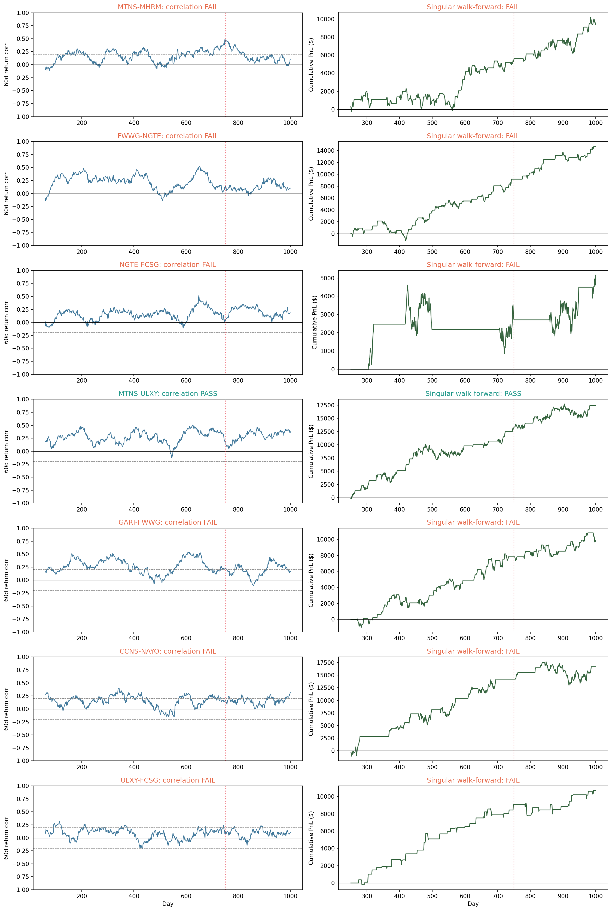

# Seven restored pairs: correlation and singular walk-forward validation

> **Source:** `analysis_outputs/new_tuning_pairs_walkforward/walkforward_report.md` in the team's working repository (relocated here for the public release).

## Method

- Exact fixed profiles currently active in `four_sigmas.py`.
- Six sequential 125-day forward folds after an initial 250 days.
- Each fold starts flat; adaptive state is warmed using past data only.
- Pair trades alone with current \$10k bang-bang legs and 1bp commission.
- Ridge, other pairs, conflict voting and portfolio netting are disabled.
- DEV1-DEV4 are chronological stability replays, not unbiased parameter tests because the profiles were selected from data through day 750.
- OOS1/OOS2 (days 751-1000) are the untouched holdout assessment.

Correlation PASS requires |forward return correlation| >= 0.20 in at least 5/6 folds, a common sign in at least 5/6 folds, and at least 50% of 60-day rolling windows at |correlation| >= 0.20.

## Summary

| Pair | Corr | Year corr (Y1/Y2/Y3/Y4) | Forward corr (6 folds) | 60d coverage | Positive folds | DEV score | OOS score | OOS decay | OOS folds + | Full score | Result |
|---|---|---|---|---:|---:|---:|---:|---:|---:|---:|---|
| MTNS-MHRM | FAIL | 0.09/0.18/0.24/0.13 | 0.18/0.18/0.15/0.33/0.16/0.10 | 41% | 6/6 | 5.31 | 9.46 | +78% | 2/2 | 6.64 | FAIL |
| FWWG-NGTE | FAIL | 0.24/0.20/0.20/0.14 | 0.25/0.15/0.22/0.19/0.12/0.16 | 54% | 6/6 | 13.65 | 18.60 | +36% | 2/2 | 15.30 | FAIL |
| NGTE-FCSG | FAIL | 0.08/0.20/0.17/0.22 | 0.19/0.17/0.18/0.16/0.33/0.12 | 39% | 3/6 | 1.15 | 4.08 | +256% | 1/2 | 1.97 | FAIL |
| MTNS-ULXY | PASS | 0.24/0.28/0.29/0.34 | 0.27/0.28/0.31/0.28/0.33/0.34 | 78% | 6/6 | 20.19 | 8.43 | -58% | 2/2 | 16.17 | PASS |
| GARI-FWWG | FAIL | 0.26/0.26/0.28/0.18 | 0.40/0.09/0.38/0.21/0.11/0.26 | 63% | 6/6 | 10.91 | 2.49 | -77% | 2/2 | 7.85 | FAIL |
| CCNS-NAYO | FAIL | 0.16/0.17/0.16/0.18 | 0.24/0.05/0.12/0.17/0.13/0.23 | 34% | 6/6 | 21.89 | 2.39 | -89% | 2/2 | 14.53 | FAIL |
| ULXY-FCSG | FAIL | 0.10/0.08/0.04/0.08 | 0.15/-0.00/-0.01/0.10/0.06/0.10 | 8% | 5/6 | 15.03 | 2.14 | -86% | 1/2 | 10.48 | FAIL |

## Fold detail

| Pair | Fold | Days | Trailing corr | Forward corr | Level corr | Score | Mean PnL | Sharpe | Entries | Active days |
|---|---|---|---:|---:|---:|---:|---:|---:|---:|---:|
| MTNS-MHRM | DEV1 | 251-375 | 0.091 | 0.175 | -0.240 | 0.84 | 5.12 | 0.44 | 4 | 58 |
| MTNS-MHRM | DEV2 | 376-500 | 0.163 | 0.177 | 0.767 | 0.12 | 2.80 | 0.22 | 6 | 82 |
| MTNS-MHRM | DEV3 | 501-625 | 0.181 | 0.147 | -0.024 | 26.64 | 30.83 | 2.52 | 7 | 80 |
| MTNS-MHRM | DEV4 | 626-750 | 0.171 | 0.332 | 0.491 | 1.59 | 6.11 | 0.59 | 5 | 68 |
| MTNS-MHRM | OOS1 | 751-875 | 0.243 | 0.158 | 0.630 | 4.93 | 10.38 | 0.95 | 4 | 60 |
| MTNS-MHRM | OOS2 | 876-1000 | 0.253 | 0.098 | 0.800 | 14.33 | 20.77 | 1.49 | 7 | 79 |
| FWWG-NGTE | DEV1 | 251-375 | 0.238 | 0.250 | 0.533 | 0.05 | 1.86 | 0.16 | 6 | 62 |
| FWWG-NGTE | DEV2 | 376-500 | 0.292 | 0.154 | 0.892 | 26.50 | 29.88 | 2.80 | 9 | 59 |
| FWWG-NGTE | DEV3 | 501-625 | 0.203 | 0.222 | 0.726 | 10.04 | 14.77 | 1.46 | 7 | 73 |
| FWWG-NGTE | DEV4 | 626-750 | 0.186 | 0.189 | 0.246 | 23.14 | 26.89 | 2.48 | 8 | 53 |
| FWWG-NGTE | OOS1 | 751-875 | 0.203 | 0.119 | 0.630 | 24.02 | 26.64 | 3.03 | 6 | 34 |
| FWWG-NGTE | OOS2 | 876-1000 | 0.156 | 0.163 | -0.437 | 13.06 | 17.66 | 1.68 | 8 | 50 |
| NGTE-FCSG | DEV1 | 251-375 | 0.076 | 0.187 | -0.703 | 17.40 | 19.78 | 2.71 | 1 | 19 |
| NGTE-FCSG | DEV2 | 376-500 | 0.127 | 0.173 | 0.527 | -2.26 | -2.26 | -0.14 | 1 | 83 |
| NGTE-FCSG | DEV3 | 501-625 | 0.197 | 0.176 | 0.851 | 0.00 | 0.00 | 0.00 | 0 | 0 |
| NGTE-FCSG | DEV4 | 626-750 | 0.171 | 0.162 | -0.227 | 0.45 | 4.14 | 0.35 | 1 | 45 |
| NGTE-FCSG | OOS1 | 751-875 | 0.170 | 0.327 | 0.691 | -7.14 | -7.14 | -1.42 | 1 | 18 |
| NGTE-FCSG | OOS2 | 876-1000 | 0.246 | 0.124 | -0.097 | 19.98 | 26.75 | 1.72 | 2 | 84 |
| MTNS-ULXY | DEV1 | 251-375 | 0.238 | 0.270 | 0.297 | 16.52 | 23.73 | 1.51 | 5 | 80 |
| MTNS-ULXY | DEV2 | 376-500 | 0.244 | 0.279 | 0.670 | 39.86 | 45.44 | 2.67 | 6 | 77 |
| MTNS-ULXY | DEV3 | 501-625 | 0.277 | 0.310 | 0.701 | 3.35 | 10.88 | 0.67 | 2 | 100 |
| MTNS-ULXY | DEV4 | 626-750 | 0.290 | 0.277 | 0.834 | 23.04 | 26.79 | 2.48 | 4 | 43 |
| MTNS-ULXY | OOS1 | 751-875 | 0.295 | 0.333 | 0.673 | 21.23 | 28.06 | 1.76 | 4 | 92 |
| MTNS-ULXY | OOS2 | 876-1000 | 0.307 | 0.343 | 0.130 | 0.36 | 4.58 | 0.29 | 1 | 100 |
| GARI-FWWG | DEV1 | 251-375 | 0.255 | 0.400 | 0.825 | 17.78 | 20.66 | 2.48 | 10 | 45 |
| GARI-FWWG | DEV2 | 376-500 | 0.370 | 0.087 | 0.162 | 0.34 | 3.57 | 0.32 | 9 | 64 |
| GARI-FWWG | DEV3 | 501-625 | 0.261 | 0.381 | 0.761 | 11.50 | 14.99 | 1.82 | 8 | 57 |
| GARI-FWWG | DEV4 | 626-750 | 0.234 | 0.210 | 0.480 | 17.95 | 23.32 | 1.83 | 10 | 56 |
| GARI-FWWG | OOS1 | 751-875 | 0.280 | 0.106 | -0.416 | 0.09 | 2.31 | 0.20 | 7 | 60 |
| GARI-FWWG | OOS2 | 876-1000 | 0.165 | 0.262 | 0.616 | 8.13 | 12.59 | 1.35 | 9 | 54 |
| CCNS-NAYO | DEV1 | 251-375 | 0.165 | 0.244 | 0.266 | 30.62 | 35.75 | 2.44 | 2 | 37 |
| CCNS-NAYO | DEV2 | 376-500 | 0.205 | 0.052 | 0.376 | 21.70 | 29.40 | 1.68 | 3 | 76 |
| CCNS-NAYO | DEV3 | 501-625 | 0.167 | 0.121 | -0.127 | 27.88 | 33.58 | 2.21 | 2 | 63 |
| CCNS-NAYO | DEV4 | 626-750 | 0.090 | 0.169 | 0.178 | 7.70 | 14.97 | 1.03 | 1 | 56 |
| CCNS-NAYO | OOS1 | 751-875 | 0.155 | 0.134 | 0.319 | 7.10 | 13.80 | 1.03 | 4 | 51 |
| CCNS-NAYO | OOS2 | 876-1000 | 0.159 | 0.234 | 0.725 | 0.45 | 5.91 | 0.29 | 1 | 111 |
| ULXY-FCSG | DEV1 | 251-375 | 0.104 | 0.150 | 0.664 | 12.51 | 15.04 | 2.22 | 8 | 12 |
| ULXY-FCSG | DEV2 | 376-500 | 0.107 | -0.003 | 0.665 | 21.96 | 25.73 | 2.41 | 8 | 18 |
| ULXY-FCSG | DEV3 | 501-625 | 0.075 | -0.009 | -0.497 | 12.14 | 14.38 | 2.33 | 7 | 9 |
| ULXY-FCSG | DEV4 | 626-750 | -0.001 | 0.100 | -0.494 | 14.01 | 17.65 | 1.96 | 7 | 21 |
| ULXY-FCSG | OOS1 | 751-875 | 0.041 | 0.056 | -0.456 | -4.89 | -4.89 | -0.49 | 7 | 15 |
| ULXY-FCSG | OOS2 | 876-1000 | 0.073 | 0.101 | 0.440 | 14.76 | 17.63 | 2.27 | 7 | 15 |

## Interpretation guardrails

- Return correlation is the primary co-movement check. Log-price level correlation is shown because it is intuitive, but it can be spurious.
- A profitable pair can fail correlation, which means it is behaving more like an idiosyncratic mean-reversion trade than a reliable pair.
- No pair is removed automatically by this diagnostic.

---

## Figures

*Walk-forward correlation and PnL of the seven restored pairs.*
