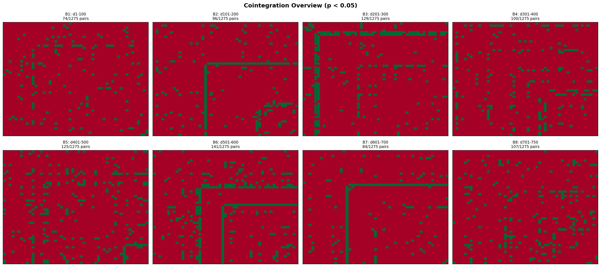

# Short-window cointegration and row-hub analysis

> **Source:** `research/cointegration/cointegration_output/short_regime_analysis/README.md` in the team's working repository (relocated here for the public release).

Large values in the existing block plots are `-log10(raw p)`, so they represent
very small raw p-values. They are relationship-strength diagnostics, not spread
moneyness or expected profit.

## Main findings

- 87 pairs were significant in no more than two 50-day blocks while reaching a
  peak strength above 3 (`raw p < 0.001`).
- There were 60 asset/block row-hub episodes with at least ten significant
  links. The largest was AMRP in block 5 with 38 links.
- Hub degree had a small association with next-block link survival
  (`Spearman rho=0.266`) but no significant association with forward PnL
  (`rho=0.150`, `p=0.276`).
- Trading the five strongest links of every row hub produced only a 51.9% hit
  rate overall. In the holdout interval it averaged -206 bp per detection with
  a 42.0% hit rate.
- Naively trading every `raw p < 0.001` spike averaged +591 bp before day 500
  but -380 bp in the holdout, where only 23.7% of detections were profitable.
- The strict confirmed short-window detector generated only five independent
  episodes. Four occurred pre-500; only one occurred in the holdout. This is too
  little evidence to promote it to a material production sleeve.
- The persistent core-pair detector remained the only consistent group in this
  test: +738 bp pre-500 and +624 bp holdout per traded checkpoint, although its
  sample is also small.

## Interpretation of bright rows

A bright row means that one asset can be fitted against many others inside that
same short block. It can be caused by a temporary common trend, a locally
stationary asset, one-direction Engle-Granger asymmetry, or genuine common-factor
structure. It does not imply that every link is an independent mean-reverting
trade. Trading every cell also repeats the same hub exposure many times.

A hub-versus-basket formulation was tested as a less crowded alternative. Its
mean fell from approximately +261 bp pre-500 to +10 bp in the holdout, with a
-1,544 bp worst episode. It should therefore remain a research indicator rather
than a production position.

## Runtime recommendation

1. Keep the 250-day persistent core-pair sleeve for actual mean reversion.
2. Calculate 50/75-day row degree and maximum `-log10(p)` as regime telemetry,
   not as an automatic trade signal.
3. For experimental episodic activation, require all of:
   - bidirectional residual DF strength;
   - confirmation at an endpoint 10 days earlier;
   - non-stationary individual asset levels;
   - positive, stable hedge ratio across both halves;
   - residual half-life between 1.5 and 20 days;
   - current local spread `|z| >= 1.5` and `< 4`;
   - asset-disjoint selection and a maximum of one to three pairs.
4. Treat a row hub as broken when its hedge ratios disagree, its links have
   opposing z-score directions, or the hub asset itself is locally stationary.
5. Paper-trade new episodic detections or use very small sizing until more
   genuinely unseen data establishes an out-of-sample edge.

## Outputs

- `transient_pair_strength_heatmap.png`: top transient pair spikes by block.
- `transient_pair_case_studies.png`: twelve pair timelines with next-period PnL.
- `hub_degree_heatmap.png`: row degree for every asset and block.
- `hub_episode_diagnostics.png`: persistence and forward-PnL hub diagnostics.
- `runtime_detector_comparison.png`: aggregate detector comparison.
- `runtime_detector_period_comparison.png`: pre-500 versus holdout comparison.
- CSV files contain the underlying pair, hub, event and detector metrics.

Regenerate everything with:

```powershell
py short_window_cointegration_analysis.py
```

---

## Figures



*Cointegration overview across 100-day blocks.*
