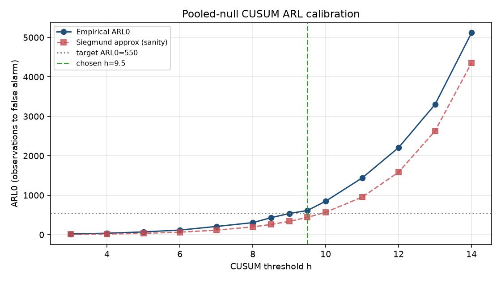

# CUSUM ARL calibration (pooled null)

> **Source:** `research/cusum_legacy/arl_calibration/arl_calibration_report.md` in the team's working repository (relocated here for the public release).

- kappa: `0.25`
- target ARL0: `550.0` (named parameter — raise to reduce false alarms, lower to detect sooner)
- chosen h: `9.5`
- achieved empirical ARL0: `614.3`
- pooled pairs: SMAH/NGTE[0,170), SMAH/ILVX[0,200), AENO/NWIG[0,200), EORC/NGTE[0,200), HUXZ/ACAC[0,200)
- pooled calm observations (concat length): `870`

## h vs ARL0

| h | ARL0 empirical | ARL0 Siegmund | censored |
|---|---|---|---|
| 3.00 | 18.5 | 7.9 | 0/300 |
| 4.00 | 37.3 | 17.6 | 0/300 |
| 5.00 | 70.8 | 34.7 | 0/300 |
| 6.00 | 117.3 | 64.3 | 0/300 |
| 7.00 | 209.1 | 114.5 | 0/300 |
| 8.00 | 305.6 | 198.4 | 0/300 |
| 8.50 | 431.0 | 259.4 | 0/300 |
| 9.00 | 537.8 | 338.1 | 0/300 |
| 9.50 | 614.3 | 439.3 | 0/300 |
| 10.00 | 850.1 | 569.7 | 0/300 |
| 11.00 | 1439.7 | 952.8 | 0/300 |
| 12.00 | 2209.1 | 1585.7 | 0/300 |
| 13.00 | 3303.5 | 2630.6 | 2/300 |
| 14.00 | 5118.2 | 4354.5 | 4/300 |

---

## Figures

*CUSUM threshold h vs in-control average run length.*
