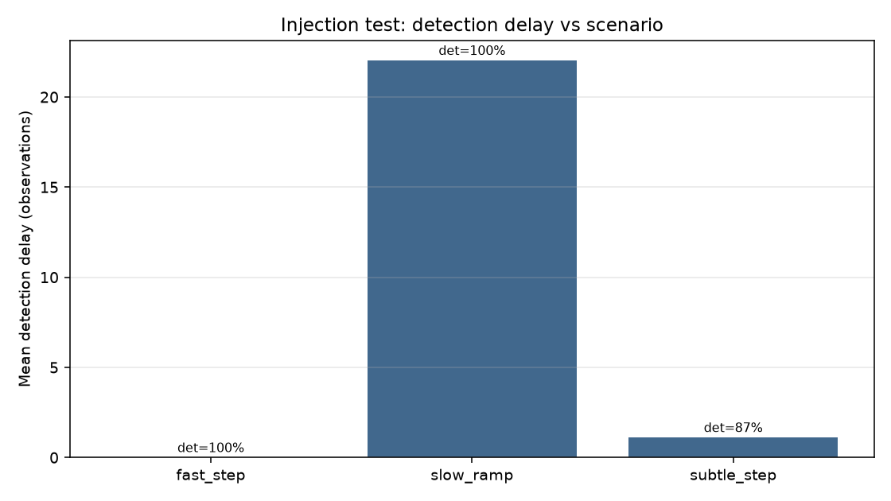

# Synthetic injection test report

> **Source:** `research/cusum_legacy/injection_test/injection_test_report.md` in the team's working repository (relocated here for the public release).

- kappa: `0.25`
- h (ARL-calibrated): `9.5`
- calibrated ARL0 target/achieved: `614.3`
- no-break trials: `60`
- no-break mean ARL (measured): `869.3`
- no-break false-alarm rate per obs: `0.00115033`
- implied FA rate from calibrated ARL0: `0.00162796`

Mismatch between measured no-break ARL and calibrated ARL0 is reported explicitly (bootstrap / finite-sample effects), not assumed away.

## Detection delay by scenario

| scenario | kind | mag | dur | mean delay | median delay | detect rate | reseed ok |
|---|---|---|---|---|---|---|---|
| fast_step | step | 0.2 | 1 | 0.0 | 0.0 | 1.00 | 0.77 |
| slow_ramp | ramp | 0.35 | 40 | 22.0 | 21.0 | 1.00 | 0.50 |
| subtle_step | subtle_step | 0.15 | 1 | 1.1 | 0.0 | 0.87 | 0.87 |

---

## Figures

*Detection delay vs injected break magnitude.*
