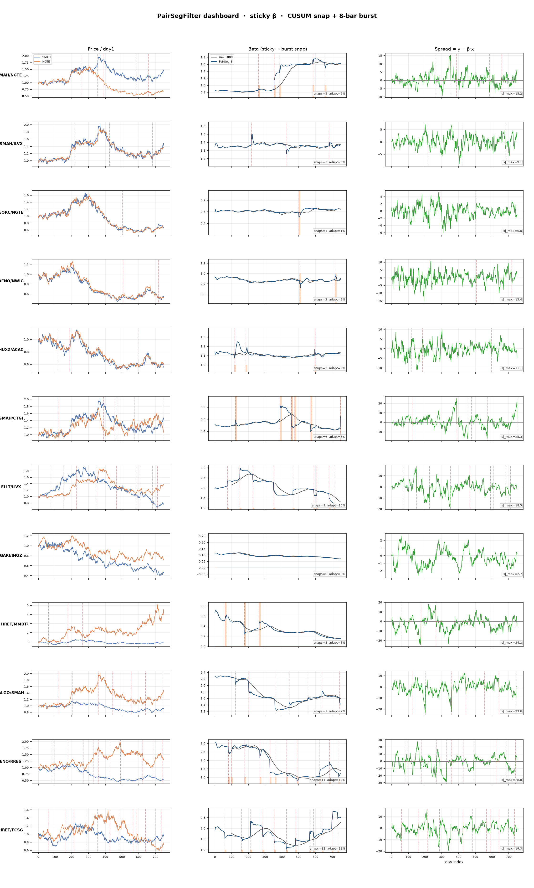

# Multi-pair PairSegFilter dashboard

> **Source:** `cusum_output/multi_pair_dashboard/multi_pair_dashboard_report.md` in the team's working repository (relocated here for the public release).

Filter: `adaptive_beta.PairSegFilter` (sticky through-origin + CUSUM snap + 8-bar burst).

| Pair | Snaps | Adapt % | max|spread| | Stable β mad | final h |
|---|---:|---:|---:|---:|---:|
| SMAH/NGTE | 5 | 5.3% | 15.18 | 0.0025 | 8.81 |
| SMAH/ILVX | 3 | 3.2% | 9.05 | 0.0012 | 9.27 |
| EORC/NGTE | 1 | 1.1% | 6.04 | 0.0004 | 9.75 |
| AENO/NWIG | 2 | 2.1% | 15.40 | 0.0008 | 9.51 |
| HUXZ/ACAC | 3 | 3.2% | 11.14 | 0.0011 | 9.27 |
| SMAH/CTGI | 6 | 5.5% | 25.26 | 0.0020 | 8.59 |
| ELLT/ILVX | 9 | 9.6% | 18.51 | 0.0067 | 7.96 |
| GARI/IHOZ | 0 | 0.0% | 2.67 | 0.0002 | 10.00 |
| HRET/MMBT | 3 | 3.2% | 24.25 | 0.0021 | 9.27 |
| ALGO/SMAH | 7 | 7.2% | 23.58 | 0.0035 | 8.38 |
| AENO/RRES | 11 | 11.7% | 28.80 | 0.0093 | 8.43 |
| HRET/FCSG | 12 | 12.8% | 19.33 | 0.0094 | 7.79 |

Plot: `multi_pair_beta_dashboard.png`

---

## Figures

*PairSegFilter beta paths across twelve pairs.*
