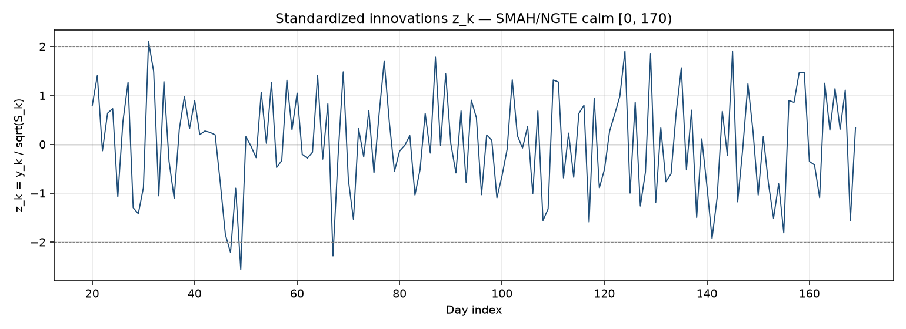

# Kalman filter validation — SMAH/NGTE

> **Source:** `research/cusum_legacy/kalman_validation_output/SMAH_NGTE_validation_report.md` in the team's working repository (relocated here for the public release).

## Scope

Base filter + calm-regime Q/R calibration + whiteness gate + drift-in-Q diagnostic. No CUSUM, switching, or adaptive-Q logic.

## Calm window

- Indices: `[0, 170)` (exclusive end)
- OLS init window: `20`
- Innovations scored / tested: `150`

## Fitted Q / R

- Q (2×2): `[[0.000777898, 0], [0, 0.000235353]]`
- R (1×1): `[[0.0644977]]`
- Negative log-likelihood: `199.069712`
- Optimizer success: `True`
- Optimizer message: `CONVERGENCE: RELATIVE REDUCTION OF F <= FACTR*EPSMCH`

## Whiteness gate (Ljung-Box)

- Significance threshold: `0.05` (stated)
- Lags: `10`
- Statistic: `17.049250`
- p-value: `0.073281`
- **Verdict: PASS**
- Note: Innovations consistent with white noise at alpha=0.05 (p=0.0733 >= 0.05).

## Drift-in-Q diagnostic (ARCH / rolling variance)

- Rolling variance window: `25` (default 25)
- Rolling var of z_k: min=`0.561101`, max=`1.420615`, range=`0.859514`
- ARCH LM lags: `5`
- ARCH LM statistic: `7.618846`
- ARCH LM p-value: `0.178531`
- **Verdict: no evidence of time-varying noise - fixed Q is adequate**
- Note: Engle ARCH LM p=0.1785 >= 0.05; rolling innovation variance stays consistent with constant noise.

## Bottom line

no evidence of time-varying noise - fixed Q is adequate

---

## Figures

*SMAH/NGTE standardised Kalman innovations.*
