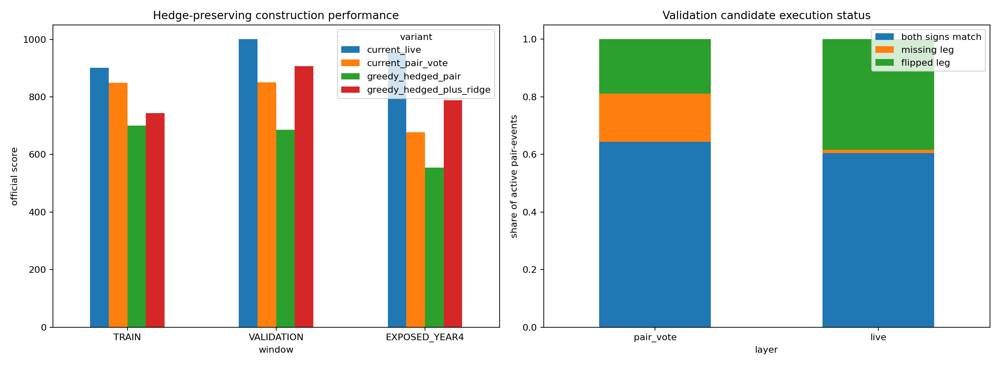

# Pair hedge execution audit

> **Source:** `analysis_outputs/pair_hedge_execution/report.md` in the team's working repository (relocated here for the public release).

Each PairAgent's intended vector is exactly dynamic-beta hedged. The audit tests whether portfolio construction preserves it.

## Execution integrity

| Period | Layer | Pair-events | Both signs | Missing leg | Flipped leg | Median hedge error | Isolated hedge error |
|---|---|---:|---:|---:|---:|---:|---:|
| TRAIN | pair_vote | 10,170 | 64.4% | 17.0% | 18.6% | 13.3% | 4.1% |
| TRAIN | live | 10,170 | 61.1% | 0.6% | 38.3% | 15.8% | 5.6% |
| VALIDATION | pair_vote | 9,920 | 64.4% | 16.7% | 18.9% | 14.7% | 3.7% |
| VALIDATION | live | 9,920 | 60.5% | 1.1% | 38.4% | 17.1% | 4.6% |
| EXPOSED_YEAR4 | pair_vote | 10,015 | 63.0% | 17.0% | 20.0% | 15.2% | 3.8% |
| EXPOSED_YEAR4 | live | 10,015 | 59.1% | 0.0% | 40.9% | 18.3% | 10.9% |

The normalized hedge error is `abs(beta*d_y + d_x) / (abs(beta*d_y) + abs(d_x))`; zero is an exact pair hedge and one is completely unhedged.

## Portfolio scores

| Variant | Train A | Train B | Train | Validation A | Validation B | Validation | Exposed Year 4 |
|---|---:|---:|---:|---:|---:|---:|---:|
| clipped_vector_pair | +798.45 | +857.96 | +828.29 | +922.77 | +721.60 | +822.30 | +650.59 |
| current_live | +769.37 | +1033.48 | +901.76 | +923.66 | +1077.09 | +1000.41 | +956.69 |
| current_pair_vote | +813.37 | +885.24 | +849.40 | +943.90 | +757.85 | +850.97 | +677.19 |
| global_scaled_hedged_pair | +336.89 | +393.56 | +365.23 | +409.23 | +302.42 | +355.86 | +258.72 |
| greedy_hedged_pair | +671.65 | +729.41 | +700.57 | +810.55 | +559.71 | +685.19 | +553.91 |
| greedy_hedged_plus_ridge | +668.08 | +819.68 | +744.03 | +882.01 | +933.26 | +907.67 | +788.62 |
| greedy_hedged_plus_ridge_flat_only | +829.53 | +891.74 | +860.67 | +942.59 | +782.98 | +862.90 | +741.32 |
| lp_equal_hedged_pair | +609.32 | +740.52 | +675.03 | +891.68 | +632.35 | +762.06 | +524.31 |
| lp_equal_hedged_plus_ridge | +646.51 | +839.21 | +743.10 | +942.67 | +973.09 | +957.94 | +756.66 |
| lp_equal_hedged_plus_ridge_flat_only | +760.33 | +893.80 | +827.13 | +1003.33 | +825.48 | +914.52 | +681.87 |
| lp_priority_hedged_pair | +646.96 | +780.12 | +713.60 | +845.32 | +592.14 | +718.74 | +541.93 |
| lp_priority_hedged_plus_ridge | +662.30 | +870.19 | +766.47 | +899.86 | +946.38 | +923.16 | +771.41 |
| lp_priority_hedged_plus_ridge_flat_only | +817.72 | +923.87 | +870.85 | +966.37 | +810.31 | +888.45 | +708.23 |

## Greedy hedge-preserving capacity

- Development active pair-events: **20,090**.
- Fully filled: **45.7%**.
- Partially filled: **15.5%**.
- Unfilled: **38.8%**.

A production correction must improve aggregate train and validation without a materially negative chronological half. Exposed Year 4 is descriptive and is not used for selection.

---

## Figures

*Pair hedge execution integrity.*
