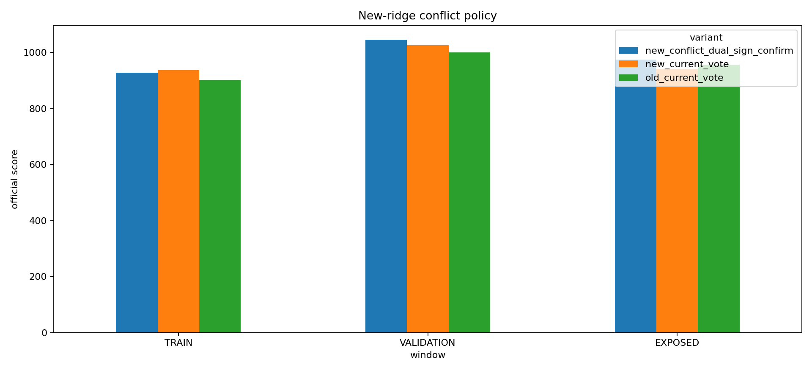

# New-ridge conflict policy

> **Source:** `analysis_outputs/ridge_conflict_policy/report.md` in the team's working repository (relocated here for the public release).

Selected before exposed evaluation: **new_conflict_dual_sign_confirm**.

## Development policy deltas versus old production voting

| Policy | Train | Validation | Train A | Train B | Val A | Val B | Positive halves | Worst half | Pass |
|---|---:|---:|---:|---:|---:|---:|---:|---:|---|
| new_current_vote | +35.25 | +25.37 | +11.19 | +59.18 | +25.69 | +25.13 | 4/4 | +11.19 | yes |
| new_pair_priority_full_deadlock | +156.12 | +24.40 | +246.12 | +66.65 | +153.77 | -105.18 | 3/4 | -105.18 | no |
| new_pair_priority_quarter_deadlock | +111.11 | -5.83 | +220.71 | +2.05 | +127.87 | -139.77 | 3/4 | -139.77 | no |
| new_pair_priority_no_deadlock | +95.86 | -16.14 | +212.11 | -19.84 | +119.08 | -151.62 | 2/4 | -151.62 | no |
| new_conflict_flat_full_deadlock | -84.73 | -79.23 | -24.20 | -144.97 | -16.18 | -142.34 | 0/4 | -144.97 | no |
| new_conflict_old_model | +25.18 | +22.91 | +30.41 | +20.12 | +29.11 | +16.75 | 4/4 | +16.75 | yes |
| new_conflict_dual_sign_confirm | +26.33 | +44.95 | +27.45 | +25.39 | +37.56 | +52.38 | 4/4 | +25.39 | yes |
| new_conflict_dual_min_strength | +27.01 | +28.20 | +39.32 | +14.97 | +44.93 | +11.48 | 4/4 | +11.48 | yes |
| new_conflict_dual_average_vote | +25.47 | +43.42 | +37.64 | +13.50 | +31.78 | +55.10 | 4/4 | +13.50 | yes |

## Frozen comparison

| Variant | Train | Validation | Exposed A | Exposed B | Exposed |
|---|---:|---:|---:|---:|---:|
| new_conflict_dual_sign_confirm | +928.10 | +1045.36 | +1314.77 | +632.95 | +975.10 |
| new_current_vote | +937.01 | +1025.79 | +1307.35 | +574.65 | +942.41 |
| old_current_vote | +901.76 | +1000.41 | +1277.48 | +634.15 | +956.69 |
| pair_only | +849.40 | +850.97 | +756.45 | +597.81 | +677.19 |

## Selected 50-day blocks

| Days | Score | Mean/day | Total PnL | Sharpe |
|---|---:|---:|---:|---:|
| 251-300 | +774.02 | \$+789 | \$+39,447 | +7.20 |
| 301-350 | +816.82 | \$+832 | \$+41,610 | +7.28 |
| 351-400 | +974.79 | \$+989 | \$+49,446 | +8.31 |
| 401-450 | +695.26 | \$+706 | \$+35,300 | +8.04 |
| 451-500 | +1378.38 | \$+1,388 | \$+69,398 | +11.99 |
| 501-550 | +835.79 | \$+850 | \$+42,483 | +7.76 |
| 551-600 | +923.13 | \$+934 | \$+46,676 | +9.42 |
| 601-650 | +1402.82 | \$+1,412 | \$+70,585 | +12.57 |
| 651-700 | +1202.93 | \$+1,215 | \$+60,733 | +10.13 |
| 701-750 | +860.75 | \$+874 | \$+43,692 | +8.11 |
| 751-800 | +1594.61 | \$+1,603 | \$+80,141 | +13.93 |
| 801-850 | +1346.05 | \$+1,355 | \$+67,774 | +11.94 |
| 851-900 | +502.01 | \$+528 | \$+26,386 | +4.42 |
| 901-950 | +497.82 | \$+517 | \$+25,857 | +5.08 |
| 951-1000 | +925.05 | \$+942 | \$+47,113 | +7.33 |

## Deadlock and overlap frequency

- Development mean deadlocks/day: **3.00**.
- Exposed mean deadlocks/day: **2.90**.
- Development mean true conflicts/day: **11.84**.
- Exposed mean true conflicts/day: **12.91**.

Days 751-1000 were not used to choose the policy.

---

## Figures

*Ridge conflict-policy development deltas.*
