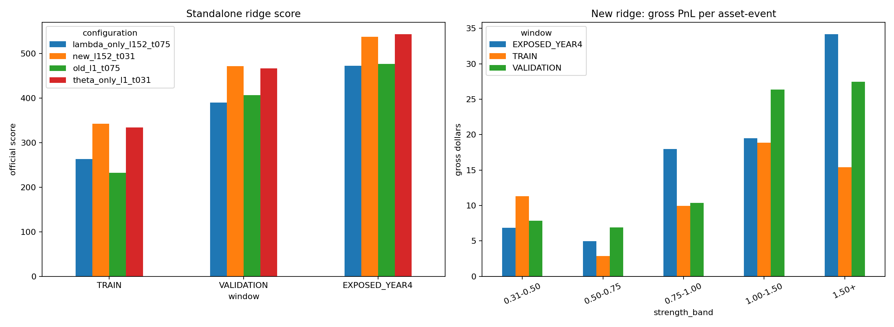

# Ridge parameter and conflict attribution

> **Source:** `analysis_outputs/ridge_parameter_conflicts/report.md` in the team's working repository (relocated here for the public release).

The production strategy is unchanged. Days 751-1000 are already exposed and are used only for descriptive attribution.

## Standalone scores

| Configuration | Train A | Train B | Train | Validation A | Validation B | Validation | Exposed A | Exposed B | Exposed |
|---|---:|---:|---:|---:|---:|---:|---:|---:|---:|
| lambda_only_l152_t075 | +188.27 | +334.93 | +262.82 | +211.00 | +565.34 | +389.61 | +806.31 | +120.83 | +471.84 |
| new_l152_t031 | +217.07 | +463.10 | +342.43 | +329.63 | +611.42 | +471.25 | +958.99 | +93.36 | +536.84 |
| old_l1_t075 | +163.97 | +298.42 | +232.19 | +249.44 | +560.47 | +406.08 | +818.93 | +117.38 | +476.38 |
| theta_only_l1_t031 | +178.39 | +482.25 | +333.53 | +323.09 | +608.34 | +466.22 | +971.79 | +92.91 | +542.83 |

## Combined pair-plus-ridge scores

| Configuration | Train A | Train B | Train | Validation A | Validation B | Validation | Exposed A | Exposed B | Exposed |
|---|---:|---:|---:|---:|---:|---:|---:|---:|---:|
| lambda_only_l152_t075 | +778.55 | +1055.61 | +917.45 | +932.11 | +1113.51 | +1022.83 | +1239.41 | +608.66 | +925.02 |
| new_l152_t031 | +780.56 | +1092.66 | +937.01 | +949.35 | +1102.22 | +1025.79 | +1307.35 | +574.65 | +942.41 |
| old_l1_t075 | +769.37 | +1033.48 | +901.76 | +923.66 | +1077.09 | +1000.41 | +1277.48 | +634.15 | +956.69 |
| theta_only_l1_t031 | +800.89 | +1106.97 | +954.33 | +942.34 | +1087.74 | +1015.04 | +1361.04 | +600.14 | +982.11 |

## Standalone PnL delivered into the combined book

| Configuration | Window | Standalone PnL | Combined incremental PnL | PnL capture | Standalone score | Combined score delta |
|---|---|---:|---:|---:|---:|---:|
| old_l1_t075 | TRAIN | \$+66,594 | \$+13,662 | 20.5% | +232.19 | +52.36 |
| old_l1_t075 | VALIDATION | \$+105,749 | \$+38,052 | 36.0% | +406.08 | +149.44 |
| old_l1_t075 | EXPOSED_YEAR4 | \$+124,301 | \$+70,810 | 57.0% | +476.38 | +279.50 |
| lambda_only_l152_t075 | TRAIN | \$+73,411 | \$+17,562 | 23.9% | +262.82 | +68.04 |
| lambda_only_l152_t075 | VALIDATION | \$+101,722 | \$+43,642 | 42.9% | +389.61 | +171.86 |
| lambda_only_l152_t075 | EXPOSED_YEAR4 | \$+123,159 | \$+62,897 | 51.1% | +471.84 | +247.83 |
| theta_only_l1_t031 | TRAIN | \$+93,357 | \$+27,097 | 29.0% | +333.53 | +104.93 |
| theta_only_l1_t031 | VALIDATION | \$+122,685 | \$+42,188 | 34.4% | +466.22 | +164.07 |
| theta_only_l1_t031 | EXPOSED_YEAR4 | \$+143,518 | \$+77,544 | 54.0% | +542.83 | +304.92 |
| new_l152_t031 | TRAIN | \$+95,428 | \$+22,862 | 24.0% | +342.43 | +87.61 |
| new_l152_t031 | VALIDATION | \$+123,851 | \$+44,790 | 36.2% | +471.25 | +174.82 |
| new_l152_t031 | EXPOSED_YEAR4 | \$+142,015 | \$+67,669 | 47.6% | +536.84 | +265.22 |

## New ridge event attribution by conflict state

| Window | State | Events | Hit rate | Gross PnL | Mean/event | Final matches ridge |
|---|---|---:|---:|---:|---:|---:|
| EXPOSED_YEAR4 | agreement | 3,426 | 55.7% | \$+115,918 | \$+33.83 | 100.0% |
| EXPOSED_YEAR4 | conflict_pair_wins | 2,161 | 46.8% | \$-25,158 | \$-11.64 | 0.0% |
| EXPOSED_YEAR4 | conflict_ridge_wins | 1,067 | 51.0% | \$+9,838 | \$+9.22 | 100.0% |
| EXPOSED_YEAR4 | pair_deadlock | 546 | 56.6% | \$+12,085 | \$+22.13 | 100.0% |
| EXPOSED_YEAR4 | pair_flat | 2,218 | 54.0% | \$+41,027 | \$+18.50 | 100.0% |
| TRAIN | agreement | 3,319 | 56.6% | \$+109,280 | \$+32.93 | 100.0% |
| TRAIN | conflict_pair_wins | 2,109 | 45.8% | \$-43,242 | \$-20.50 | 0.0% |
| TRAIN | conflict_ridge_wins | 982 | 47.8% | \$-12,820 | \$-13.05 | 100.0% |
| TRAIN | pair_deadlock | 546 | 54.8% | \$+14,612 | \$+26.76 | 100.0% |
| TRAIN | pair_flat | 2,170 | 51.2% | \$+39,515 | \$+18.21 | 100.0% |
| VALIDATION | agreement | 2,984 | 55.2% | \$+112,322 | \$+37.64 | 100.0% |
| VALIDATION | conflict_pair_wins | 1,922 | 46.1% | \$-25,106 | \$-13.06 | 0.0% |
| VALIDATION | conflict_ridge_wins | 907 | 50.7% | \$+2,307 | \$+2.54 | 100.0% |
| VALIDATION | pair_deadlock | 503 | 53.3% | \$+8,879 | \$+17.65 | 100.0% |
| VALIDATION | pair_flat | 2,149 | 51.8% | \$+36,304 | \$+16.89 | 100.0% |

## New ridge strength bands

| Window | Strength | Events | Hit rate | Gross PnL | Mean/event |
|---|---|---:|---:|---:|---:|
| EXPOSED_YEAR4 | 0.31-0.50 | 1,720 | 50.2% | \$+11,758 | \$+6.84 |
| EXPOSED_YEAR4 | 0.50-0.75 | 2,026 | 50.4% | \$+10,111 | \$+4.99 |
| EXPOSED_YEAR4 | 0.75-1.00 | 1,698 | 53.1% | \$+30,501 | \$+17.96 |
| EXPOSED_YEAR4 | 1.00-1.50 | 2,346 | 54.1% | \$+45,716 | \$+19.49 |
| EXPOSED_YEAR4 | 1.50+ | 1,628 | 56.2% | \$+55,626 | \$+34.17 |
| TRAIN | 0.31-0.50 | 1,721 | 51.9% | \$+19,518 | \$+11.34 |
| TRAIN | 0.50-0.75 | 1,993 | 50.2% | \$+5,766 | \$+2.89 |
| TRAIN | 0.75-1.00 | 1,642 | 51.0% | \$+16,334 | \$+9.95 |
| TRAIN | 1.00-1.50 | 2,191 | 53.3% | \$+41,359 | \$+18.88 |
| TRAIN | 1.50+ | 1,579 | 52.4% | \$+24,368 | \$+15.43 |
| VALIDATION | 0.31-0.50 | 1,589 | 50.2% | \$+12,494 | \$+7.86 |
| VALIDATION | 0.50-0.75 | 1,825 | 51.1% | \$+12,631 | \$+6.92 |
| VALIDATION | 0.75-1.00 | 1,572 | 50.8% | \$+16,320 | \$+10.38 |
| VALIDATION | 1.00-1.50 | 2,090 | 53.3% | \$+55,091 | \$+26.36 |
| VALIDATION | 1.50+ | 1,389 | 52.8% | \$+38,169 | \$+27.48 |

---

## Figures

*Ridge lambda/theta variants: standalone vs combined.*
