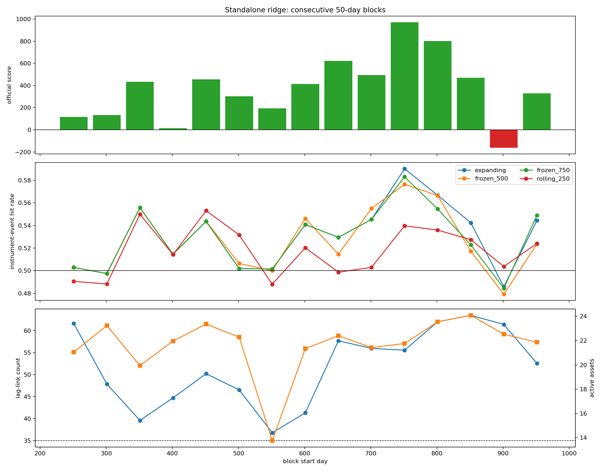

# Standalone ridge time-trend attribution

> **Source:** `analysis_outputs/ridge_time_trend/report.md` in the team's working repository (relocated here for the public release).

The strategy is frozen. Days 751-1000 are descriptive and were not used to alter any model or threshold.

## Exact expanding-ridge 50-day blocks

| Days | Score | Mean/day | Total PnL | Sharpe | Daily win | Signal hit | Positive move share | Gate | Active assets | Links |
|---|---:|---:|---:|---:|---:|---:|---:|---:|---:|---:|
| 251-300 | +116.20 | \$+165 | \$+8,257 | +1.54 | 46.0% | 50.3% | 52.6% | 96.0% | 21.0 | 61.6 |
| 301-350 | +132.02 | \$+182 | \$+9,119 | +1.62 | 60.0% | 49.7% | 52.6% | 100.0% | 23.2 | 47.9 |
| 351-400 | +434.54 | \$+456 | \$+22,789 | +4.52 | 66.0% | 55.6% | 56.7% | 90.0% | 19.9 | 39.6 |
| 401-450 | +14.14 | \$+51 | \$+2,551 | +0.62 | 52.0% | 51.5% | 51.1% | 100.0% | 22.0 | 44.7 |
| 451-500 | +456.47 | \$+478 | \$+23,878 | +4.65 | 64.0% | 54.4% | 56.2% | 100.0% | 23.4 | 50.2 |
| 501-550 | +302.91 | \$+328 | \$+16,420 | +3.45 | 66.0% | 50.2% | 54.8% | 100.0% | 22.3 | 46.6 |
| 551-600 | +192.92 | \$+211 | \$+10,560 | +3.25 | 42.0% | 50.1% | 54.6% | 60.0% | 13.8 | 36.8 |
| 601-650 | +415.04 | \$+438 | \$+21,898 | +4.25 | 54.0% | 54.1% | 56.1% | 96.0% | 21.3 | 41.3 |
| 651-700 | +621.84 | \$+634 | \$+31,684 | +7.25 | 66.0% | 52.9% | 57.9% | 100.0% | 22.4 | 57.7 |
| 701-750 | +493.14 | \$+503 | \$+25,174 | +6.91 | 68.0% | 54.5% | 57.0% | 100.0% | 21.4 | 56.0 |
| 751-800 | +971.01 | \$+982 | \$+49,110 | +9.32 | 78.0% | 59.0% | 62.9% | 100.0% | 21.8 | 55.6 |
| 801-850 | +801.49 | \$+812 | \$+40,585 | +8.86 | 72.0% | 56.7% | 60.2% | 100.0% | 23.5 | 62.0 |
| 851-900 | +469.87 | \$+493 | \$+24,629 | +4.55 | 64.0% | 54.2% | 56.3% | 100.0% | 24.1 | 63.5 |
| 901-950 | -162.03 | \$-162 | \$-8,102 | -1.91 | 44.0% | 48.6% | 48.4% | 100.0% | 22.5 | 61.4 |
| 951-1000 | +329.70 | \$+361 | \$+18,059 | +3.24 | 64.0% | 54.4% | 55.0% | 100.0% | 21.9 | 52.6 |

## Counterfactual score by block

| Days | Expanding | Rolling 250 | Frozen day 500 | Frozen day 750 |
|---|---:|---:|---:|---:|
| 251-300 | +116.20 | +54.78 | +116.20 | +116.20 |
| 301-350 | +132.02 | +68.80 | +132.02 | +132.02 |
| 351-400 | +434.54 | +392.93 | +434.54 | +434.54 |
| 401-450 | +14.14 | +123.74 | +14.14 | +14.14 |
| 451-500 | +456.47 | +506.88 | +456.47 | +456.47 |
| 501-550 | +302.91 | +417.28 | +337.31 | +302.91 |
| 551-600 | +192.92 | +4.74 | +127.34 | +192.92 |
| 601-650 | +415.04 | +115.90 | +472.89 | +415.04 |
| 651-700 | +621.84 | +162.76 | +447.01 | +621.84 |
| 701-750 | +493.14 | +5.52 | +681.76 | +493.14 |
| 751-800 | +971.01 | +499.32 | +881.26 | +854.69 |
| 801-850 | +801.49 | +452.17 | +714.67 | +670.14 |
| 851-900 | +469.87 | +398.61 | +259.32 | +200.52 |
| 901-950 | -162.03 | +120.71 | -230.71 | -294.86 |
| 951-1000 | +329.70 | +238.03 | +108.09 | +413.73 |

## Cross-block score correlations

- `signal_hit_rate`: **+0.892**
- `positive_move_share`: **+0.991**
- `avg_significant_links`: **+0.201**
- `avg_forecast_active_assets`: **+0.185**
- `avg_active_strength`: **+0.220**
- `fees`: **+0.139**

## Is the time trend monotonic?

| Window | Score slope per block | Pearson r | Linear p | Spearman rho |
|---|---:|---:|---:|---:|
| All blocks | +19.32 | +0.293 | 0.2893 | +0.368 |
| Development 251-750 | +43.07 | +0.662 | 0.0369 | +0.685 |
| Exposed 751-1000 | -224.62 | -0.805 | 0.1006 | -0.900 |

## Instrument breadth

| Period | Positive | Negative | Top-five share of positive PnL | Net PnL |
|---|---:|---:|---:|---:|
| YEAR2 | 36 | 14 | 38.9% | \$+66,594 |
| YEAR3 | 39 | 11 | 30.4% | \$+105,736 |
| EXPOSED_YEAR4 | 41 | 9 | 25.7% | \$+124,281 |

### Top exposed-Year-4 contributors

- FCSG: **\$+8,650**, 108 active days, 66.7% hit rate.
- RTTH: **\$+7,494**, 123 active days, 57.7% hit rate.
- RRES: **\$+7,218**, 113 active days, 60.2% hit rate.
- SRTX: **\$+6,855**, 114 active days, 60.5% hit rate.
- GARI: **\$+6,790**, 112 active days, 63.4% hit rate.
- AMRP: **\$+6,769**, 111 active days, 63.1% hit rate.
- EELT: **\$+6,090**, 113 active days, 62.8% hit rate.
- RCRI: **\$+5,328**, 116 active days, 53.4% hit rate.

### Worst exposed-Year-4 contributors

- MMBT: **\$-6,996**, 90 active days, 46.7% hit rate.
- EORC: **\$-2,534**, 107 active days, 50.5% hit rate.
- AGVF: **\$-2,231**, 112 active days, 48.2% hit rate.
- NAYO: **\$-1,794**, 116 active days, 46.6% hit rate.
- FWWG: **\$-1,606**, 103 active days, 45.6% hit rate.

---

## Figures

*Standalone ridge sleeve by 50-day block.*
