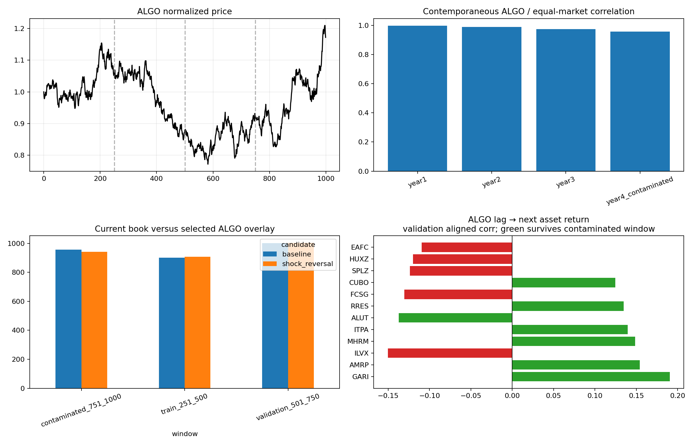

# ALGO 1,000-day deep dive

> **Source:** `analysis_outputs/algo_1000_deepdive/report.md` in the team's working repository (relocated here for the public release).

## Protocol

- Expanding, causal forecasts only.
- Days 251-500: training stability.
- Days 501-750: validation selection.
- Days 751-1000: already exposed; descriptive only.
- Direct ALGO overlay size: \$25,000.

## ALGO as a market/factor instrument

| window | algo_simple_return | algo_ann_vol | algo_return_sharpe | algo_market_corr | market_beta_to_algo | algo_pc1_abs_corr | pc1_variance_share | mean_asset_algo_corr | algo_lag1_autocorr |
| --- | --- | --- | --- | --- | --- | --- | --- | --- | --- |
| year1 | 0.0605 | 0.1522 | 0.3876 | 0.9969 | 0.9930 | 0.9777 | 0.2013 | 0.4364 | 0.1163 |
| year2 | -0.1755 | 0.1614 | -1.2006 | 0.9896 | 0.9694 | 0.9611 | 0.2266 | 0.4543 | -0.0952 |
| year3 | 0.0430 | 0.1727 | 0.2446 | 0.9737 | 0.9202 | 0.9483 | 0.2365 | 0.4595 | 0.0426 |
| year4_contaminated | 0.2671 | 0.1751 | 1.3574 | 0.9564 | 0.8598 | 0.9224 | 0.2212 | 0.4319 | 0.1163 |

## Current book exposure to ALGO

| window | portfolio_algo_corr | equivalent_algo_beta_dollars |
| --- | --- | --- |
| train_251_500 | -0.0876 | -14062.7967 |
| validation_501_750 | 0.0491 | 7400.7015 |
| contaminated_751_1000 | -0.1206 | -19305.3321 |

## Direct ALGO forecast diagnostics

| forecast | window | n | hit_rate | move_weighted_hit_rate | forecast_return_corr | mean_signed_return_bps |
| --- | --- | --- | --- | --- | --- | --- |
| always_long | train_251_500 | 249 | 0.4618 | 0.4523 | 0.0000 | -7.7486 |
| always_long | validation_501_750 | 249 | 0.4859 | 0.5097 | 0.0000 | 1.6891 |
| always_long | contaminated_751_1000 | 249 | 0.5261 | 0.5545 | 0.0000 | 9.5086 |
| algo_momentum_1 | train_251_500 | 248 | 0.4960 | 0.4396 | -0.0935 | -9.8371 |
| algo_momentum_1 | validation_501_750 | 247 | 0.5142 | 0.5607 | 0.0426 | 10.5787 |
| algo_momentum_1 | contaminated_751_1000 | 246 | 0.5285 | 0.5300 | 0.1159 | 5.2003 |
| algo_reversal_1 | train_251_500 | 248 | 0.5000 | 0.5604 | 0.0935 | 9.8371 |
| algo_reversal_1 | validation_501_750 | 247 | 0.4777 | 0.4393 | -0.0426 | -10.5787 |
| algo_reversal_1 | contaminated_751_1000 | 246 | 0.4593 | 0.4700 | -0.1159 | -5.2003 |
| market_lead | train_251_500 | 249 | 0.4980 | 0.4415 | -0.0858 | -9.4997 |
| market_lead | validation_501_750 | 249 | 0.5100 | 0.5568 | 0.0459 | 9.9265 |
| market_lead | contaminated_751_1000 | 249 | 0.5663 | 0.5687 | 0.0965 | 11.9905 |
| market_reversal | train_251_500 | 249 | 0.4980 | 0.5585 | 0.0858 | 9.4997 |
| market_reversal | validation_501_750 | 249 | 0.4819 | 0.4432 | -0.0459 | -9.9265 |
| market_reversal | contaminated_751_1000 | 249 | 0.4217 | 0.4313 | -0.0965 | -11.9905 |
| relative_reversal | train_251_500 | 249 | 0.4819 | 0.5249 | 0.0660 | 4.0427 |
| relative_reversal | validation_501_750 | 249 | 0.5100 | 0.4948 | 0.0055 | -0.9158 |
| relative_reversal | contaminated_751_1000 | 249 | 0.5020 | 0.5096 | -0.0897 | 1.6834 |
| adaptive_algo_acf60 | train_251_500 | 248 | 0.5121 | 0.5610 | 0.0420 | 9.9350 |
| adaptive_algo_acf60 | validation_501_750 | 247 | 0.4939 | 0.4975 | 0.0157 | -0.4427 |
| adaptive_algo_acf60 | contaminated_751_1000 | 246 | 0.4553 | 0.4672 | 0.0003 | -5.6853 |
| adaptive_algo_acf125 | train_251_500 | 248 | 0.5323 | 0.5631 | 0.0242 | 10.2645 |
| adaptive_algo_acf125 | validation_501_750 | 247 | 0.5020 | 0.5376 | 0.0408 | 6.5558 |
| adaptive_algo_acf125 | contaminated_751_1000 | 246 | 0.4593 | 0.4473 | 0.0155 | -9.1387 |
| adaptive_market_acf60 | train_251_500 | 249 | 0.5181 | 0.5546 | 0.0180 | 8.8695 |
| adaptive_market_acf60 | validation_501_750 | 249 | 0.4940 | 0.5227 | 0.0261 | 3.9718 |
| adaptive_market_acf60 | contaminated_751_1000 | 249 | 0.5060 | 0.5052 | 0.0163 | 0.9005 |
| adaptive_market_acf125 | train_251_500 | 249 | 0.4980 | 0.5159 | 0.0032 | 2.5756 |
| adaptive_market_acf125 | validation_501_750 | 249 | 0.4859 | 0.5052 | -0.0099 | 0.9024 |
| adaptive_market_acf125 | contaminated_751_1000 | 249 | 0.5663 | 0.5687 | 0.0965 | 11.9905 |
| shock_reversal | train_251_500 | 28 | 0.5000 | 0.6245 | 0.2155 | 19.6368 |
| shock_reversal | validation_501_750 | 36 | 0.5556 | 0.5418 | 0.0438 | 6.2201 |
| shock_reversal | contaminated_751_1000 | 36 | 0.3333 | 0.2616 | -0.2824 | -40.8477 |
| adaptive_shock_acf60 | train_251_500 | 28 | 0.4643 | 0.5586 | 0.0730 | 9.2368 |
| adaptive_shock_acf60 | validation_501_750 | 36 | 0.5556 | 0.5492 | 0.1056 | 7.3172 |
| adaptive_shock_acf60 | contaminated_751_1000 | 36 | 0.4444 | 0.5255 | -0.0445 | 4.3697 |
| adaptive_shock_acf125 | train_251_500 | 28 | 0.5000 | 0.5515 | 0.0590 | 8.1277 |
| adaptive_shock_acf125 | validation_501_750 | 36 | 0.4444 | 0.4822 | 0.0035 | -2.6541 |
| adaptive_shock_acf125 | contaminated_751_1000 | 36 | 0.5000 | 0.6090 | 0.1157 | 18.6731 |
| own_ar1 | train_251_500 | 249 | 0.4498 | 0.4713 | -0.0660 | -4.6679 |
| own_ar1 | validation_501_750 | 249 | 0.5100 | 0.4906 | -0.0986 | -1.6357 |
| own_ar1 | contaminated_751_1000 | 249 | 0.5020 | 0.5211 | 0.0552 | 3.6807 |
| compact_ridge | train_251_500 | 249 | 0.4900 | 0.5010 | 0.0021 | 0.1663 |
| compact_ridge | validation_501_750 | 249 | 0.5261 | 0.5155 | 0.0296 | 2.7111 |
| compact_ridge | contaminated_751_1000 | 249 | 0.5020 | 0.4971 | -0.0300 | -0.5131 |
| cross_asset_ridge | train_251_500 | 249 | 0.4217 | 0.4228 | -0.1226 | -12.5476 |
| cross_asset_ridge | validation_501_750 | 249 | 0.5261 | 0.5062 | -0.0532 | 1.0884 |
| cross_asset_ridge | contaminated_751_1000 | 249 | 0.4980 | 0.4993 | 0.0331 | -0.1135 |
| full_ridge | train_251_500 | 249 | 0.5020 | 0.5006 | -0.0888 | 0.1014 |
| full_ridge | validation_501_750 | 249 | 0.5100 | 0.5117 | -0.0061 | 2.0496 |
| full_ridge | contaminated_751_1000 | 249 | 0.5060 | 0.5058 | 0.0014 | 1.0170 |

## Candidate ranking

A candidate must have positive score delta in both training halves and both validation halves. Selection uses validation floor; the contaminated final window is not consulted.

Selected candidate: `shock_reversal`

| candidate | contaminated_751_1000 | contaminated_a_751_875 | contaminated_b_876_1000 | train_251_500 | train_a_251_375 | train_b_376_500 | validation_501_750 | validation_a_501_625 | validation_b_626_750 | train_floor | validation_floor |
| --- | --- | --- | --- | --- | --- | --- | --- | --- | --- | --- | --- |
| market_lead | 28.3195 | 4.1747 | 52.5443 | -25.7771 | -25.1818 | -26.4044 | 24.8707 | 16.4991 | 33.3057 | -26.4044 | 16.4991 |
| algo_momentum_1 | 10.9364 | -2.3446 | 23.9645 | -26.6671 | -12.2959 | -40.9966 | 24.2741 | 14.0008 | 34.6011 | -40.9966 | 14.0008 |
| compact_ridge | -1.2977 | -21.2608 | 18.8127 | -0.9728 | -8.5780 | 6.5102 | 7.1456 | 11.3342 | 2.9643 | -8.5780 | 2.9643 |
| shock_reversal | -14.7598 | -12.2579 | -17.3090 | 5.5199 | 4.8809 | 6.1490 | 2.2410 | 2.1876 | 2.2902 | 4.8809 | 2.1876 |
| adaptive_shock_acf60 | 1.3684 | -11.8019 | 14.5344 | 2.5467 | -1.0064 | 6.0688 | 2.4032 | 0.9991 | 3.8087 | -1.0064 | 0.9991 |
| baseline | 0.0000 | 0.0000 | 0.0000 | 0.0000 | 0.0000 | 0.0000 | 0.0000 | 0.0000 | 0.0000 | 0.0000 | 0.0000 |
| adaptive_algo_acf125 | -24.3824 | -72.8064 | 23.9645 | 25.1670 | 9.3574 | 40.8750 | 16.2009 | -2.1835 | 34.6011 | 9.3574 | -2.1835 |
| adaptive_shock_acf125 | 6.4262 | -4.0450 | 16.9038 | 2.3336 | -1.5110 | 6.1490 | -1.2180 | 0.2803 | -2.7035 | -1.5110 | -2.7035 |
| always_long | 26.4197 | 7.4737 | 45.7997 | -18.5269 | 1.5530 | -38.6189 | 6.3029 | -4.0354 | 16.7188 | -38.6189 | -4.0354 |
| full_ridge | 0.3972 | -7.2968 | 7.9908 | -1.2554 | 7.5186 | -10.0055 | 2.4863 | -4.1949 | 9.1851 | -10.0055 | -4.1949 |
| adaptive_market_acf60 | 0.0438 | 15.8919 | -16.4778 | 21.2517 | 12.8991 | 29.6112 | 7.6523 | -7.4980 | 22.8306 | 12.8991 | -7.4980 |
| cross_asset_ridge | -1.7001 | 6.0938 | -9.8260 | -33.2964 | -38.5980 | -28.1205 | -0.2415 | 9.6404 | -10.1162 | -38.5980 | -10.1162 |
| factor_hedge_w60_h0.5_c100k | -68.9379 | -75.1216 | -62.8480 | 17.8603 | 17.8313 | 18.0180 | -11.6327 | -12.0301 | -11.2734 | 17.8313 | -12.0301 |
| own_ar1 | 7.6629 | -17.1101 | 32.5958 | -12.1402 | -11.4666 | -12.8498 | -6.7634 | 3.4792 | -17.0719 | -12.8498 | -17.0719 |
| relative_reversal | 4.0368 | 19.6548 | -11.5848 | 9.2838 | -0.8277 | 19.3548 | -1.8557 | 17.6115 | -21.3321 | -0.8277 | -21.3321 |
| adaptive_algo_acf60 | -14.5252 | 5.8310 | -35.8453 | 23.8827 | 1.1246 | 46.6145 | -1.1921 | -24.4414 | 22.0822 | 1.1246 | -24.4414 |
| adaptive_market_acf125 | 28.3195 | 4.1747 | 52.5443 | 5.9539 | -6.6291 | 18.5015 | 0.3468 | -32.5092 | 33.3057 | -6.6291 | -32.5092 |
| market_reversal | -29.8339 | -5.5257 | -54.3710 | 24.1738 | 23.4987 | 24.8402 | -26.3369 | -17.9836 | -34.7504 | 23.4987 | -34.7504 |
| algo_reversal_1 | -12.4853 | 0.9703 | -25.7856 | 25.0430 | 10.6496 | 39.3628 | -25.8235 | -15.5633 | -36.1338 | 10.6496 | -36.1338 |

## Selected overlay versus baseline

| candidate | window | score | score_delta | mean_pnl | total_pnl | fees |
| --- | --- | --- | --- | --- | --- | --- |
| baseline | train_a_251_375 | 769.3702 | 0.0000 | 783.7013 | 97962.6663 | 3594.3137 |
| baseline | train_b_376_500 | 1033.4761 | 0.0000 | 1042.8087 | 130351.0848 | 3674.3652 |
| baseline | train_251_500 | 901.7640 | 0.0000 | 913.3285 | 228332.1323 | 7250.2977 |
| baseline | validation_a_501_625 | 923.6599 | 0.0000 | 933.9640 | 116745.5061 | 3114.8839 |
| baseline | validation_b_626_750 | 1077.0886 | 0.0000 | 1087.9014 | 135987.6689 | 3585.0911 |
| baseline | validation_501_750 | 1000.4121 | 0.0000 | 1011.0114 | 252752.8451 | 6680.3049 |
| baseline | contaminated_a_751_875 | 1277.4848 | 0.0000 | 1287.1481 | 160893.5134 | 3533.8366 |
| baseline | contaminated_b_876_1000 | 634.1539 | 0.0000 | 651.6844 | 81460.5438 | 3454.8962 |
| baseline | contaminated_751_1000 | 956.6930 | 0.0000 | 969.4574 | 242364.3550 | 6978.4350 |
| shock_reversal | train_a_251_375 | 774.2511 | 4.8809 | 788.4737 | 98559.2157 | 3609.3143 |
| shock_reversal | train_b_376_500 | 1039.6251 | 6.1490 | 1048.7678 | 131095.9699 | 3686.3601 |
| shock_reversal | train_251_500 | 907.2839 | 5.5199 | 918.6943 | 229673.5668 | 7277.2932 |
| shock_reversal | validation_a_501_625 | 925.8475 | 2.1876 | 936.0714 | 117008.9270 | 3128.8930 |
| shock_reversal | validation_b_626_750 | 1079.3788 | 2.2902 | 1090.0560 | 136256.9983 | 3605.6017 |
| shock_reversal | validation_501_750 | 1002.6531 | 2.2410 | 1013.1424 | 253285.5953 | 6714.8247 |
| shock_reversal | contaminated_a_751_875 | 1265.2269 | -12.2579 | 1274.7367 | 159342.0866 | 3548.8534 |
| shock_reversal | contaminated_b_876_1000 | 616.8449 | -17.3090 | 634.2678 | 79283.4790 | 3471.4510 |
| shock_reversal | contaminated_751_1000 | 941.9333 | -14.7598 | 954.5435 | 238635.8633 | 7010.0067 |

## Random-direction control

| window | candidate | observed_delta | random_mean_delta | random_std_delta | random_95pct | randomization_p |
| --- | --- | --- | --- | --- | --- | --- |
| train_251_500 | shock_reversal | 5.5199 | 0.2354 | 5.2365 | 8.2832 | 0.1497 |
| validation_501_750 | shock_reversal | 2.2410 | -0.2256 | 5.7105 | 9.2781 | 0.3453 |
| contaminated_751_1000 | shock_reversal | -14.7598 | -0.2608 | 6.5682 | 10.3872 | 0.9900 |

## Does ALGO lead other assets?

Correlations are between today's ALGO return and the next return of each asset. Validation/final values are aligned to the sign learned in training.

| symbol | train_corr | validation_corr | contaminated_corr | train_t | train_p | validation_aligned | contaminated_aligned | bh_q |
| --- | --- | --- | --- | --- | --- | --- | --- | --- |
| GARI | 0.0471 | 0.1903 | 0.1245 | 0.7411 | 0.4593 | 0.1903 | 0.1245 | 0.8095 |
| AMRP | 0.0853 | 0.1541 | 0.1779 | 1.3450 | 0.1799 | 0.1541 | 0.1779 | 0.6386 |
| MHRM | 0.0043 | 0.1487 | 0.0747 | 0.0670 | 0.9466 | 0.1487 | 0.0747 | 0.9963 |
| ITPA | 0.0175 | 0.1396 | 0.1208 | 0.2749 | 0.7837 | 0.1396 | 0.1208 | 0.9308 |
| RRES | -0.1230 | -0.1348 | -0.0478 | -1.9480 | 0.0525 | 0.1348 | 0.0478 | 0.3707 |
| CUBO | -0.1231 | -0.1244 | -0.0396 | -1.9496 | 0.0524 | 0.1244 | 0.0396 | 0.3707 |
| NAYO | -0.0618 | -0.1061 | -0.0096 | -0.9726 | 0.3317 | 0.1061 | 0.0096 | 0.6661 |
| DIHO | 0.0384 | 0.1058 | 0.0597 | 0.6032 | 0.5469 | 0.1058 | 0.0597 | 0.8159 |
| ELLT | 0.0498 | 0.0984 | 0.0849 | 0.7837 | 0.4340 | 0.0984 | 0.0849 | 0.8095 |
| CCNS | 0.0115 | 0.0909 | 0.0451 | 0.1814 | 0.8562 | 0.0909 | 0.0451 | 0.9513 |
| NGTE | 0.0161 | 0.0894 | 0.0072 | 0.2530 | 0.8005 | 0.0894 | 0.0072 | 0.9308 |
| HRET | -0.2013 | -0.0872 | -0.0232 | -3.2303 | 0.0014 | 0.0872 | 0.0232 | 0.0702 |
| HRND | 0.0970 | 0.0848 | 0.0777 | 1.5323 | 0.1267 | 0.0848 | 0.0777 | 0.5760 |
| LSST | 0.1030 | 0.0803 | 0.0086 | 1.6274 | 0.1049 | 0.0803 | 0.0086 | 0.5246 |
| EELT | -0.0773 | -0.0405 | -0.0036 | -1.2184 | 0.2242 | 0.0405 | 0.0036 | 0.6386 |

## Interpretation guardrails

- Contemporaneous correlation makes ALGO a plausible market proxy, but does not itself create a forecast.
- A normalized or large model output is not a probability.
- Fifty cross-asset lead tests create a multiple-testing burden; BH q-values are reported.
- Any final-window improvement is not fresh out-of-sample evidence.

---

## Figures

*ALGO as a market/factor instrument.*
