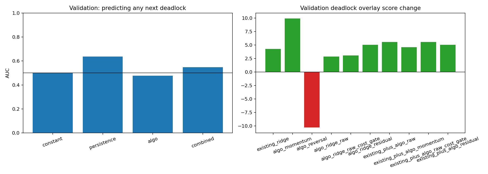

# ALGO movement and pair-vote deadlocks

> **Source:** `analysis_outputs/algo_deadlock_prediction/report.md` in the team's working repository (relocated here for the public release).

Only days 1-750 are loaded. Days 751-1000 are excluded.

- Training deadlock asset-events: **446**.
- Validation deadlock asset-events: **413**.
- Training days with any deadlock: **80.0%**.
- Validation days with any deadlock: **82.8%**.

## Can ALGO predict deadlock occurrence?

| Protocol | Model | Count RMSE | Count corr | AUC | Brier | Top-quartile rate |
|---|---|---:|---:|---:|---:|---:|
| TRAIN_FORWARD | constant | 1.363 | 0.000 | 0.500 | 0.151 | 81.6% |
| TRAIN_FORWARD | persistence | 1.325 | 0.256 | 0.580 | 0.150 | 84.6% |
| TRAIN_FORWARD | algo | 1.335 | 0.225 | 0.597 | 0.150 | 87.5% |
| TRAIN_FORWARD | combined | 1.300 | 0.330 | 0.604 | 0.150 | 87.5% |
| VALIDATION | constant | 1.238 | 0.000 | 0.500 | 0.143 | 82.8% |
| VALIDATION | persistence | 1.199 | 0.288 | 0.637 | 0.142 | 88.0% |
| VALIDATION | algo | 1.270 | -0.114 | 0.477 | 0.144 | 82.5% |
| VALIDATION | combined | 1.227 | 0.129 | 0.548 | 0.143 | 88.9% |

## Can ALGO resolve deadlock direction?

| Protocol | Model | Events | Coverage | Win rate | Mean event PnL | Total PnL | Random p |
|---|---|---:|---:|---:|---:|---:|---:|
| TRAIN_FORWARD | algo_momentum | 231 | 100.0% | 50.2% | \$0.58 | \$134 | 0.3979 |
| TRAIN_FORWARD | algo_reversal | 231 | 100.0% | 49.4% | \$-1.58 | \$-365 | 0.6149 |
| TRAIN_FORWARD | algo_ridge_raw | 231 | 100.0% | 51.9% | \$2.06 | \$477 | 0.2505 |
| TRAIN_FORWARD | algo_ridge_raw_cost_gate | 222 | 96.1% | 50.9% | \$1.46 | \$323 | 0.3111 |
| TRAIN_FORWARD | algo_ridge_residual | 231 | 100.0% | 47.6% | \$-3.26 | \$-754 | 0.7696 |
| TRAIN_FORWARD | existing_ridge | 223 | 96.5% | 52.9% | \$2.49 | \$555 | 0.2280 |
| TRAIN_FORWARD | existing_plus_algo_raw | 231 | 100.0% | 53.2% | \$2.75 | \$636 | 0.2054 |
| TRAIN_FORWARD | existing_plus_algo_momentum | 231 | 100.0% | 52.4% | \$2.02 | \$467 | 0.2448 |
| TRAIN_FORWARD | existing_plus_algo_raw_cost_gate | 231 | 100.0% | 53.2% | \$2.75 | \$636 | 0.1954 |
| TRAIN_FORWARD | existing_plus_algo_residual | 231 | 100.0% | 52.4% | \$1.86 | \$431 | 0.2745 |
| TRAIN_FORWARD | algo_raw_uncovered_only | 8 | 3.5% | 62.5% | \$10.06 | \$80 | 0.2444 |
| VALIDATION | algo_momentum | 410 | 99.3% | 52.7% | \$5.61 | \$2298 | 0.0142 |
| VALIDATION | algo_reversal | 410 | 99.3% | 46.6% | \$-6.61 | \$-2708 | 0.9874 |
| VALIDATION | algo_ridge_raw | 413 | 100.0% | 51.3% | \$1.74 | \$720 | 0.2060 |
| VALIDATION | algo_ridge_raw_cost_gate | 398 | 96.4% | 51.8% | \$1.93 | \$766 | 0.1868 |
| VALIDATION | algo_ridge_residual | 413 | 100.0% | 52.3% | \$2.65 | \$1095 | 0.1292 |
| VALIDATION | existing_ridge | 368 | 89.1% | 52.4% | \$2.31 | \$849 | 0.1690 |
| VALIDATION | existing_plus_algo_raw | 413 | 100.0% | 52.3% | \$2.81 | \$1162 | 0.1084 |
| VALIDATION | existing_plus_algo_momentum | 413 | 100.0% | 52.3% | \$2.20 | \$909 | 0.1590 |
| VALIDATION | existing_plus_algo_raw_cost_gate | 413 | 100.0% | 52.3% | \$2.81 | \$1162 | 0.1148 |
| VALIDATION | existing_plus_algo_residual | 413 | 100.0% | 52.5% | \$2.50 | \$1031 | 0.1332 |
| VALIDATION | algo_raw_uncovered_only | 45 | 10.9% | 51.1% | \$6.96 | \$313 | 0.1752 |

## Portfolio score changes versus no deadlock overlay

| Variant | Train A | Train B | Train | Validation A | Validation B | Validation |
|---|---:|---:|---:|---:|---:|---:|
| existing_ridge | +0.51 | +5.09 | +2.79 | +6.91 | +1.64 | +4.27 |
| algo_momentum | -8.98 | +1.39 | -3.77 | +5.95 | +13.88 | +9.92 |
| algo_reversal | +8.62 | -1.76 | +3.42 | -6.36 | -14.20 | -10.28 |
| algo_ridge_raw | +0.00 | +3.80 | +1.89 | +1.84 | +3.89 | +2.87 |
| algo_ridge_raw_cost_gate | +0.00 | +2.56 | +1.28 | +1.69 | +4.41 | +3.06 |
| algo_ridge_residual | +0.00 | -6.11 | -3.07 | +4.40 | +5.71 | +5.05 |
| existing_plus_algo_raw | +0.51 | +5.74 | +3.11 | +9.55 | +1.58 | +5.56 |
| existing_plus_algo_momentum | -0.21 | +4.42 | +2.11 | +7.58 | +1.58 | +4.58 |
| existing_plus_algo_raw_cost_gate | +0.51 | +5.74 | +3.11 | +9.55 | +1.58 | +5.56 |
| existing_plus_algo_residual | +0.51 | +4.11 | +2.30 | +8.51 | +1.58 | +5.04 |

## Acceptance rule

ALGO must add predictive value beyond the constant/persistence baseline in the Train-B forward check and validation. A direction rule must improve both chronological validation halves and must not be justified by any data after day 750.

---

## Figures

*Can ALGO predict pair-vote deadlocks?.*
