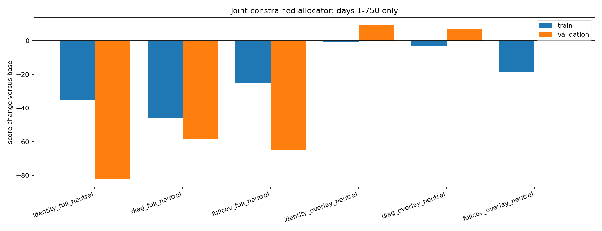

# Joint constrained ALGO residual allocator

> **Source:** `analysis_outputs/algo_joint_allocator/report.md` in the team's working repository (relocated here for the public release).

Only days 1-750 are loaded. Days 751-1000 are excluded.

The objective is the signal-implied mean/variance problem `min (w-d)'Q(w-d)` with exact box constraints.

| Variant | Train delta | Validation delta | Train A | Train B | Validation A | Validation B |
|---|---:|---:|---:|---:|---:|---:|
| identity_full_neutral | -35.40 | -82.18 | -39.66 | -30.93 | -78.44 | -86.00 |
| diag_full_neutral | -46.05 | -58.28 | -40.61 | -51.34 | -46.01 | -70.62 |
| fullcov_full_neutral | -24.78 | -65.08 | -25.17 | -24.16 | -80.31 | -49.95 |
| identity_overlay_neutral | -0.54 | +9.39 | -19.71 | +18.52 | +4.10 | +14.72 |
| diag_overlay_neutral | -3.07 | +7.20 | -23.59 | +17.31 | +0.98 | +13.44 |
| fullcov_overlay_neutral | -18.51 | +0.05 | -37.44 | +0.30 | -6.75 | +6.87 |

## Diagnostics

- `identity_full_neutral`: mean absolute post-round beta error 0.0444; mean position change \$76,518.
- `diag_full_neutral`: mean absolute post-round beta error 0.0444; mean position change \$85,312.
- `fullcov_full_neutral`: mean absolute post-round beta error 0.0376; mean position change \$84,729.
- `identity_overlay_neutral`: mean absolute post-round beta error 0.0397; mean position change \$15,228.
- `diag_overlay_neutral`: mean absolute post-round beta error 0.0382; mean position change \$16,023.
- `fullcov_overlay_neutral`: mean absolute post-round beta error 0.0284; mean position change \$30,504.

## Acceptance rule

A production candidate must improve aggregate train and validation and must not have a materially negative chronological half. No result from days after 750 is available to this script.

---

## Figures

*Joint constrained ALGO residual allocator.*
