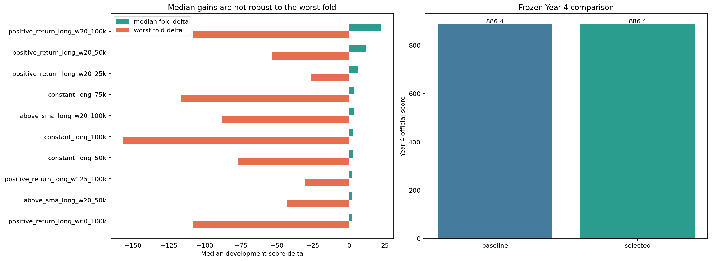

# ALGO long-index tilt investigation

> **Source:** `analysis_outputs/algo_long_tilt/algo_long_tilt_report.md` in the team's working repository (relocated here for the public release).

## Selection protocol

- Current `four_sigmas` baseline.
- Selection phase physically loaded only days 1-750.
- Five sequential 125-day development/validation folds.
- Candidate must improve at least 4/5 folds and have positive median score improvement.
- Only the frozen selection was subsequently tested on days 751-1000.

## Frozen result

- Selected: **baseline**
- Year-4 baseline score: **886.39**
- Year-4 selected score: **886.39**
- Year-4 score delta: **+0.00**
- Year-4 ALGO return: **27.7%**
- Year-4 portfolio/ALGO PnL correlation: **-0.095**

## Development index diagnostics

| Window | ALGO return | ALGO return Sharpe | Portfolio/ALGO PnL corr | Equivalent ALGO beta dollars |
|---|---:|---:|---:|---:|
| YEAR1 | 6.0% | 0.39 | -0.084 | \$-10,797 |
| YEAR2 | -17.9% | -1.22 | -0.152 | \$-24,743 |
| YEAR3 | 5.3% | 0.30 | 0.013 | \$2,008 |

## Top development candidates

| Candidate | Positive folds | Median delta | Mean delta | Worst delta |
|---|---:|---:|---:|---:|
| positive_return_long_w20_100k | 3/5 | +21.81 | -15.15 | -108.22 |
| positive_return_long_w20_50k | 3/5 | +11.51 | -7.03 | -53.38 |
| positive_return_long_w20_25k | 3/5 | +5.93 | -3.36 | -26.54 |
| constant_long_75k | 3/5 | +3.23 | -4.33 | -116.71 |
| above_sma_long_w20_100k | 3/5 | +3.20 | -12.74 | -88.34 |
| constant_long_100k | 3/5 | +3.02 | -6.90 | -156.57 |
| constant_long_50k | 3/5 | +2.88 | -2.31 | -77.31 |
| positive_return_long_w125_100k | 3/5 | +2.29 | +2.15 | -30.38 |
| above_sma_long_w20_50k | 3/5 | +2.25 | -5.81 | -43.43 |
| positive_return_long_w60_100k | 3/5 | +1.99 | -9.13 | -108.42 |
| positive_return_long_w125_50k | 3/5 | +1.82 | +1.58 | -15.16 |
| constant_long_25k | 3/5 | +1.77 | -0.87 | -38.39 |

## Heldout details

| Strategy | Score | Mean PnL | Total PnL | Sharpe | Turnover | Fees |
|---|---:|---:|---:|---:|---:|---:|
| baseline | 886.39 | 899.86 | \$224,965 | 8.11 | \$70,925,546 | \$7,093 |
| selected | 886.39 | 899.86 | \$224,965 | 8.11 | \$70,925,546 | \$7,093 |

---

## Figures

*ALGO long-index tilt.*
