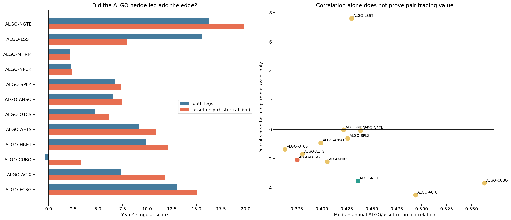

# What the historical ALGO pair signals were trading

> **Source:** `analysis_outputs/algo_pair_market_relative/algo_pair_interpretation.md` in the team's working repository (relocated here for the public release).

## Live configuration

- Current `four_sigmas` active ALGO pairs: **0** (none).
- Historical `testbedv2_tuned` ALGO pair agents: **12**.
- Historical wrapper set `dollars[0] = 0`, so those agents traded only the non-ALGO asset after pair selection.

## Conclusion by relationship

| Pair | Median return corr | Median market beta | ADF passes | Residual reversal years | Both-leg score Y4 | Asset-only score Y4 | Both-minus-asset Y4 | Interpretation |
|---|---:|---:|---:|---:|---:|---:|---:|---|
| ALGO-NGTE | 0.436 | 0.94 | 2/4 | 4/4 | 16.32 | 19.86 | -3.54 | MARKET_RELATIVE_REVERSION |
| ALGO-LSST | 0.430 | 0.95 | 0/4 | 2/4 | 15.55 | 7.95 | +7.59 | MOSTLY_NAKED_ASSET_REVERSION |
| ALGO-MHRM | 0.422 | 0.94 | 0/4 | 2/4 | 2.13 | 2.17 | -0.03 | MOSTLY_NAKED_ASSET_REVERSION |
| ALGO-NPCK | 0.439 | 0.79 | 0/4 | 2/4 | 2.24 | 2.32 | -0.09 | MOSTLY_NAKED_ASSET_REVERSION |
| ALGO-SPLZ | 0.426 | 1.00 | 0/4 | 3/4 | 6.74 | 7.35 | -0.62 | MOSTLY_NAKED_ASSET_REVERSION |
| ALGO-ANSO | 0.399 | 0.81 | 2/4 | 4/4 | 6.51 | 7.43 | -0.92 | MOSTLY_NAKED_ASSET_REVERSION |
| ALGO-OTCS | 0.363 | 0.96 | 0/4 | 3/4 | 4.73 | 6.09 | -1.36 | MOSTLY_NAKED_ASSET_REVERSION |
| ALGO-AETS | 0.381 | 1.20 | 2/4 | 2/4 | 9.20 | 10.90 | -1.69 | MOSTLY_NAKED_ASSET_REVERSION |
| ALGO-HRET | 0.405 | 0.86 | 1/4 | 3/4 | 9.92 | 12.14 | -2.22 | MOSTLY_NAKED_ASSET_REVERSION |
| ALGO-CUBO | 0.563 | 0.85 | 1/4 | 4/4 | -0.38 | 3.30 | -3.68 | MOSTLY_NAKED_ASSET_REVERSION |
| ALGO-ACIX | 0.494 | 0.78 | 1/4 | 2/4 | 7.31 | 11.81 | -4.49 | MOSTLY_NAKED_ASSET_REVERSION |
| ALGO-FCSG | 0.375 | 0.87 | 0/4 | 0/4 | 13.00 | 15.09 | -2.09 | UNSTABLE_OR_MIXED |

## Structural detail

| Pair | Year | Return corr | Return beta | R² | Residual ADF p | Residual half-life | Residual-return lag-1 |
|---|---|---:|---:|---:|---:|---:|---:|
| ALGO-ACIX | YEAR1 | 0.494 | 0.84 | 0.244 | 0.4280 | 32.5 | 0.009 |
| ALGO-ACIX | YEAR2 | 0.497 | 0.81 | 0.247 | 0.0417 | 15.3 | 0.059 |
| ALGO-ACIX | YEAR3 | 0.435 | 0.67 | 0.189 | 0.2833 | 22.8 | -0.071 |
| ALGO-ACIX | YEAR4 | 0.494 | 0.75 | 0.244 | 0.1071 | 13.5 | -0.030 |
| ALGO-AETS | YEAR1 | 0.412 | 1.45 | 0.170 | 0.0379 | 15.1 | -0.023 |
| ALGO-AETS | YEAR2 | 0.385 | 1.24 | 0.148 | 0.5213 | 38.2 | -0.003 |
| ALGO-AETS | YEAR3 | 0.376 | 1.15 | 0.141 | 0.4371 | 30.2 | 0.056 |
| ALGO-AETS | YEAR4 | 0.251 | 0.70 | 0.063 | 0.0120 | 10.2 | 0.123 |
| ALGO-ANSO | YEAR1 | 0.348 | 0.72 | 0.121 | 0.9054 | 46.1 | -0.168 |
| ALGO-ANSO | YEAR2 | 0.450 | 0.90 | 0.203 | 0.2983 | 20.6 | -0.083 |
| ALGO-ANSO | YEAR3 | 0.490 | 0.96 | 0.240 | 0.0352 | 9.8 | -0.060 |
| ALGO-ANSO | YEAR4 | 0.304 | 0.58 | 0.092 | 0.0320 | 10.6 | -0.057 |
| ALGO-CUBO | YEAR1 | 0.496 | 0.84 | 0.246 | 0.2702 | 21.0 | -0.016 |
| ALGO-CUBO | YEAR2 | 0.557 | 0.87 | 0.310 | 0.0588 | 14.3 | -0.087 |
| ALGO-CUBO | YEAR3 | 0.600 | 0.92 | 0.360 | 0.0232 | 9.0 | -0.055 |
| ALGO-CUBO | YEAR4 | 0.569 | 0.83 | 0.324 | 0.4835 | 19.5 | -0.132 |
| ALGO-FCSG | YEAR1 | 0.374 | 0.94 | 0.140 | 0.3185 | 23.2 | 0.070 |
| ALGO-FCSG | YEAR2 | 0.452 | 1.13 | 0.204 | 0.0948 | 17.7 | 0.010 |
| ALGO-FCSG | YEAR3 | 0.312 | 0.67 | 0.097 | 0.1634 | 28.6 | 0.039 |
| ALGO-FCSG | YEAR4 | 0.377 | 0.79 | 0.142 | 0.0812 | 15.6 | 0.073 |
| ALGO-HRET | YEAR1 | 0.379 | 0.86 | 0.144 | 0.2226 | 16.3 | -0.002 |
| ALGO-HRET | YEAR2 | 0.362 | 0.80 | 0.131 | 0.0686 | 13.0 | -0.126 |
| ALGO-HRET | YEAR3 | 0.431 | 0.85 | 0.186 | 0.0137 | 8.0 | 0.058 |
| ALGO-HRET | YEAR4 | 0.440 | 0.90 | 0.193 | 0.4434 | 21.7 | -0.089 |
| ALGO-LSST | YEAR1 | 0.410 | 0.87 | 0.168 | 0.4979 | 48.2 | -0.054 |
| ALGO-LSST | YEAR2 | 0.459 | 0.98 | 0.211 | 0.1083 | 19.5 | -0.066 |
| ALGO-LSST | YEAR3 | 0.450 | 0.98 | 0.202 | 0.1825 | 17.6 | 0.047 |
| ALGO-LSST | YEAR4 | 0.410 | 0.92 | 0.168 | 0.3013 | 22.4 | 0.027 |
| ALGO-MHRM | YEAR1 | 0.416 | 1.03 | 0.173 | 0.0640 | 10.0 | -0.179 |
| ALGO-MHRM | YEAR2 | 0.427 | 0.91 | 0.183 | 0.1710 | 15.9 | 0.060 |
| ALGO-MHRM | YEAR3 | 0.443 | 0.97 | 0.196 | 0.3351 | 26.4 | -0.064 |
| ALGO-MHRM | YEAR4 | 0.415 | 0.83 | 0.172 | 0.3324 | 23.0 | 0.030 |
| ALGO-NGTE | YEAR1 | 0.434 | 1.01 | 0.188 | 0.1059 | 13.3 | -0.105 |
| ALGO-NGTE | YEAR2 | 0.520 | 1.15 | 0.271 | 0.0412 | 10.1 | -0.078 |
| ALGO-NGTE | YEAR3 | 0.438 | 0.87 | 0.192 | 0.0343 | 10.5 | -0.070 |
| ALGO-NGTE | YEAR4 | 0.390 | 0.79 | 0.152 | 0.5098 | 32.0 | -0.093 |
| ALGO-NPCK | YEAR1 | 0.422 | 0.81 | 0.178 | 0.5585 | 51.2 | 0.205 |
| ALGO-NPCK | YEAR2 | 0.456 | 0.79 | 0.208 | 0.0966 | 17.6 | -0.054 |
| ALGO-NPCK | YEAR3 | 0.438 | 0.78 | 0.192 | 0.1778 | 16.9 | -0.020 |
| ALGO-NPCK | YEAR4 | 0.440 | 0.77 | 0.193 | 0.3709 | 30.4 | 0.137 |
| ALGO-OTCS | YEAR1 | 0.346 | 0.95 | 0.119 | 0.3943 | 25.0 | -0.005 |
| ALGO-OTCS | YEAR2 | 0.370 | 0.98 | 0.137 | 0.1980 | 19.8 | 0.000 |
| ALGO-OTCS | YEAR3 | 0.480 | 1.25 | 0.230 | 0.6375 | 49.2 | -0.108 |
| ALGO-OTCS | YEAR4 | 0.357 | 0.85 | 0.127 | 0.2146 | 21.1 | -0.060 |
| ALGO-SPLZ | YEAR1 | 0.481 | 1.33 | 0.232 | 0.4901 | 32.7 | 0.065 |
| ALGO-SPLZ | YEAR2 | 0.453 | 1.09 | 0.205 | 0.4641 | 16.4 | -0.132 |
| ALGO-SPLZ | YEAR3 | 0.399 | 0.90 | 0.159 | 0.2738 | 27.1 | -0.105 |
| ALGO-SPLZ | YEAR4 | 0.346 | 0.76 | 0.120 | 0.1208 | 14.7 | -0.067 |

## Interpretation

- A genuine index-relative pair is the residual `asset return - beta * ALGO return`; its cumulative relative-price residual should repeatedly mean-revert.
- Negative residual-return lag-1 correlation indicates short-horizon idiosyncratic reversal after removing the market move.
- If the asset-only implementation performs as well as or better than both legs, the historical PnL was not dependent on neutralising the market. It was effectively a single-asset reversal signal.
- Fixed-beta ADF is deliberately reported per year. The PairAgent uses adaptive beta, but adaptivity alone cannot prove economic cointegration.

---

## Figures

*What the historical ALGO pair signals were trading.*
