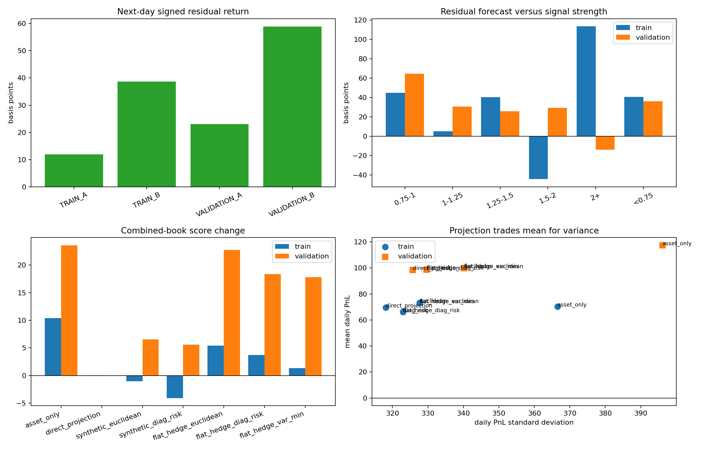

# ALGO residual forecast and beta-projection research

> **Source:** `analysis_outputs/algo_residual_projection/report.md` in the team's working repository (relocated here for the public release).

Only days 1-750 are loaded. Days 751-1000 are excluded.

## Forecast test

Positive values mean the asset position correctly predicted the future return residual `r_asset - beta * r_ALGO`.

| Fold | Days | Active days | Mean signed residual (bp) | Win rate | t-stat |
|---|---:|---:|---:|---:|---:|
| TRAIN_A | 251-375 | 125 | 11.944 | 0.496 | 0.96 |
| TRAIN_B | 376-500 | 123 | 38.652 | 0.593 | 3.22 |
| VALIDATION_A | 501-625 | 124 | 23.104 | 0.565 | 2.02 |
| VALIDATION_B | 626-750 | 122 | 58.851 | 0.689 | 4.59 |

## Episode randomization

| Fold | Observed bp | Random 95% | One-sided p | Episodes |
|---|---:|---:|---:|---:|
| TRAIN_A | 11.944 | 12.929 | 0.0699 | 56 |
| TRAIN_B | 38.652 | 20.268 | 0.0020 | 74 |
| VALIDATION_A | 23.104 | 12.856 | 0.0010 | 70 |
| VALIDATION_B | 58.851 | 22.958 | 0.0010 | 63 |

## Portfolio construction

| Variant | Train standalone | Validation standalone | Train combined delta | Validation combined delta |
|---|---:|---:|---:|---:|
| asset_only | 63.419 | 112.286 | +10.380 | +23.601 |
| direct_projection | 64.205 | 94.258 | +0.066 | +0.015 |
| synthetic_euclidean | 67.616 | 95.477 | -1.014 | +6.551 |
| synthetic_diag_risk | 60.377 | 94.454 | -4.071 | +5.586 |
| flat_hedge_euclidean | 67.616 | 95.477 | +5.439 | +22.755 |
| flat_hedge_diag_risk | 60.377 | 94.454 | +3.737 | +18.384 |
| flat_hedge_var_min | 67.616 | 95.477 | +1.376 | +17.794 |

## Key findings

- The signed next-day residual is positive in all four folds. Episode randomization rejects chance at 5% in three folds; the first training half is only suggestive.
- Direct projection reduces standalone daily volatility by 13.2% in train and 17.8% in validation.
- It also removes mean PnL: 16.2% of validation mean disappears with the market component.
- Directly adding the complete projection to the bang-bang book is infeasible: one saturated leg forces almost the whole vector to be scaled away.
- Hedging only with currently flat assets improves aggregate train and validation, but its first train-half delta is -11.52. The variance-minimizing version still produces -5.43.
- Residual edge is not monotonic in z-score magnitude. This rejects proportional sizing by raw dislocation strength.

## Interpretation

- The projection equation guarantees estimated beta neutrality; it does not guarantee positive expected residual returns.
- A production candidate must have a positive residual forecast in both training halves and both validation halves.
- A construction must also improve aggregate train and validation score. Validation-only improvement is insufficient.
- Naive t-statistics are descriptive because held episodes and multi-asset observations are dependent.

## Hedge diagnostics

- `asset_only`: mean delivered beta dollars 6794.09; mean gross delivery \$10,104.
- `direct_projection`: mean delivered beta dollars 8.89; mean gross delivery \$15.
- `synthetic_euclidean`: mean delivered beta dollars 349.97; mean gross delivery \$16,157.
- `synthetic_diag_risk`: mean delivered beta dollars 331.13; mean gross delivery \$17,170.
- `flat_hedge_euclidean`: mean delivered beta dollars 69.34; mean gross delivery \$16,429.
- `flat_hedge_diag_risk`: mean delivered beta dollars 66.68; mean gross delivery \$17,710.
- `flat_hedge_var_min`: mean delivered beta dollars 48.62; mean gross delivery \$8,979.

---

## Figures

*ALGO residual forecast and beta projection.*
