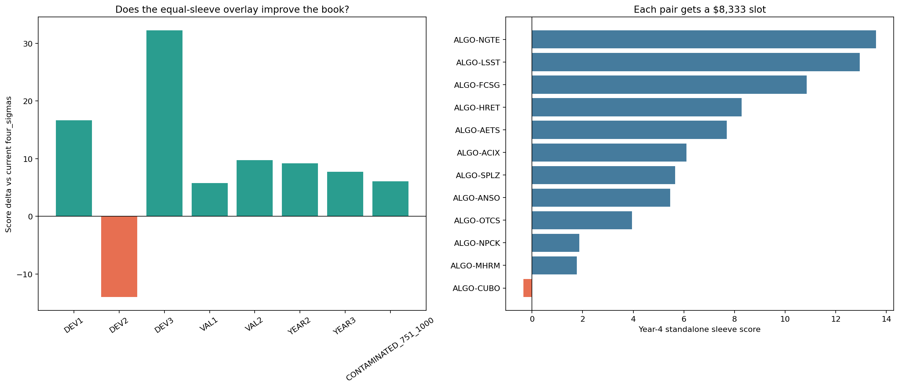

# Twelve independent ALGO equal sleeves

> **Source:** `analysis_outputs/algo12_equal_sleeves/equal_sleeve_report.md` in the team's working repository (relocated here for the public release).

## Construction

- ALGO capacity: **\$100,000**.
- Independent pair slots: **12 × \$8,333.33**.
- Every pair updates and signals independently; no priority competition.
- Each sleeve sizes both ALGO and asset legs so neither exceeds its slot.
- ALGO legs are netted only after all twelve decisions are formed.
- Non-ALGO overlay legs are combined with the current strategy and then subject to the existing \$10k per-asset limit.

## Portfolio results

| Window | Baseline | Full overlay delta | ALGO-leg-only delta | Asset-leg-only delta | Base+full PnL |
|---|---:|---:|---:|---:|---:|
| DEV1 | 922.62 | +16.67 | +3.12 | +13.49 | \$118,187 |
| DEV2 | 769.37 | -13.98 | +2.16 | -16.19 | \$96,258 |
| DEV3 | 1033.48 | +32.24 | -4.64 | +36.84 | \$134,358 |
| VAL1 | 923.66 | +5.80 | -25.10 | +30.63 | \$117,431 |
| VAL2 | 1077.09 | +9.72 | -6.92 | +16.59 | \$137,178 |
| YEAR2 | 901.76 | +9.20 | -1.23 | +10.38 | \$230,636 |
| YEAR3 | 1000.41 | +7.76 | -15.99 | +23.60 | \$254,630 |
| CONTAMINATED_751_1000 | 956.69 | +6.07 | -13.01 | +19.05 | \$243,739 |

## Sleeve mechanics

- Mean active sleeves: **3.29/12**.
- Mean gross ALGO allocation: **\$22,089**.
- Mean absolute net ALGO exposure: **\$9,838**.
- Mean internal ALGO cancellation: **48.9%**.
- Mean delivery of requested non-ALGO overlay after combining with the base book: **37.3%**.
- Development/validation-stable asset-only shortlist: **ALGO-AETS, ALGO-ACIX**.

## Individual sleeves

| Pair | Full Y2 | Full Y3 | Full Y4 | Asset-only Y2 | Asset-only Y3 | Asset-only Y4 | ALGO-only Y4 |
|---|---:|---:|---:|---:|---:|---:|---:|
| ALGO-NGTE | 7.42 | 12.03 | 13.59 | 3.40 | 6.68 | 16.57 | -3.21 |
| ALGO-LSST | 2.47 | 8.38 | 12.95 | 4.14 | 10.15 | 6.65 | 2.94 |
| ALGO-FCSG | 5.55 | 2.84 | 10.85 | 6.99 | 4.31 | 12.59 | -1.57 |
| ALGO-HRET | 8.41 | 2.61 | 8.27 | 6.74 | 6.90 | 10.12 | -1.80 |
| ALGO-AETS | 4.58 | 8.83 | 7.70 | 1.80 | 10.15 | 9.10 | -1.15 |
| ALGO-ACIX | 7.70 | 3.18 | 6.10 | 7.35 | 7.58 | 9.85 | -3.75 |
| ALGO-SPLZ | 1.68 | 4.47 | 5.65 | 2.44 | 5.58 | 6.16 | -0.55 |
| ALGO-ANSO | 1.02 | 6.44 | 5.46 | 1.19 | 7.87 | 6.21 | -0.69 |
| ALGO-OTCS | 0.03 | 12.83 | 3.95 | 0.64 | 10.70 | 5.07 | -1.33 |
| ALGO-NPCK | 3.28 | 5.15 | 1.86 | 1.89 | 6.29 | 1.94 | -0.11 |
| ALGO-MHRM | 0.81 | 5.69 | 1.78 | 2.01 | 5.84 | 1.80 | -0.07 |
| ALGO-CUBO | 0.00 | 1.39 | -0.34 | 0.00 | 4.27 | 2.72 | -4.23 |

## Asset-leg timing versus random directions

Random controls preserve each asset's active episodes and position magnitudes but replace the residual signal direction.

| Window | Observed delta | Random mean | Random SD | Random 95% | p(random >= observed) |
|---|---:|---:|---:|---:|---:|
| YEAR2 | +10.38 | -27.60 | 10.53 | -10.37 | 0.0020 |
| YEAR3 | +23.60 | -43.48 | 13.34 | -21.55 | 0.0020 |
| CONTAMINATED_751_1000 | +19.05 | -42.96 | 12.37 | -22.38 | 0.0020 |

## Stable asset-only shortlist

A pair qualifies only when its asset-only overlay improves the current book in at least 4/5 development folds and in both validation halves. Original \$8,333 slots are retained.

| Window | Baseline | Shortlist | Delta |
|---|---:|---:|---:|
| DEV1 | 922.62 | 927.34 | +4.73 |
| DEV2 | 769.37 | 763.85 | -5.52 |
| DEV3 | 1033.48 | 1048.49 | +15.01 |
| VAL1 | 923.66 | 946.78 | +23.12 |
| VAL2 | 1077.09 | 1085.01 | +7.92 |
| YEAR2 | 901.76 | 906.53 | +4.77 |
| YEAR3 | 1000.41 | 1015.93 | +15.52 |
| CONTAMINATED_751_1000 | 956.69 | 964.01 | +7.32 |

---

## Figures

*Twelve independent ALGO sleeves.*
